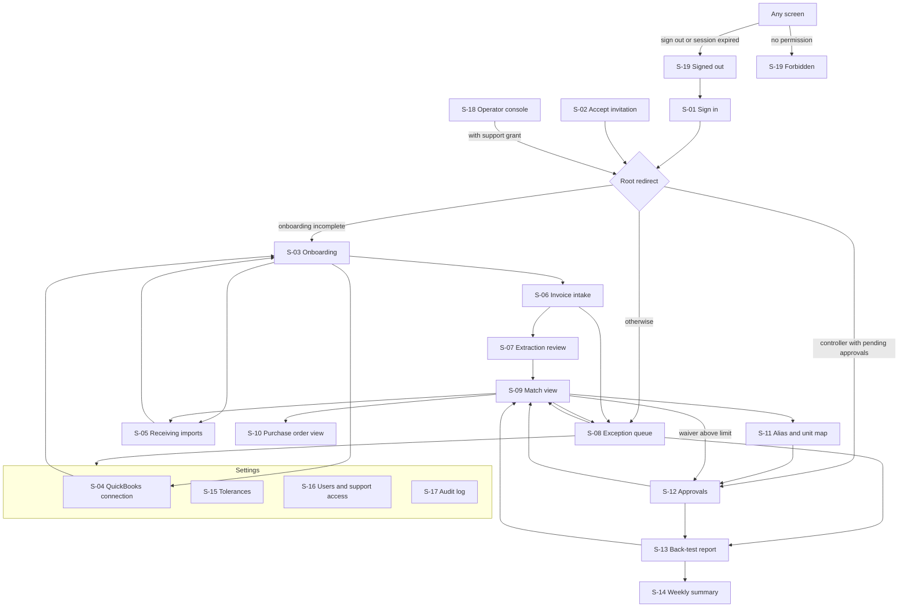

# Application flow — MatchDesk AP three-way match

Number labels follow [Decision.md section 0](Decision.md#0-how-numbers-are-labelled). Limits and intervals here are author proposals, so **[assumption]**, unless labelled otherwise. Requirement IDs (MH-nn) are defined in [PRD.md](PRD.md); API paths in [TRD.md section 12](TRD.md#12-api-contracts); tables in [schema.md](schema.md). Roles: C controller, K clerk, V viewer, O operator. An operator in a support session (`support_reader`) sees what a viewer sees plus the audit log, read-only. The permission table in [schema.md section 4.1](schema.md#41-user-roles) is authoritative.

Every screen exists to serve the pilot question: can the account supply invoices, purchase orders and independent receiving records, and does the match find anything worth paying for.

## 1. Screen inventory

| ID | Screen | Route | Roles | Must-haves |
|---|---|---|---|---|
| S-01 | Sign in | `/login`, `/login/verify` | public | MH-01 |
| S-02 | Accept invitation | `/invite` (token in the link's fragment) | public | MH-01 |
| S-03 | Onboarding checklist | `/onboarding` | C K (V read) | MH-02, MH-03, MH-04, MH-16 |
| S-04 | QuickBooks connection | `/settings/quickbooks` | C (K read and start a read; V read) | MH-02 |
| S-05 | Receiving imports | `/receiving`, `/receiving/imports/:importId` | C K (V read) | MH-03, MH-07 |
| S-06 | Invoice intake | `/intake`, `/intake/batches/:batchId` | C K (V read) | MH-04, MH-08, MH-14 |
| S-07 | Extraction review | `/invoices/:invoiceId/review` | C K | MH-05 |
| S-08 | Exception queue | `/exceptions` | C K (V read) | MH-11, MH-07 |
| S-09 | Invoices and match view | `/invoices`, `/invoices/:invoiceId` | C K (V read) | MH-06 to MH-09, MH-11 |
| S-10 | Purchase order view | `/purchase-orders/:poId` | C K V | MH-06, MH-09 |
| S-11 | Alias and unit map | `/aliases` | C K | MH-10 |
| S-12 | Approvals | `/approvals` | C | MH-10, MH-11 |
| S-13 | Back-test reports | `/reports`, `/reports/backtest/:reportId` | C K V (approve: C) | MH-12, MH-07, MH-16 |
| S-14 | Weekly summary | `/reports/weekly` | C K V | MH-15 |
| S-15 | Tolerances | `/settings/tolerances` | C (K V read) | MH-06, MH-11 |
| S-16 | Users and support access | `/settings/users` | C | MH-01 |
| S-17 | Audit log | `/audit` | C (operator in a support session: read) | MH-13 |
| S-18 | Operator console | `/operator/tenants`, `/operator/tenants/:tenantId` | O | MH-16, MH-01 |
| S-19 | System pages | `/signed-out`, `/forbidden`, any unknown route | any | MH-01 |

The root route `/` redirects: no session to S-01; onboarding incomplete to S-03; controller with pending approvals to S-12; otherwise S-08.

## 2. Navigation

Global header on every signed-in screen: account name with tenant switcher (only if the user has more than one membership), navigation (Exceptions, Invoices, Receiving, Aliases, Reports, Approvals for C, Settings), a QuickBooks status dot, and the user menu with Sign out.

## 3. Screens

Each screen lists: story; entry conditions; inputs; visible data; actions and destinations; states; acceptance checks. Role columns are in the inventory above.

### S-01 Sign in

- **Story.** As an invited user, I sign in with my work email without a password.
- **Entry.** No session.
- **Inputs.** Email address (field marked for email autofill). On `/login/verify`: the token, carried in the link's fragment so it is never sent in a URL to the server, and a "Sign in" button.
- **Visible.** Product name, one field, one button.
- **Actions.** "Email me a sign-in link" → confirmation text on the same page. Opening the link shows "Sign in as dana@example.test?" with a "Sign in" button; pressing it → root redirect, or the deep link saved before sign-in. Merely opening the link, as a mail scanner does, uses nothing up. Operators are then asked for their one-time code.
- **States.** *Pending:* button disabled, "Sending…". *Sent:* "If that address has access, a link is on its way. It works once, in this browser, and expires in 10 minutes." Same text for unknown addresses. *Expired or used link:* "This link has expired or was already used." with the email form below. *Opened in a different browser:* "Open this link in the browser where you asked for it, or send a new link to this one." with the form. *Rate limited:* "Too many requests. Try again in a few minutes."
- **Acceptance.** Unknown and known addresses get identical responses. A link works once, only after the button is pressed, only in the requesting browser. A deep link requested before sign-in is restored after it, if it belongs to the user's active tenant.

### S-02 Accept invitation

- **Story.** As a clerk invited by my controller, I join the account.
- **Entry.** Valid invitation token (7 days), carried in the link's fragment and sent in a POST body, never in a path.
- **Visible.** Account name, inviter's name, role offered.
- **Inputs.** Display name.
- **Actions.** "Join" → session created → root redirect.
- **States.** *Expired or revoked:* message and "Ask your controller for a new invitation." *Already a member:* goes to sign in.
- **Acceptance.** The token cannot be reused. The role is the one in the invitation, never one chosen by the invitee.

### S-03 Onboarding checklist

- **Story.** As a controller starting a back-test, I see the four things MatchDesk needs and which are done.
- **Entry.** Signed in; shown by default until all four steps are complete, and always reachable.
- **Visible.** Pilot terms from the pilot record: what the CAD 500 covers (30 days: back-test and live checking), who signed, the refund criterion and its threshold, and for the controller the billable units used this month. Four steps with status and counts: (1) Connect QuickBooks Online; (2) Choose the test month; MatchDesk then reads every purchase order named on that month's invoices, whatever its date, with all bills and credits on those purchase orders; (3) Load receiving evidence for those purchase orders, for any date, and say what kind it is; (4) Upload the month's invoices and credit notes, and earlier invoices on the same purchase orders where MatchDesk asks for them. Beside step 3, a plain statement: "MatchDesk counts warehouse receiving records and delivery documents your receiver has signed or marked. It does not count the 'received' quantity on a QuickBooks purchase order, or a supplier's packing slip with no receiver marks." The controller's attestation of the evidence class is shown with name and date.
- **Inputs.** Month picker (step 2).
- **Actions.** Each step links to its screen (S-04, S-05, S-06). "Read from QuickBooks" starts a sync. "Go to exceptions" appears when step 4 has at least one processed document.
- **States.** *Empty:* all steps "Not started". *Processing:* step shows a progress line that updates. *Partial:* e.g. "Receiving: 3 files, 1,184 lines; 212 purchase-order lines have no receipt". *Earlier invoices needed:* step 4 lists purchase-order lines where QuickBooks shows more billed than MatchDesk has documents for, with the bill numbers to upload. *No receiving data:* step 3 offers "We have no warehouse receiving records"; choosing it records the fact, sets coverage to 0%, and explains that every line will carry a "receipt absent" exception, that price, ordered-quantity and duplicate checks still run, and that the report will therefore be two-way only. *QuickBooks not on a plan with purchase orders:* step 2 reports zero purchase orders and says what to check.
- **Acceptance.** Steps 3 and 4 can be done in either order. Reloading shows the same state. The "no receiving records" choice is recorded in the audit log and shown on the report.

### S-04 QuickBooks connection

- **Story.** As a controller, I connect our QuickBooks company and see that reading works.
- **Entry.** Any member. Controls depend on role.
- **Visible.** Connection status, company name, connected by, last successful read, counts by record type for the last sync, the statement "MatchDesk only reads. It never creates or changes anything in QuickBooks." If T-1.1.1 finds that Intuit's permission is broader than read-only, a second sentence is shown here and before consent: "QuickBooks' permission screen will say this app can change data. That is the only permission Intuit offers; MatchDesk does not use it." The scopes actually granted are listed.
- **Actions.** Controller: "Connect to QuickBooks" → Intuit consent page → callback → this screen; "Disconnect". Controller and clerk: "Read now", for the test month's purchase-order references or a date range.
- **Review before an external action.** Before leaving for Intuit the screen states what is read (purchase orders, bills, vendor credits, vendors, items) and that the user will choose the company on Intuit's page. Before connecting, the QuickBooks data disclosure of [compliance/self-check.md section 6.3](compliance/self-check.md#63-disclosure-text-template---adapt) is shown. Before disconnecting, a dialog states that reconnecting requires consent again and (C2, [P], Decision.md section 11 decision 12) that matching stops on QuickBooks data at once, approved reports stay exportable for 30 days, and the copied QuickBooks data is then deleted. This replaces the earlier wording "matching will continue on the last copy", which the Intuit developer terms (s. 12.2) do not allow.
- **States.** *Connecting:* returned from Intuit, "Finishing connection…". *Consent declined:* "Connection was cancelled. Nothing changed." *Wrong company* (a different company than before): blocked with an explanation; a tenant is bound to one company. *Token expired or revoked:* red status, "Reconnect". *Sync running:* counts update; "Read now" disabled. *Sync failed:* reason, "Try again"; the last good copy stays in use. *Timeout during callback:* reloading the screen shows the true status.
- **Acceptance.** Starting two syncs for the same range creates one. A callback with an invalid or reused `state` connects nothing. A clerk sees status and "Read now" but no connect or disconnect control; a viewer sees status only.

### S-05 Receiving imports

- **Story.** As a clerk, I load the warehouse receiving log or receiver-signed delivery documents and see exactly which rows were used and what kind of evidence they are.
- **Entry.** C or K.
- **List view visible.** Imports with file name, evidence class (A warehouse record, B receiver-attested delivery document, C supplier document only), declared coverage dates, date loaded, rows imported, rows rejected, rows waiting for controller approval, status. Coverage summary for the purchase orders in scope: PO lines with a counting receipt out of PO lines invoiced, by class.
- **Import flow.** (1) Upload CSV, XLSX, or PDF/image delivery documents. (2) Choose the evidence class, with a one-line explanation of each, and name who keeps the record. (3) Spreadsheet: map columns to PO number, item code, quantity, unit, received date, receiver reference; preview first 20 rows; a saved mapping is pre-applied. (4) Class A: state the dates for which this log is complete ("Every delivery between 1 Sep and 31 Oct is in this file"). (5) Validation result. (6) "Import valid rows".
- **Delivery documents (class B).** Each extracted document opens beside its image. The clerk confirms or corrects every line, ticks "Receiver's signature or count marks are on this document" and enters who signed. Without that tick the document is stored as class C and counts for nothing.
- **QuickBooks item-receipt export (class A, C1).** The clerk uploads a QuickBooks Online report or CSV export of item receipts (QuickBooks offers no API for them) and chooses "QuickBooks item-receipt export"; the class is fixed at A. The controller's attested list of accounts-payable users is shown. Each row is tested: it counts only if the export shows who created it and when, that person is not on the list and did not enter the linked bill, and it was created before the bill. Other rows appear under "rows rejected" with the reason, for example "Entered after the bill" or "Entered by accounts-payable staff", and count for nothing.
- **Supplier documents only (class C).** Accepted and shown on S-09 as context, labelled "Supplier's packing slip. Not counted as a receipt."
- **Late evidence.** If an exception is already open on a purchase-order line, rows for that line are imported as "Waiting for controller approval" and do not count until approved on S-12. The screen says how many.
- **States.** *Empty:* explanation and a link to a synthetic sample file layout. *Uploading / parsing.* *Validation errors:* summary "1,184 rows valid, 37 rejected", table of rejected rows with row number and reason (unknown PO number, unknown item, quantity not a number, unreadable date), downloadable; focus moves to the summary. A date outside the test month is not an error. *Partial success:* valid rows can be imported while rejected rows are fixed and re-uploaded. *Duplicate file:* "This file was already imported on 3 Nov. Nothing was added." *Voided file re-uploaded:* accepted. *Abandoned preview:* listed as "Draft, not imported" for 7 days, then removed.
- **Actions and destinations.** A rejected row with an unknown item links to S-11 to add an alias. An imported receipt line links to S-10. "Void import" (reason required).
- **Acceptance.** Importing a file twice changes no quantity. Rejected rows never disappear without being listed. Every receipt line shows file and row and class. A receipt dated before the test month counts. Class C lines and unticked class B documents never count. Committing triggers a re-match of affected PO lines and the screen says how many.

### S-06 Invoice intake

- **Story.** As a clerk, I drop a month of invoice and credit-note PDFs and see what happened to each.
- **Entry.** C or K.
- **List view visible.** Batches with date, source (upload, email), counts by state.
- **Batch view visible.** Totals bar: queued (including waiting to retry), processing, ready, needs review, failed, duplicate file; the six always add up to the file count. A file holding several invoices shows how many it yielded. Table of files with state, vendor and number once known, and reason for failures.
- **Inputs.** Files by drag-and-drop or picker (PDF, PNG, JPEG; 20 MB; up to 500 per batch).
- **Actions.** "Retry failed" requeues failed files only. A "needs review" row opens S-07. A "ready" row opens S-09. P1 panel "Email intake": the account's intake address, the allowed-sender list (C edits), and held messages from unlisted senders with "Process" or "Discard".
- **States.** *Empty.* *Uploading:* per-file progress; closing the tab mid-upload leaves uploaded files in the batch and the rest absent, and the page says "212 of 240 received; add the remaining files". *Processing:* the totals bar refreshes on screen every 5 seconds; screen readers are told of changes at most once every 15 seconds and once on completion. *Partial success:* the normal end state; totals make it visible. *Failed file:* reason in plain words ("Password-protected PDF", "Not a PDF or image", "Could not be read after 3 attempts"). *Duplicate file:* links to the original document. *Network loss:* banner "Connection lost. Uploaded files are safe. Retrying…".
- **Acceptance.** Uploading the same file twice in one or two batches creates one document. "Retry failed" never reprocesses a ready file. Refreshing during processing shows current counts. The batch total equals the sum of states at all times.

### S-07 Extraction review

- **Story.** As a clerk, I fix what was misread before it is matched.
- **Entry.** Document in "needs review", or any document via "Edit extraction" on S-09.
- **Visible.** Left: the PDF, page navigation, zoom. Right: header fields and line table. Failed checks are listed at the top in words: "Line 3: 12 × 18.50 = 222.00, document shows 220.00" and "Lines + tax = 1,284.50, document total 1,248.50". Selecting a field highlights its region on the page where the region is known. Each field shows whether its value was read or human-entered; a "History" button beside an edited field (reachable by keyboard and touch, not only on hover) shows the original reading.
- **Inputs.** Any field; add or delete a line; document type (invoice or credit note).
- **Actions.** "Save draft" keeps work on the server; the form also saves a draft every 30 seconds. Nothing is kept in browser storage. "Confirm and match" is enabled when the arithmetic checks pass or the clerk ticks "The document itself does not add up" and gives a note; then → S-09. "Skip to next in review".
- **States.** *Validation error:* inline at the field, summary at the top receives focus. *Conflict:* another user saved first: "This document was changed by Dana at 10:42. Reload to see their changes." with the user's unsaved values kept visible for copying. *Timeout on save:* retry keeps the form.
- **Acceptance.** The original reading is kept and viewable. A confirmed document with a self-inconsistent total carries that flag into the report. Leaving with unsaved changes asks for confirmation.

### S-08 Exception queue

- **Story.** As a clerk, I see only what needs me, most valuable first.
- **Entry.** C, K; V read-only.
- **Visible.** Filter bar: type, vendor, status (open, pending approval, resolved, waived), value range, period, assigned to. Columns: type, vendor, document number, PO number, item, variance quantity, variance value, age, status. Counters per type above the table. A fixed strip: "Receipt coverage 64% (warehouse log 58%, signed delivery documents 6%). Not received: 3 lines, CAD 1,260.00. Unverified: 209 lines, CAD 47,050.00" linking to S-05 (figures are a synthetic illustration).
- **Actions.** Open a row → S-09 at that line. Select rows → bulk action "Resolve as…" for one type at a time. Keyboard: `J`/`K` move, `Enter` opens, `X` selects.
- **Bulk rules.** The dialog lists how many items and their total value before confirming, and says if the total would pass the clerk's 30-day waiver cap, in which case the whole batch goes to the controller. `receipt_absent` cannot be waived in bulk. Items needing approval go to the controller. The result dialog reports per item: resolved, sent for approval, skipped (changed by someone else), failed.
- **States.** *Empty, nothing processed yet:* link to S-06. *Empty, all clear:* "No open exceptions for October." with a link to S-13. *Loading:* table skeleton. *Viewer:* no action controls. *Stale row:* opening an exception resolved elsewhere shows its current state.
- **URL state.** Filters, sort and page cursor live in the query string. Refresh, Back and a shared link reproduce the same list. Returning from S-09 restores scroll position and the selected row, and puts keyboard focus on that row.
- **Acceptance.** A filtered URL opened by another permitted user of the same account shows the same filter. Counters equal the number of rows for each filter. No bulk path turns `receipt_absent` into matched.

### S-09 Invoices and match view

- **Story.** As a clerk, I see the invoice line, the order line and the receipts together, with the arithmetic, and decide.
- **Entry.** `/invoices` lists all documents with state filters. `/invoices/:invoiceId` opens one; `?line=` selects a line.
- **Visible.** Three panes. *Invoice:* PDF with the selected line highlighted; extracted values; "paid" or "unpaid" from the QuickBooks bill, or "no bill found". *Purchase order:* PO number, the matched line, ordered quantity and price, alias used. *Receipts and history:* each independent receipt (date, quantity, source file and row), each earlier invoice and credit note counted for this PO line, and a separate greyed row "Billed against PO in QuickBooks: 100. Not counted as a receipt." Below: the calculation in words, e.g. "Received to date 60. Invoiced to date 100. Excess 40 × 4.20 = 168.00. Quantity tolerance 0." Rule-set version and tolerance are shown.
- **Line statuses.** Matched (green tick and the word), Exception (type name; receipt absent shows its sub-reason: "Not received: your log covers this order and shows nothing", "Supplier slip only", or "No receiving evidence"), Waived (grey, struck tick never used), Superseded (history only). A line can show more than one exception, for example "Receipt absent" and "Price variance"; each is resolved separately and the amounts shown add up to no more than the line amount. A supplier-only packing slip appears in the receipts pane greyed, like the QuickBooks quantity. Earlier invoices known only from QuickBooks bills are listed as "QuickBooks bill 8831, no document" and are counted as invoiced.
- **Actions.** Resolve with a code and note. Controller only: "Confirm not received" on a receipt-absent line; "Is a duplicate" / "Not a duplicate" on a possible duplicate; "Credited" / "Not credited" on an exception flagged "possibly credited in QuickBooks". "Add or fix alias" → S-11 with the supplier item pre-filled. "Attach receiving record" → S-05. "Edit extraction" → S-07. "Open purchase order" → S-10. Controller only: "Reopen". Previous and next exception.
- **States.** *Processing:* "Matching…" while a match run is active; results appear without reload. *Re-matched:* banner "Results updated after a new receiving import at 14:05." *Pending approval:* the resolution shows "Waiting for controller" and cannot be edited by the clerk except to withdraw it. *Conflict (409):* current state shown, the user's note preserved. *Document not in this account or missing:* S-19 not found. *PDF fails to load:* values still shown, "Retry loading document".
- **Acceptance.** Every number in the calculation can be traced to a row shown on the screen. The QuickBooks billed quantity is never included in "Received to date". A deep link to a line opens that line. Resolving moves to the next exception in the queue order the user came from and puts focus on that exception's heading; after the last one, the app returns to S-08 with focus on its status message.

### S-10 Purchase order view

- **Story.** As a clerk or controller, I see everything that happened on one purchase order.
- **Visible.** Header from QuickBooks (vendor, date, status, last read time). Per line: ordered, received independently (sum and list), invoiced, credited, net invoiced, open exceptions. Timeline of receipts, invoices and credit notes by date.
- **Actions.** Open any document → S-09. "Read again from QuickBooks" (C K).
- **States.** *PO changed in QuickBooks since last read:* banner with old and new values after a re-read; affected lines are re-matched. *PO not found in the last sync:* shown as "No longer returned by QuickBooks" with the last copy.
- **Acceptance.** Net invoiced = invoiced − credited on every line. The line totals agree with S-09 for the same line.

### S-11 Alias and unit map

- **Story.** As a clerk, I record once that this supplier's code is our item, and in which unit.
- **Visible.** Table: vendor, supplier item code, supplier description, our item, supplier unit, our unit, conversion, status (active, pending approval, retired), created by, approved by, lines using it. Filter "Unconfirmed codes seen on invoices". For a new code: up to 5 suggested PO lines with the reason ("same code", "similar description").
- **Inputs.** Our item (search), units, conversion factor (default 1).
- **Actions.** "Confirm alias". With conversion 1 it is active at once and listed for controller review. With any other conversion it becomes "Pending approval" and the screen says so: "Lines using this alias stay in exceptions until your controller approves the conversion." "Retire" asks for a reason and states how many lines will be re-matched.
- **States.** *Empty.* *Validation:* conversion must be a positive number; the same vendor and supplier code cannot have two active aliases. *Re-match running:* count of lines being re-matched.
- **Acceptance.** No suggestion is applied without a confirm action. Retiring an alias used in an approved report flags that report as out of date. The entry form shows a worked example with the user's numbers: "5 CS × 12 = 60 EA; 50.40 per CS = 4.20 per EA".

### S-12 Approvals

- **Story.** As a controller, I approve or return what my clerk cannot decide alone.
- **Visible.** Three lists: waivers above the item limit or the 30-day cap (exception, value, clerk's reason, which limit, link to evidence); unit conversions (alias, conversion, worked example, an invoice line that uses it); late receiving evidence (import, who loaded it, evidence class, the open exceptions it would clear and their value). Recently created 1-to-1 aliases for review, with "Mark reviewed". The week's waivers made without approval.
- **Actions.** "Approve" or "Return with note". Opening evidence → S-09 and back.
- **Review before approving.** The approve dialog restates the decision in words and value: "Waive CAD 168.00 on INV-01042 line 3 (invoiced above received). It will be listed in the report as waived."
- **States.** *Empty:* "Nothing is waiting for you." *Already decided* (two controllers): the second sees the outcome. *Own request:* a controller cannot approve a waiver they requested if another controller exists; if they are the only controller, the approval is recorded as self-approved and flagged in the report.
- **Acceptance.** A clerk who opens `/approvals` gets S-19 forbidden. An approval of a conversion triggers the re-match and the screen shows the count.

### S-13 Back-test reports

- **Story.** As a controller, I review the result, sign it, and send it to the owner.
- **Visible (report).** Status banner: DRAFT (version n) or APPROVED (by, date) or SUPERSEDED. Period and data cut-off time. Section 1: documents and lines processed, lines matched. Section 2: flagged discrepancies by type and by supplier, in dollars, split "already paid" and "not yet paid", with a column for whether the controller has confirmed each as an overcharge and a label "credited in QuickBooks" where it applies; "not received" is its own row. A summary line keeps three counts apart, each with its dollar total: "Flagged discrepancies 7, CAD 1,912.40. Confirmed overcharges by the controller 4, CAD 1,310.00. Credit actually recovered 1, CAD 420.00." (synthetic figures; PRD M-3a to M-3c, C1). The second and third are recorded after approval against the governing version and never change its figures. Section 3: receipt coverage by evidence class, lines with supplier slips only, lines and dollars unverified, how far back purchase-order history was read, with the statement of what an absent receipt means. Section 4: waived items with reasons and approver. Section 5: open exceptions by type, including possible duplicates and possible credits. Section 6: documents with self-inconsistent totals; duplicates found. Section 7: pilot terms and the refund calculation on the governing version ("Qualifying discrepancies CAD 1,912.40. Threshold CAD 500.00. No refund." or "Qualifying discrepancies CAD 0.00. Refund applies. Unverified because no receiving evidence: CAD 48,310.00."). Every figure links to the filtered queue or document list behind it.
- **Actions.** "Refresh draft" (C K). "Approve report" (C). "Export PDF", "Export CSV".
- **Review before approval (irreversible for that version).** Blocking items are listed first: pending extraction reviews, pending approvals. Then a summary: findings total, unverified total, open exceptions count, and a checkbox "I have reviewed the waived items". The button reads "Approve version 2".
- **States.** *Empty:* no report for the period; "Create draft". *Generating:* progress; safe to leave. *Out of date:* "14 lines were re-matched after approval. Draft 3 is ready for review." *Export preparing:* "Preparing your file…" then download; link valid while signed in. *Double click on approve:* one approval recorded.
- **Acceptance.** The refund result shown is the one recorded for the governing version and does not change when a later version is approved. Draft exports carry DRAFT on every page and in the CSV header. Figures in an approved version never change. Totals equal the sums of the linked lists. A viewer can read and export but not approve.

### S-14 Weekly summary (P1)

- **Story.** As a controller, I see which suppliers cause exceptions week by week.
- **Visible.** Week picker. Per supplier: documents, lines, pass rate, findings by type, open exceptions and oldest age.
- **Actions.** Open a supplier → S-08 filtered.
- **States.** *Empty week.* *Email version:* totals and a link only.
- **Acceptance.** Figures equal S-08 with the same filters.

### S-15 Tolerances

- **Story.** As a controller, I decide how much difference is acceptable per supplier and how much my clerk may waive.
- **Visible.** Account defaults and per-vendor overrides: quantity tolerance, price tolerance (absolute and percent), charge allowance; waiver limit. A fixed line: "A missing receiving record is always an exception. There is no tolerance for it." Change history.
- **Actions.** Edit and save. Before saving, a preview states "This change will re-match 412 lines; an estimated 37 exceptions would now pass." (synthetic illustration).
- **States.** *Validation:* non-negative numbers; percent at most 10. *Re-match running.*
- **Acceptance.** Each save creates a new version; earlier match results keep the version they used. A clerk sees values without edit controls.

### S-16 Users and support access

- **Story.** As a controller, I decide who is in and whether MatchDesk staff may look.
- **Visible.** Members with role, last sign-in, status. Open invitations. Support access: current grant with end time, or none; history.
- **Actions.** Invite (email, role). Revoke an open invitation. Change role. Deactivate. "Allow MatchDesk support access for 24 hours / 7 days". "End access now".
- **States.** *Last controller:* cannot be removed or demoted; the control explains why.
- **Acceptance.** Deactivating a user ends their sessions at once. A support grant appears in the audit log and expires on its own.

### S-17 Audit log

- **Story.** As a controller, I show who did what.
- **Visible.** Time, actor, action, record, before and after. Filters by person, record, action, date. Export CSV.
- **States.** *Empty filter result.* *Large result:* paged.
- **Acceptance.** No edit or delete control exists. A link from any record's "History" opens the log filtered to it.

### S-18 Operator console

- **Story.** As the operator, I set up a pilot account and record what was agreed and paid.
- **Entry.** Operator flag.
- **Visible.** Tenants with status, pilot record (price, period, signatory, delivery mode, refund threshold, governing report, qualifying amount, refund result, payment status, outcome; and the three pilot counts kept apart: flagged discrepancies, controller-confirmed overcharges, actual credit recovered), billable-unit counts by month, support-grant status. No invoices, prices or reports.
- **Actions.** Create tenant and first controller invitation. Create and edit the pilot record; at the end of the review window, record the governing report and the refund result it gives. "Open account" is enabled only while a support grant is active; it starts a read-only support session (viewer rights plus the audit log) and shows a persistent banner "Support access to Fictional Distributor A (synthetic) until 16:00".
- **States.** *No grant:* "Ask the controller to allow support access." *Grant expired while working:* next request returns to the console with a message.
- **Acceptance.** Without a grant, every tenant data endpoint returns 404 for the operator. Payment status is entered by hand and audited.

### S-19 System pages

- **Signed out:** "You are signed out." and a sign-in link. Shown after sign-out and after session expiry, with "Your work is saved" when expiry interrupted a form whose draft was kept.
- **Forbidden:** "Your role does not include this page. Ask your controller." with a link to the queue.
- **Not found:** shown for unknown routes and for records outside the user's account, with identical wording in both cases.
- **Acceptance.** Not-found for another account's record is indistinguishable from a record that does not exist.

## 4. Flows across screens

### 4.1 Onboarding to first result

S-01 → S-03 → S-04 (connect, read the month) → S-05 (receiving) → S-06 (invoices) → S-07 for flagged documents → S-08 → S-09 → S-11 for new aliases → S-12 (controller) → S-13 (approve) → export.

### 4.2 Review and correction

| Situation | Path | What changes |
|---|---|---|
| Extraction was wrong | S-09 "Edit extraction" → S-07 → confirm | New extraction version; re-match; old results superseded |
| Alias or conversion was wrong | S-11 retire and recreate → S-12 if conversion ≠ 1 | Re-match of all lines that used it; reports flagged |
| Receiving file was wrong | S-05: void the import (C K, reason required) and load the corrected file | Receipt lines of the voided import stop counting; re-match |
| Resolution was wrong | S-09 "Reopen" (C) | Exception returns to open; history kept |
| Earlier invoice on the same PO was missing | S-03 or S-06: upload it | "History incomplete" clears; cumulative quantities and results are recomputed |
| Receiving evidence was the wrong class | S-05: void and re-import with the right class | Lines stop or start counting; re-match |
| Tolerance was wrong | S-15 | New version; re-match |
| Approved report now out of date | S-13 new draft version → approve | Earlier version marked superseded, still retrievable |

### 4.3 Sign-out and session expiry

Sign-out is in the user menu on every screen and ends the server session. Two minutes before the 60-minute idle limit a dialog appears and is announced: "You will be signed out in 2 minutes. Stay signed in?" Choosing "Stay signed in" extends the session; this can be repeated without limit until the 24-hour absolute lifetime. If the session does expire, the next request returns "session expired"; the app shows S-19, keeps the current URL, and after sign-in returns the user to it. Extraction-review edits are saved as server-side drafts and are still there. Nothing is written to browser storage.

## 5. Browser behaviour

| Topic | Behaviour |
|---|---|
| Refresh | Every screen rebuilds from the server. Long operations (sync, batch, import, match, report generation) are jobs; their progress is read from the server, so a refresh never restarts or loses them (R-18) |
| Back and Forward | Each screen and each filter change is a history entry. Dialogs are not. Back from S-09 returns to S-08 with filters, page and scroll restored. Back never re-submits a form |
| Deep links | Every route in the inventory can be opened directly. A link to a record in another account shows not found. A link opened while signed out is restored after sign-in |
| Duplicate submission | Buttons disable while a request is in flight; every mutating request carries an idempotency key, so a double click, a retry after a timeout, or Back-then-resubmit produces one effect |
| Batch actions | Always report per-item outcomes; a partial result is shown as partial, never as success or failure of the whole |
| Reopening unfinished work | Batches, import previews, extraction drafts, and draft reports are listed with their state on their list screens. S-03 shows the next incomplete step |
| Two tabs or two users | Edits carry a version; the second writer sees the current state and keeps their text |
| Tenant switch | Returns to the root redirect in the new tenant; no data from the previous tenant remains on screen |
| Focus after navigation | Route change: focus moves to the page's main heading and the browser title changes. Dialog closes: focus returns to the control that opened it, or to the row or heading that replaced it if that control is gone. "Resolve and next": focus on the next exception's heading. Back from S-09: focus on the row that was opened |
| Page titles | Each route sets the title as "<object> · <screen> · MatchDesk", for example "INV-01042 · Match view · MatchDesk" |
| Timeouts | A read that times out shows "Retry"; a write that times out is retried with the same idempotency key, and the screen then shows the server's state |

## 6. Stale-route and label rules

One route table in the web app is the source for navigation, breadcrumbs and links in emails. Removed routes redirect to their replacement or to not found; a link check over this file and the route table runs in CI (R-20). Labels use the words in [design.md section 9](design.md#9-vocabulary); an icon never appears without its word.

## 7. As built in B4 (2026-11-12)

Updated to B10 (2026-11-13; the B10 bullet at the end lists what changed). What is still not built below is tied to an outside account (live QuickBooks, a hosted extractor and its region highlighting, a hosted email provider). The other differences from the screens above are as-built choices, each with its reason.

The web app under `web/` implements the route table of section 1 (`web/src/app/App.tsx`, navigation and settings links from `web/src/app/routes.ts`). The demo script is `docs/PLAY.md`. Differences from the screens above, each because the API does not offer the data or the action yet (TRD 12, "As built in B4"):

- **S-01.** A development build shows "Local development: open Mailpit to get your link" with the Mailpit address; a production build drops it (Vite's development flag). The deep link saved before sign-in is restored in the tab that asked for the link, which watches for the session; the emailed link itself opens at the root.
- **S-03.** The pilot terms are shown read-only from the pilot record (price, period, refund condition and threshold, signed-terms reference and signer, payment, governing version and refund result; B7). Billable units are shown to the operator on S-18, not here (a choice: billable units are the operator's billing record; `GET /usage` for the controller is not built and no screen asks for it). Step 3 names the controller's receiving attestation with name, date, class and source (B9). "We have no warehouse receiving records" (controller, B9): a dialog states what it means, the statement is recorded with name and date, step 3 reads "None kept", coverage is a measured 0 % on S-05, S-08 and S-13 (state `no_receiving_records`), every line stays `receipt_absent`, and the report states it in section 3 and its PDF; committing a receiving import withdraws it, and the controller can withdraw it with a reason. The test month lives in the address (`?month=`). "Earlier invoices needed" lists the purchase-order lines where QuickBooks shows more billed than MatchDesk has documents for, with the quantity and the QuickBooks bill numbers to upload (B9).
- **S-04.** In recorded-response mode the screen says so and "Connect to QuickBooks" is disabled; the demo connection is made by `make seed-demo`. Scopes are shown as granted.
- **S-05.** Column mapping is suggested from the file's headers; a saved mapping whose columns are all in the file is pre-applied and named ("The saved mapping Warehouse log fits this file"), every saved mapping can be chosen from **Use a saved mapping**, and **Save this mapping as** names it (B9). The rows are checked only when the clerk asks. A coverage line for the test month sits above the upload form (same figures and denominator as S-08 and S-13; B9). A draft never imported shows the date it is removed and is removed 7 days after upload by the worker, its file deleted and the removal audited (B9).
- **S-06.** "Invoices by email" (B7): the account's intake address, allowed senders (an address or `@domain`; the controller edits them), messages held for a person with Release into a batch or Discard (controller and clerk), and recent emails linked to their batches; batches show their source (Upload or Email). Upload sends four files at a time, each with its own idempotency key.
- **S-07.** Lines are edited as one block per line, so quantity, unit, unit price and amount stay in view (B7). **Remove line N** (B9) removes a stored line before the document is confirmed: a soft removal with who, when and why, kept under "N removed lines"; the gates run again on the remaining lines and the document waits for confirmation; a confirmed document offers no removal; a removed line's number is never reused. "The document itself does not add up" asks for a required note, kept on the document, in its history (audit log) and in report section 6 and its PDF (B9). Region highlighting is not built (the extractor records no regions; account-bound with the hosted extractor). At phone width the fields come first and the document below them (B9). Leaving with unsaved changes is guarded on reload and close; a draft is also saved every 30 seconds.
- **S-08.** The queue's scope (dates, supplier or "supplier not identified", type, status, value range, sort) lives in the address bar and the server applies all of it to the tenant's whole set before a page is cut, with keyset cursors on the full sort key and the exception id as tie-break (B8). Without exact dates the scope is the top-bar test month; the weekly summary and the report open it with their exact dates (`from`, `to`). The scope shows as removable chips; count and value in the footer are the server's for the whole scope; type counters ignore the type filter. Under 640 px each exception is a case block with its Review control, filters behind a toggle; coverage and "why counts differ" sit below the list. Assigned to (Everyone, Me, Nobody, each member) is part of the same server-side scope, cursor and neighbours (B9); rows say who is assigned; the bulk bar assigns or unassigns the selected rows; the scope bar shows it as a chip.
- **S-09.** "Is a duplicate" / "Not a duplicate" and "Credited" / "Not credited" are the controller's own controls with their own endpoints (B9): the panel says the amount is undecided, not a finding, names the QuickBooks vendor credit, and states what each choice does; a clerk reads "Waiting for the controller's decision". A credited decision nets that one credit with that one exception, once; not credited makes it a finding again. **Assigned to** for one case (B9). A document confirmed as not adding up shows its note. Pane widths follow the window (a design choice of B6, not draggable); panes stack under 1280 and 1024 px. Previous and next come from `GET /exceptions/{id}/neighbours` with the scope of the queue the user opened, with the position; after the last case "Resolve" returns to that queue, row selected and focused (B8). A ledger line over the panes gives billed, received (linked to the exact receiving row, S-05 `?row=`), excess, unit price and exposure from the stored result; the resolution panel states what the chosen decision does before it is submitted; one decision per click. The PDF has Fit width, an expanded view and opens on the line's page when the extractor recorded it.
- **S-10.** Line totals are summed from the invoices on the purchase order. "Changed in QuickBooks" (B9): after a read that changed or removed lines that had been matched, a banner gives each line's old and new values and when the affected lines were matched again; a removed line reads "No longer returned by QuickBooks" with the last copy. `make demo-po-change` reads recorded responses taken after a change.
- **S-12.** Each request reads proposed change, affected records, consequence, decision (B8). A conversion lists the invoice lines it re-matches with the billed and converted quantity and the exceptions open on them now (`affected` on the approval). The late-evidence request lists the exceptions open now on its purchase-order lines with their value; the re-match after approval decides which clear (B9).
- **S-13.** The "confirmed by the controller" column reads "Yes" for exceptions resolved as confirmed overbilling or confirmed not received, else the queue status; on the governing version the three counts come from the recorded outcomes (B9): section 8 "What happened to the flagged discrepancies" records the controller-confirmed amount (at most the flagged amount) and then the credit recovered (at most the confirmed amount, with a credit note or a QuickBooks reference); each record is insert-only; flagged, confirmed and recovered stay separate and the report's figures never change. Section 7 shows the pilot terms; on an approved version a controller makes it the governing version once, and the refund result on it is stored and shown (B7). "Flagged discrepancies" is findings plus not received everywhere, with both parts named; section 5 is "Undecided items". A new draft after approval is offered only when results changed after its data cut-off. Section 6 lists the documents confirmed as not adding up, with the clerk's note (B9), and the duplicates.
- **S-14 (B7).** One week (Monday to Sunday, documents dated in it) by supplier: documents, lines, pass rate, flagged discrepancies, open exceptions and their value, equal to S-08 with the same filters; each open count opens S-08 with the week's dates, the supplier and the status (B8); a week with nothing measured says why instead of showing zeros; previous and next week; controllers get the totals and a link by email every Monday morning, and can send one by hand per week.
- **S-18 (B7).** For operators only (TOTP sign-in): accounts with pilot, payment, billable units and support-access state; per account the pilot record form (edit with a version check; the threshold is fixed once the governing version is chosen), billable units by month, and asking for support access; with an active grant, "Open the account, read only" shows the account's screens with a banner on every screen and "Leave the account". No document, price or line is ever shown outside a grant.
- **S-16.** Support access (B7): requests from MatchDesk support with their length and reason; the controller grants (the dialog states what it allows and until when), declines, or ends access early; earlier requests listed. Account data (B9): **Prepare an archive** builds one ZIP (original files and a CSV per record type, available 24 hours); **Request deletion** (the account name typed to confirm) waits for MatchDesk, then shows the date everything is deleted and **Cancel the deletion**.
- **S-18 (B9).** Account deletion requests: **Schedule deletion** (30 days' notice; the dialog says approved reports and the audit log go with the account and only a ledger record stays) or **Decline** with a note; each decision is in the account's audit log. When due, the worker deletes the files, then every row of the account, and writes `deletion_ledger`.
- **B3/B4 review fixes (2026-11-12).** Built since: S-01 names the address being signed in; S-05 lists rows waiting for controller approval per import and receipt lines show PO line and unit (receipt lines already linked to S-10); S-06 links a duplicate file to the original; S-08 links carry `from=`, the coverage strip is live without a report draft and a type filter stays visible with its own empty state; S-09 shows the QuickBooks billed quantity greyed, explains an exception that adds nothing because the line amount is counted under another one, and shows one cleared by a credit as cleared; S-13 uses one meaning of "flagged discrepancies" on the list and the report, hides "Refresh draft" on an approved version unless it is out of date, and counts every exception still open in the approval dialog; S-16 shows each member's last sign-in; an unknown record shows S-19.
- **Session.** The idle warning appears two minutes before 60 minutes without user activity in this browser (polling after a minute without keyboard or pointer input is not activity, for the browser or the server); an expired session clears every cached read and goes to sign-in once; single-key shortcuts can be turned off in the user menu (kept for the tab only, nothing in browser storage).
- **B8 (2026-11-13).** Empty versus zero: live coverage (S-08) and S-14 carry a measurement state (awaiting invoices, processing, awaiting receiving, measured, unavailable) and show figures only when measured. S-03 opens with the signed-in role's next task (the clerk's receiving file and its required columns first), the controller's pilot terms above the checklist. S-05 leads the check with "N valid rows, N rejected" and shows each rejected row's original cells; the mapping folds away once checked. S-06 leads a read batch with "Review N invoices"; ready files and duplicate provenance fold below. S-07 shows printed total, lines plus tax, the total field and the result side by side. S-13 names the next decision and the governing version, keeps flagged, confirmed and recovered apart, and its totals open S-08 with the report's dates. S-17 reads who changed what first, values on request. S-18 shows payment, pilot and support access before the editing form. The header says "QuickBooks: demo data" in recorded-response mode and a failed last read from the server. The sidebar's Exceptions link returns to the last queue opened in the tab; since B9 it survives a reload (sessionStorage, the queue path and scope keys only, with a fallback to memory when storage is refused). The support banner stays in view.
- **B10 (2026-11-13), outside QA fixes.** Numbers typed or pasted are read by one rule (thousands separators between groups of three before a dot; `1.000,5`, `1,5`, letters and oversize numbers refused with the reason beside the field; never an exception during render); the backend uses the same rule for receiving files, the PDF reader and the queue filter. S-07: the total check is one line when it agrees and opens on a mismatch. S-09: the credit or duplicate decision groups its facts and states the chosen decision's financial effect before **Confirm**. S-05: each mapping shows a sample value; required unmatched columns first; optional folded. S-11 and S-15: a live example that keeps the last valid values, and the consequence of saving beside the button (S-15 previews the re-match while typing). S-14: delivery per recipient with a retry for failed ones; an unmeasured week shows the same words as the email (one rule, also in the S-08 coverage line and the report CSV and PDF). S-13: scope and the three totals above the outcome rows; each row has a permanent state and its next step. S-16: archive completeness (`Complete: n/n` or `Incomplete: n/m` with **Retry missing files**); deletion without a complete archive needs an explicit acknowledgement; Requested, Scheduled, Deleting and Cancelled are distinct and Deleting cannot be cancelled. S-18: decisions first by urgency with account, controller, effective date and archive; an Operations panel; account creation folded. Invoices, reports and receiving imports page on the server in the order shown (keyset cursor with an id tie-break). Toasts carry a required tone, sit at the top, at most two; errors stay until dismissed; a failed download offers **Retry download** inline.
- **B6 polish (2026-11-12).** Redesigned look with the same routes, states and API calls ([docs/UI.md](docs/UI.md)). Navigation moved from a top bar to a collapsible left sidebar grouped as Work (S-08 with the open count, S-09, S-06, S-05), Review (S-12 with the waiting count, S-13) and Setup (S-03 "Getting started", S-04, S-11, S-15, S-16, S-17), filtered by role; the Settings index (`/settings`) stays reachable by its links. The top bar carries the company, a period selector (the test month that S-03, S-04, S-08 and S-13 start from; held in memory for the tab, `?month=` on S-03 still wins), the QuickBooks status (to S-04) and the user menu. S-03 shows a stepper with progress. S-08 shows four coverage figures, a filter toolbar with keyboard hints, and a bulk action bar only while rows are selected. S-09 is three panes: document, calculation with a line comparison (red difference for an excess, green otherwise) and receipts, and an action panel with the resolution form and purchase-order facts; the resolution form moved from a bar fixed to the bottom into that panel. S-06 has a drag-and-drop zone and a progress row per file while uploading. Under 640 px the S-08, S-06 and S-13 tables stack into labelled cards; other tables scroll inside their own box. Since B9 no screen asks for a wider window: S-07, the S-05 column step, S-06 upload, S-11 and S-15 are worked at 375 px. S-04 states that the live QuickBooks connection needs the owner's Intuit developer account and the sandbox check T-1.1.1 (outside QA finding 3).
