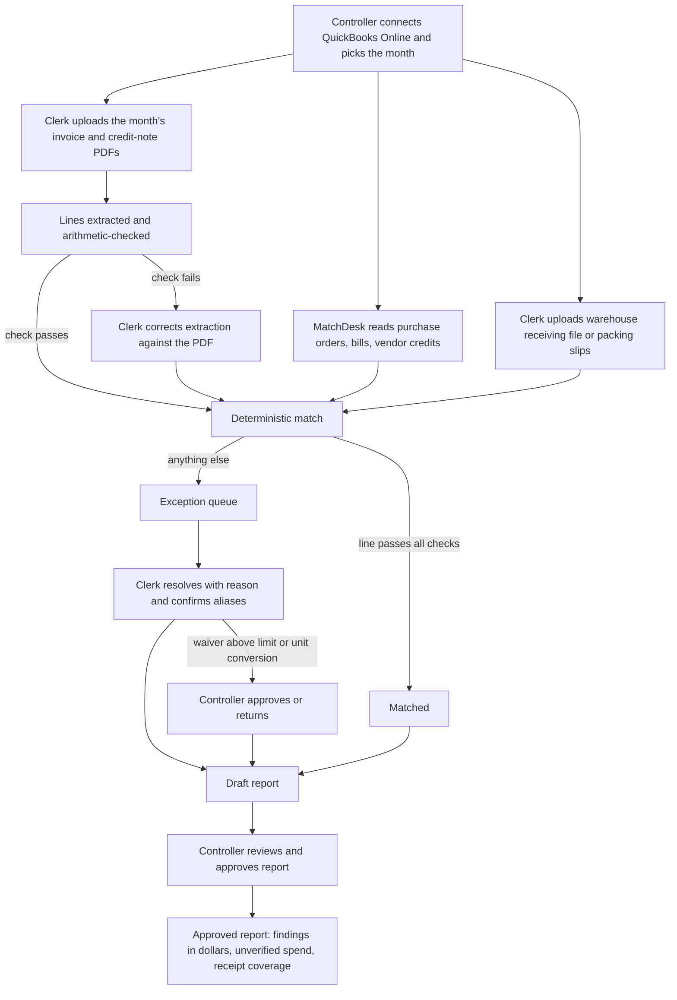

# Product requirements — MatchDesk AP three-way match

Number labels follow [Decision.md section 0](Decision.md#0-how-numbers-are-labelled): **[chat]**, **[source: SRC-nn]**, **[assumption]**. Every target, limit and threshold in this document that carries no other label is an author proposal and therefore an **[assumption]**.

This document says what users need and why. Technology choices are in [TRD.md](TRD.md).

## 1. Overview

MatchDesk checks a distributor's supplier invoices, line by line, against the purchase order held in QuickBooks Online and against a receiving record that is independent of the invoice. It passes the lines that agree and holds every other line for a person, with the source documents beside it.

The first thing sold is a back-test: last month's invoices, checked after the fact, for CAD 500, refunded if nothing is found **[chat]**. The CAD 500 covers a 30-day pilot: the back-test report plus live checking of new invoices for the rest of the 30 days **[assumption]** (research record; details and the refund criterion are in [Decision.md section 5](Decision.md#5-offer-channel-and-pilot)). The controller signs and pays **[assumption]**. The product in this document is the smallest tool that lets the founder deliver that back-test repeatably and lets a controller trust the result.

## 2. What the product does

1. Reads purchase orders, vendors, items, bills and vendor credits from the account's QuickBooks Online company. It writes nothing to QuickBooks in this version.
2. Imports receiving records from a warehouse spreadsheet or from scanned packing slips.
3. Takes supplier invoice and credit-note PDFs in batches and extracts their lines.
4. Matches each invoice line on item, quantity and unit price, cumulatively across partial deliveries, net of credit notes, with tolerances per vendor.
5. Raises an exception for every line that does not pass, including every line with no receiving record, and for suspected duplicate invoices.
6. Lets the accounts-payable clerk resolve exceptions and the controller approve a report that states dollar findings and how much spend could not be verified.

## 3. Why now

- Among the vendors whose pricing pages were read on 2026-11-10, three-way matching with QuickBooks Online starts at USD 499 per month on annual billing or is quote-only [source: SRC-01 to SRC-05]. Details are in [Decision.md section 3](Decision.md#3-competitor-gap-what-was-read-today-and-what-was-not).
- Reading invoice lines from PDFs at a few cents per document is assumed feasible (CAD 0.03 per invoice **[assumption]**).
- Neither point shows demand. Demand is what Phase 0 tests.

## 4. Goals

| ID | Goal | Evidence that it is met |
|---|---|---|
| G-1 | Answer the pilot question with paid back-tests | Count of paid back-tests and of accounts that supplied all three record types |
| G-2 | Produce a back-test a controller will sign | Report approved by the controller with every finding traceable to source documents |
| G-3 | Never let a line pass without a purchase-order line and an independent receipt | Zero false passes on the golden fixture set and in pilot sampling |
| G-4 | Keep clerk effort on exceptions only | Share of lines that pass without a person |

## 5. Problem statement

A mid-size distributor receives hundreds of supplier invoices a month (200–1,500 **[assumption]**). Each should be compared with what was ordered and what the warehouse received. On QuickBooks Online this is done by hand from paper or PDFs, so many firms check only totals or large invoices **[assumption]**. Short shipments, price differences and duplicate invoices get paid **[chat]**.

Three facts make the comparison harder than it sounds and shape every requirement below:

- **Deliveries are partial.** One purchase-order line can arrive in three shipments and be billed on three invoices. A line-by-line check that ignores earlier receipts and invoices is wrong.
- **Supplier item codes and units differ from the distributor's.** A supplier bills "5 CS" of its code where the purchase order says "60 EA" of the distributor's item.
- **Purchase-order history crosses month ends.** A purchase order opened in August can be billed in September and again in October. Checking October alone misses the September invoice.
- **QuickBooks Online appears to have no receiving record of its own.** Its "received" quantity seems to be produced by entering the bill ([Decision.md section 3](Decision.md#the-assumption-that-matters-most-quickbooks-online-receiving); forum and marketing pages only, to be confirmed in T-1.1.1). Receiving evidence has to come from the warehouse, and a supplier's own packing slip without receiver marks is not such evidence.

## 6. Buyer, users and roles

| Role | Who | What they need | In the product |
|---|---|---|---|
| Buyer, signatory and approver | Controller or finance manager **[chat]**; signs the pilot agreement and pays the CAD 500 **[assumption]** | A dollar figure they can defend to the owner and recover from suppliers; assurance nothing was waved through | `controller` role: connects QuickBooks, sets tolerances, approves waivers above the limit, approves unit conversions, approves the report, manages users |
| Daily user | Accounts-payable clerk | To deal only with lines that need a person, with the documents in front of them | `clerk` role: uploads documents, corrects extraction, confirms supplier-item aliases, resolves exceptions |
| Observer | Owner, external bookkeeper, auditor | To read results | `viewer` role: read-only |
| Budget owner | Owner (signs off under about CAD 10,000 a year **[assumption]**) | To see cost against recovered dollars | Usually a `viewer`; receives the approved report |
| Supplier of receiving data | Warehouse receiver | Not a user. Their spreadsheet or packing slips are an input | None |
| Operator | MatchDesk staff (the founder during pilots) | To set up accounts and help with imports | `operator`: no access to an account's data without a time-limited support grant issued by that account's controller |

## 7. Current and proposed workflow

**Current (assumed, to be observed in T-0.1.2).** The invoice arrives by email or post. The clerk finds the purchase order in QuickBooks, finds the packing slip in a folder or the warehouse spreadsheet, ticks lines, enters the bill against the purchase order, and pays on the due date. Under time pressure only totals are compared.

**Proposed, back-test.**

**Proposed, live month.** The same flow runs on each new invoice as it is forwarded or uploaded, before the bill is paid, with a weekly summary by supplier.

## 8. Must-haves

Priority P0 = needed to deliver a paid back-test. P1 = needed for the live part of the 30-day pilot. "Owner role" is the user role accountable for the outcome in use.

### MH-01 — Separate workspace per account, with roles (P0, owner: controller)

*Story.* As a controller, I want only people I invite to see my company's purchasing data, each with the rights their job needs.

*Acceptance.*
- A user of account A who requests any record, file or report of account B by its identifier receives "not found"; nothing about B is disclosed.
- A clerk cannot open approvals, tolerances, user management or the QuickBooks connection. A viewer cannot change anything.
- An operator sees an account's data only while a support grant from that account's controller is active; each grant has an end time and appears in the audit log.

### MH-02 — Read purchasing records from QuickBooks Online (P0, owner: controller)

*Story.* As a controller, I want MatchDesk to read our purchase orders and bills so nobody re-keys them.

*Acceptance.*
- After connecting, the controller sees counts of purchase orders, bills and vendor credits read, and the time of the last successful read.
- **Open-PO history.** Purchase orders are found by reference, not by date: every purchase order named on a test-month document is read whatever its date, together with every QuickBooks bill and vendor credit linked to it, whatever their dates. A purchase order dated before the test month is never reported as "no PO" for that reason.
- Reading the same period twice produces no duplicate records.
- If the connection is revoked or expires, the account sees a banner naming the problem and the action to take; matching continues on data already read and says how old it is.
- MatchDesk creates, changes and deletes nothing in QuickBooks.

### MH-03 — Import receiving evidence that is independent of the invoice (P0, owner: clerk; attested by: controller)

*Story.* As a clerk, I want to load the warehouse's receiving log or receiver-signed delivery documents so that "received" means the warehouse saw the goods.

*Acceptance.*
- Each import is given one evidence class, defined in [Decision.md section 3](Decision.md#the-assumption-that-matters-most-quickbooks-online-receiving): A warehouse record; B receiver-attested delivery document; C supplier document only. Class C is stored and shown but never counts as a receipt.
- A spreadsheet with purchase-order number, item, quantity and date can be loaded after the clerk maps its columns once; the mapping is remembered.
- Receiving rows are accepted for any date. A row is rejected only if it cannot be read or names an unknown purchase order or item; "date outside the test month" is not a reason.
- For a class A import the clerk states the date range for which the log is complete. That range decides whether a purchase-order line with no receipt is "not received" or merely "unverified" (MH-07).
- For class B, each document counts only after the clerk records that receiver marks (signature or counts, and date) are present and who signed.
- The controller attests once per pilot which class the account's evidence is and who produces it.
- Receiving evidence added after an exception was raised on the same purchase-order line counts only after the controller approves it.
- Rows that cannot be used are listed with row number and reason; valid rows are still imported; nothing is dropped silently.
- Loading the same file twice does not double the received quantity. A voided file can be loaded again.
- Every receipt line shows where it came from (file and row, or document and page) and its class.
- A quantity derived from a QuickBooks bill is shown as "billed against PO in QuickBooks" and never counts as a receipt.

### MH-04 — Take invoices and credit notes in batches (P0, owner: clerk)

*Story.* As a clerk, I want to drop a month of PDFs and see what happened to each one.

*Acceptance.*
- A batch of up to 500 files shows, per file, one of six states: queued (including waiting to retry), processing, ready, needs review, failed (with reason), or duplicate file.
- A failed file can be retried without reprocessing files that succeeded.
- The batch total always equals the sum of the six per-file states.
- A PDF that holds several invoices yields one invoice record per invoice, each with its page range.
- The clerk can leave and come back; the batch page shows current progress.

### MH-05 — Extract invoice lines, verified before use (P0, owner: clerk)

*Story.* As a clerk, I want the lines read for me, and I want to be told when the reading might be wrong.

*Acceptance.*
- For each document the product records vendor, document number, date, purchase-order reference, each line's item code, description, quantity, unit, unit price and amount, and tax, freight and total.
- A document is used for matching without human review only if quantity × unit price equals the line amount for every line and lines plus tax plus other charges equal the document total, to the cent, and the vendor and document number were found.
- Any other document goes to extraction review, where the clerk corrects fields beside the PDF. Corrected values are marked as human-entered and the original reading is kept.

### MH-06 — Deterministic line-level three-way match across partial deliveries (P0, owner: controller)

*Story.* As a controller, I want each invoice line compared with the order and with what was actually received so far, using rules I can read.

*Acceptance.*
- A line passes only if all hold: it maps to one purchase-order line through a confirmed alias; unit price is within the vendor's tolerance of the purchase-order price; cumulative invoiced quantity for that purchase-order line, net of credit notes, does not exceed cumulative independently received quantity plus the quantity tolerance; and cumulative invoiced quantity does not exceed the ordered quantity.
- Example: order 100 at CAD 4.20. Receipts of 60 then 40. Invoices for 60 then 40 at CAD 4.20. Both invoices pass.
- Example: same order, one receipt of 60, one invoice for 100. The line is an exception "invoiced above received", variance 40 units, 40 × 4.20 = CAD 168.00.
- **History before the test month counts.** Cumulative invoiced quantity includes earlier invoices on the same purchase-order line: from uploaded PDFs, and from QuickBooks bills linked to the purchase order for which no PDF was uploaded. Example: order 100. A September invoice for 100 exists only as a QuickBooks bill. 100 received in October. An October invoice for 100 under a new number: cumulative invoiced 200 against received 100, exception "invoiced above received", 100 × 4.20 = CAD 420.00.
- Example: order 100, receipt of 100 dated 29 September, invoice for 100 dated 2 October. The invoice passes; the receipt's date does not matter.
- If QuickBooks shows a quantity billed against the purchase-order line that the invoices and bill lines known to MatchDesk do not account for, the line is an exception "history incomplete" and cannot pass until the earlier invoice is supplied.
- A document flagged as a duplicate is left out of cumulative quantities, so one overbilling is reported once, with one amount.
- The same inputs always give the same result, whatever order the documents were loaded in. Ties are broken by document date, then normalised document number, then the file's content hash, never by upload time.
- Each result records the rule-set version and tolerance values used.

### MH-07 — An absent receipt is always an exception, and can be a finding (P0, owner: controller)

*Story.* As a controller, I never want "we have no receiving record" to look like "it matched", and when our log shows the goods never came I want that counted as a finding.

*Acceptance.*
- An invoice line whose purchase-order line has no counting receipt line is an exception of type "receipt absent". No tolerance, setting or bulk action can turn it into a pass.
- **Two cases are told apart.** *Not received:* a class A log declared complete covers the period from the purchase-order date to at least 14 days after the invoice date, and shows nothing for the line. The exception is a finding candidate worth the line amount. *Unverified:* no such coverage exists (no log, a log that does not reach those dates, or supplier slips only). The line amount is reported as unverified.
- Example: the October log is declared complete and holds receipts for lines 1 and 3 of PO 4471 but none for line 2, billed at CAD 420.00 on 4 October. Line 2 is "receipt absent: not received", a finding candidate of CAD 420.00. With no log at all the same line is "receipt absent: unverified".
- **The checks that need no receipt still run.** A receipt-absent line is also checked for price against the purchase order and for quantity invoiced against quantity ordered, and its document for duplicates. Example: no receiving evidence, PO price 4.20, invoice 60 at 4.35: the line has two exceptions, "receipt absent" and "price variance" CAD 9.00; the report shows a finding of CAD 9.00 and CAD 252.00 unverified, which together equal the line amount of CAD 261.00. This is what a "two-way only" report contains. The same holds for a "history incomplete" line.
- The controller, and only the controller, may confirm any receipt-absent line as "not received", with a note; it then counts as a finding whatever the coverage.
- Other resolutions: attach receiving evidence (which triggers a re-match), tie a credit note, or waive with a reason. A waived line is shown as waived, never as matched, and a waiver does not remove it from the refund calculation ([Decision.md section 5.1](Decision.md#51-refund-criterion-proposal)).
- The report states receipt coverage (purchase-order-backed invoice lines with at least one counting receipt line, divided by all purchase-order-backed invoice lines) split by evidence class A and B, the count of lines with class C only, the dollar value "not received", and the dollar value "unverified", each separately.

### MH-08 — Detect duplicate invoices (P0, owner: clerk)

*Story.* As a clerk, I want to be stopped before the same invoice is paid twice.

*Acceptance.*
- A byte-identical file uploaded again is recognised, not reprocessed and not counted as a billable unit.
- Two documents from one vendor whose numbers are equal after removing case, spaces, punctuation and leading zeros raise "duplicate" on the later one, where "later" is by document date, then normalised number, then file content hash. Example: `INV-01042` and `inv 1042`. The duplicate's lines are not matched and not counted in cumulative quantities; the finding is the document total, once.
- Two documents from one vendor with the same total and dates within 7 days but different numbers raise "possible duplicate". Its lines are still matched. Until a person confirms or clears it, its amount is listed as open, not as a finding; once confirmed it is treated as a duplicate and its line exceptions close.
- A document whose number equals more than one QuickBooks bill for that vendor raises "duplicate" and names the bills.

### MH-09 — Net credit notes against invoices (P0, owner: clerk)

*Story.* As a clerk, I do not want to chase a short shipment or a price error the supplier already credited.

*Acceptance.*
- A credit note is recognised as such and reduces cumulative invoiced quantity or amount on the purchase-order line it refers to. Credit-note lines are linked, not matched: the receipt, quantity and price checks are not run on them.
- Example: order 100, received 60, invoiced 100, credit note for 40. No open quantity exception remains; the earlier exception shows "resolved by credit note" with a link to it.
- **Price-only credit.** A credit for an amount with no quantity, referring to an invoice with a price variance, reduces that variance; if nothing remains the exception is resolved by credit. Example: price variance CAD 9.00, credit CAD 9.00, nothing remains.
- **Credit in QuickBooks with no PDF.** A QuickBooks vendor credit that can be tied to the invoice by its number or to the purchase-order line by its lines is netted like a credit note and labelled "credited in QuickBooks, no document". One that can be tied only by vendor and a similar amount does not net; the exception is flagged "possibly credited in QuickBooks" and is listed as open, not as a finding, until a person decides.
- **Credit dated after the test month.** All credits known at the report's data cut-off are netted, whatever their date. The report states the cut-off.
- **Returns.** A return to the supplier is a negative receiving line and reduces cumulative received quantity. A return with no credit yet leaves an "invoiced above received" exception labelled "returned, credit not yet received".
- A credit note that cannot be tied to an invoice or purchase-order line raises "credit not linked" for the clerk.

### MH-10 — Supplier item alias and unit map, with controller review (P0, owner: clerk; reviewer: controller)

*Story.* As a clerk, I want to tell the system once that this supplier's code means our item, and in what unit.

*Acceptance.*
- The first time a supplier item code is seen, the line is an exception "alias not confirmed" and the product suggests candidate purchase-order lines. Nothing is applied until the clerk confirms.
- An alias may carry a unit conversion, for example 1 CS = 12 EA. An alias with a conversion other than 1 does not let lines pass until the controller approves it.
- Changing or retiring an alias re-matches every line that used it and keeps the earlier results as superseded.
- The controller sees a list of aliases created since their last review.

### MH-11 — Exception queue with evidence, resolution and correction (P0, owner: clerk)

*Story.* As a clerk, I want one list of what needs me, and for each item the invoice, the order and the receipts side by side.

*Acceptance.*
- The queue filters by type, vendor, value and status, and the filters survive refresh, Back and a shared link.
- Each exception shows the invoice line highlighted on the PDF, the purchase-order line, every receipt and earlier invoice counted, the arithmetic, and the tolerance applied.
- A resolution requires one of: confirmed overbilling, confirmed short shipment, confirmed duplicate, explained and waived, source data corrected. A reason note is required for a waiver.
- A waiver worth more than the account's waiver limit (default CAD 100 **[assumption]**) is pending until the controller approves or returns it. So is any waiver that would take the clerk's unapproved waivers over the period cap (default CAD 500 in any rolling 30 days **[assumption]**), whether made singly or in bulk. The controller receives a weekly list of every waiver made without approval.
- If two people act on the same exception, the second is told it changed and shown the current state.
- Any resolution can be reopened by the controller; the history is kept.

### MH-12 — Back-test report: draft, then approved (P0, owner: controller)

*Story.* As a controller, I want a report I can sign and send to the owner and to suppliers.

*Acceptance.*
- The report shows, for the period: documents and lines processed; lines passed; findings in dollars by type and by supplier, split into "already paid" and "not yet paid" using the bill's status in QuickBooks, with "credited in QuickBooks" labelled where it applies; "not received" dollars; waived items with reasons; open exceptions including possible duplicates and possible credits; receipt coverage by evidence class and unverified dollars; the qualifying-discrepancy total used for the refund criterion; and how far back purchase-order history was read.
- A draft is marked DRAFT on every page and in every export. Approval is refused while extraction reviews or approvals are pending; open exceptions are allowed and are listed.
- Approval records who and when and freezes the figures. Later changes produce a new draft version; the approved version stays retrievable.
- The approved report exports to PDF and CSV. Each finding row carries document number, purchase-order number and line.

### MH-13 — Audit trail (P0, owner: controller)

*Story.* As a controller, I want to show an auditor who decided what, and on which data.

*Acceptance.*
- Every sign-in, connection change, import, extraction correction, alias change, tolerance change, resolution, approval, report approval, export and support grant is recorded with actor, time, before and after values.
- Audit records cannot be edited or deleted through the product.
- The controller can filter the log by record and by person and export it.

### MH-14 — Live intake during the pilot month (P1, owner: clerk)

*Story.* As a clerk, I want to forward a supplier's email and have the invoice checked before we pay it.

*Acceptance.*
- Each account has an intake address. PDFs attached to forwarded mail enter the same flow as uploads; the sender is told nothing about other accounts.
- The same email delivered twice creates one document.
- New and changed purchase orders, bills and vendor credits are read at least daily and on demand.
- Mail is processed only if the sender is on the account's allowed-sender list and the email service reports that the message passed sender authentication (SPF or DKIM aligned with the sender's domain). Anything else is held for the clerk, not processed.

### MH-15 — Weekly variance summary by supplier (P1, owner: controller)

*Story.* As a controller, I want a weekly view of which suppliers cause exceptions.

*Acceptance.*
- For each supplier: documents, lines, pass rate, findings in dollars by type, open exceptions and their age.
- The emailed summary contains totals and a link; it contains no line detail and no document images.

### MH-16 — Usage and pilot record (P0, owner: operator)

*Story.* As the operator, I need to know what each account used and what was promised, so billing and the refund are not argued from memory.

*Acceptance.*
- Billable units per account per calendar month are counted as defined in [Decision.md section 6](Decision.md#6-one-paying-account-one-billable-unit) and can be listed per document.
- The pilot record holds price, period, what the fee covers, who signed, how the back-test is delivered (by hand or in the application), the refund threshold, payment status entered by the operator, and outcome (converted, refunded, ended).
- The refund criterion of [Decision.md section 5.1](Decision.md#51-refund-criterion-proposal) is evaluated from the governing report version, which the pilot record names. The qualifying-discrepancy total, the threshold and the result are shown to both controller and operator. A later report version does not change a recorded result.
- Example results: qualifying discrepancies CAD 1,912.40 against a CAD 500 threshold, no refund; CAD 0.00, refund; an account with no receiving evidence whose only discrepancy is a CAD 9.00 price variance, refund, with the unverified total printed beside it.

## 9. Non-goals and deferred items

| Item | Why not now | What would bring it in |
|---|---|---|
| Posting matched bills to QuickBooks with a purchase-order link (listed in the research record's MVP) | Not needed to answer the pilot question; for a historical month the bills already exist. Writing to the books is hard to undo and needs its own approval design | Two or more pilot accounts say they will not subscribe without it |
| Paying suppliers, payment approval | Outside matching | Not planned |
| Creating or editing purchase orders | "No change to purchasing" is the selling point **[assumption]** | Not planned |
| Sage 50, QuickBooks Desktop, other ledgers | Desktop connector is a separate project | Majority of qualified prospects are on Sage 50 |
| In-app card billing and plan self-service | Pilot fee is collected by a manually issued invoice or payment link | First 5 subscriptions |
| Embedding-based item matching (suggested in the research record) | Text similarity plus clerk confirmation is enough to test the question | Alias suggestion acceptance below 50% in pilots |
| Catch-weight items (ordered by case, billed by kilogram) | No fixed conversion exists | A food distributor pilot where they exceed 10% of lines |
| Sign-in with an Intuit account | One more provider to secure | Requested by pilots |
| Dispute letters to suppliers, recovery tracking | Follows from findings; not needed to prove them | Controllers ask for it after approving a report |
| Mobile capture of packing slips | Scans and spreadsheets cover the pilot | Warehouses with paper only |

## 10. Highest-cost user mistake

This section is about mistakes a *user* can make. The ranking of all failures, commercial and product, is in [Decision.md section 1](Decision.md#1-proposed-decision); a false pass is the highest-ranked product failure, and the mistake below is the user action most likely to cause one.

**The mistake.** A clerk confirms a wrong alias or unit conversion, for example 1 CS = 24 EA when the case holds 12. Every later invoice for that item is then compared against twice the true received quantity. Over-billing passes silently, on every invoice, until someone notices.

**Who reviews.** The controller. An alias with a conversion other than 1 does not let any line pass until the controller approves it (MH-10). New 1-to-1 aliases appear in the controller's review list.

**How it is corrected.** The controller or clerk retires the alias and creates the right one. Every line matched through the old alias since its start date is re-matched automatically; earlier results are kept as superseded; any report that included them is flagged as out of date and returns to draft as a new version (MH-10, MH-12). The audit log shows who created and who approved the alias (MH-13).

Second in cost: waiving a real exception. Waivers need a reason, are capped by the waiver limit without controller approval, and are listed in the report (MH-11, MH-12).

## 11. Dependencies

| Dependency | Needed for | Status |
|---|---|---|
| QuickBooks Online API read access to purchase orders with line detail, bills, vendor credits, vendors, items | MH-02 | **Unverified, no source consulted**; confirm in T-1.1.1 |
| The account's QuickBooks plan is Plus or Advanced | Purchase orders exist [source: SRC-06] | Qualification question |
| Independent receiving data from the account | MH-03, MH-07 | The pilot question itself |
| A document-extraction model reachable by API | MH-05 | Provider chosen in T-1.1.3 |
| Inbound and outbound email service | MH-14, sign-in links | Chosen in TRD |
| Written permission from the account to process its supplier documents, including by an extraction provider | All | T-0.2.1 |
| Founder's VPS and domain | Hosting | Stated in chat; location and size are missing inputs |

## 12. Constraints

- One to three developers in Vancouver; founder has hosting, a domain and a VPS **[chat]**.
- Sell before building; the first step must be doable by hand **[chat]**.
- Development estimate 160 hours **[assumption]**; the plan's own estimate is higher ([execution-plan.md section 5](execution-plan.md#5-estimate-summary)).
- Match decisions and all money arithmetic are deterministic. A model may read documents and suggest aliases; it never decides a match.
- Personal information is limited to users' names and work emails and names appearing on supplier documents. Canadian private-sector privacy law applies to these (PIPEDA and BC's PIPA; named from the author's knowledge, **unverified, no source consulted**).
- Synthetic data only in this repository and in test fixtures.

## 13. Success metrics

Baselines are unknown until pilots run. Targets are proposals **[assumption]**.

| # | Kind | Metric | Method | Denominator | Window | Source | Baseline | Target |
|---|---|---|---|---|---|---|---|---|
| M-1a | Commercial | Paid back-tests, rule in force | Count of funnel-log rows with payment received | — | Day 1 to day 30 [chat] | Funnel log | 0 | 2 or more [chat] |
| M-1b | Commercial | Paid back-tests, proposed rule | Same count, cold outreach only | — | Cohort day 1 to day 60 | Funnel log | 0 | 2 or more; false-stop risk about 40% (Decision.md section 9) |
| M-2 | Commercial | Distributors with independent receiving evidence | In the Phase 0 census, the founder picks 20 purchase-order lines from last month and counts those for which the distributor can show class A or class B evidence; a distributor passes at 10 or more | Qualified distributors visited | First 8 visits | Census sheet (T-0.1.2) | Unknown | 5 of 8 |
| M-3 | Commercial | Qualifying discrepancies per account-month | Qualifying-discrepancy total (Decision.md section 5.1) in the governing report, including "not received" | Per account | Back-test month | Approved report | Unknown | CAD 500 or more in at least 1 of the first 3 |
| M-4 | Commercial | Back-test to subscription conversion | Subscriptions started | Paid back-tests completed | 30 days after report approval | Pilot records | Unknown | 50% |
| M-5 | Workflow quality | Automatic pass rate | Item lines passing with no human action after aliases are confirmed | Purchase-order-backed item lines (charge lines excluded) | Back-test month | Match results | Unknown | 70% (the research record's week-3 gate) |
| M-6 | Workflow quality | Extraction field accuracy | Fields equal to human-verified values | Fields in the evaluation fixture set | Each model or prompt change | Evaluation run | Unknown | 98% on quantity, unit price, amount |
| M-7 | Workflow quality | Clerk minutes per exception | Time from opening to resolving, median | Resolved exceptions | Pilot month | Audit events | Unknown; manual matching assumed at 6 minutes per invoice | 3 minutes |
| M-8 | Failure | False passes | Lines marked matched that a human check finds wrong | Random sample of 100 matched lines per pilot account | Back-test month | Controller or founder sampling | Unknown | 0 |
| M-9 | Failure | False exceptions | Exceptions resolved as "source data corrected" or waived as "no issue" | All exceptions excluding "receipt absent" | Pilot month | Resolutions | Unknown | 20% or less |
| M-10 | Failure | Documents needing extraction review | Documents failing the arithmetic or identity check | Documents processed | Pilot month | Extraction runs | Unknown | 15% or less |
| M-11 | Failure | Files lost or double-processed in a batch | Batch total minus sum of per-file states; documents with the same hash processed twice | Files uploaded | Every batch | Batch records | — | 0 |
| M-12 | Failure | Cross-account access | Requests that returned another account's data | All requests | Continuous | Automated tests and logs | — | 0 |

## 14. Evidence that would justify expanding the MVP

- **Bill posting to QuickBooks:** two or more pilot accounts make it a condition of subscribing.
- **Sage 50 or file-only mode:** more than half of qualified prospects are not on QuickBooks Online.
- **Supplier dispute tracking:** two or more controllers export findings to send to suppliers and ask to track replies.
- **Embedding-based alias suggestions:** suggestion acceptance below 50% across pilots while alias work dominates clerk time.
- **In-app billing:** five paying subscriptions.

Anything else requested during pilots is logged and declined unless it changes the answer to the pilot question (risk R-21 in [verification-report-fixing.md](verification-report-fixing.md)).
