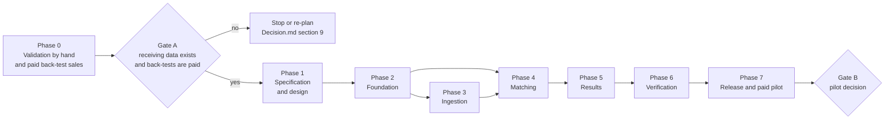

# Execution plan — MatchDesk AP three-way match

Number labels follow [Decision.md section 0](Decision.md#0-how-numbers-are-labelled). All estimates, thresholds and durations are author proposals, so **[assumption]**, unless labelled otherwise. Nothing in this plan has been done. Every command and script name is **proposed**; none exists.

Structure: phase → milestone → task → subtask. Task IDs are `T-<phase>.<milestone>.<task>`. Requirement IDs (MH-nn) are in [PRD.md](PRD.md); risk IDs (R-nn) are in [verification-report-fixing.md](verification-report-fixing.md); screens (S-nn) in [App-flow.md](App-flow.md); test IDs in [section 7](#7-test-catalogue).

Owner roles: **Founder** (sales, product decisions, pilot delivery), **Developer** (one to three people; may be the founder), **Controller** (the pilot account's buyer; external).

## 1. Sequence and gates

Phase 0 needs no application. Its first milestone, M0.1, is the first milestone of the plan and can start today.

**Critical path:** T-0.1.2 → T-0.1.4 → T-0.1.5 → T-0.2.2 → T-0.2.4 → T-1.1.1 → T-1.1.2 → T-2.2.1 → T-3.1.2 → T-4.1.2 → T-4.1.6 → T-4.2.2 → T-5.1.1 → T-6.1.3 → T-7.1.1 → T-7.2.1 → T-7.2.2 → T-7.2.4. Critical-path tasks are marked **CP**. Tasks marked **[P]** can run in parallel with others in the same milestone once its entry conditions hold.

## 2. External dependencies

| Dependency | Kind | Blocks | Who resolves |
|---|---|---|---|
| A distributor lets the founder see one month of invoices, purchase orders and receiving records | Sample data, permission | T-0.1.3, T-0.1.4 | Founder with a controller |
| Signed data-handling letter before any real document is copied | Permission | T-0.1.3 | Founder, controller |
| CAD 500 received for a back-test [chat]; the controller signs the pilot agreement and pays [assumption] | Payment | T-0.2.3; Gate A | Controller (owner where the controller cannot sign) |
| The account supplies open-PO history: earlier invoices and receiving evidence on every purchase order touched in the test month | Sample data | T-0.1.4, T-7.2.1 | Controller, clerk |
| Founder decision on the revised stop rule and refund definition | Buyer-side and founder decision | T-0.2.1, T-0.2.4 | Founder |
| Intuit developer account, sandbox company, production app keys and any programme review | Permission, possible cost | T-1.1.1, T-3.1.1, T-7.1.1 | Founder |
| Controller grants QuickBooks consent for the pilot company | Permission | T-7.2.1 | Controller |
| Extraction provider account with no-training terms | Permission | T-1.1.3 | Founder |
| VPS size and location; DNS for production and staging names | Infrastructure input | T-7.1.1 | Founder |
| Controller's time to review exceptions and approve the report | Buyer decision | T-7.2.2 | Controller |

## 3. Phases, milestones and tasks

Columns: ID; links (requirement, risk or operational need); owner; estimate in hours (low–high); deliverable; acceptance check. Subtasks follow each table.

### Phase 0 — Validation before building

#### Milestone M0.1 — Feasibility on real records, by hand

- **Entry conditions:** none.
- **Dependencies:** access to distributors; a signed data-handling letter per distributor.
- **Owner:** Founder.
- **Measurable outcome:** of 8 distributors visited, the number that have purchase orders in QuickBooks Online and receiving records independent of the invoice; one month of one distributor matched by hand with a dollar result.
- **Exit criteria:** feasibility note written; Gate A input 1 decided: at least 5 of 8 have both (the research record's gate) — or the stop decision is recorded.

| ID | Links | Owner | Hours | Deliverable | Acceptance check |
|---|---|---|---|---|---|
| T-0.1.1 [P] | Decision §8 funnel; M-1a, M-1b | Founder | 6–10 | De-duplicated prospect list with one row per legal entity | List has a count of distinct entities, source per row, and a named finance contact for at least 80% of rows; the count is written into Decision.md section 8 and compared with three thresholds from there: 500 (one cohort), 9,900 (27 accounts with churn) and 11,400 (positive monthly cash with founder). A count below 9,900 is recorded as "founder-paid break-even not reachable by cold outreach in this market" |
| T-0.1.2 **CP** | Pilot question; M-2 | Founder | 16–24 | Receiving-data census for 8 distributors | For each: QuickBooks plan, share of purchases on POs, invoices per month, who would sign and pay for a CAD 500 pilot, and metric M-2: the founder picks 20 PO lines from last month and counts those for which the distributor can show class A or class B receiving evidence (Decision.md section 3); 10 or more is a pass |
| T-0.1.3 | MH-05, MH-10; HR-01 | Founder | 8–12 | 50 document sets observed; synthetic fixture set derived from them | No real document, name or price leaves the distributor's premises or enters the repository; fixtures reproduce layouts and failure patterns with invented data; share of invoice lines whose supplier code equals the internal item is recorded |
| T-0.1.4 **CP** | MH-06 to MH-09; M-3 | Founder | 12–20 | One distributor's month matched by hand in a spreadsheet using the rule table in TRD 8.5, including open-PO history. This is also how every back-test sold before the application exists is delivered | Each line classified into the exception types; earlier invoices and receipts on the same POs included; receipt coverage computed by evidence class; qualifying discrepancies listed with document references; hours taken recorded against the 12–20 hour estimate |
| T-0.1.5 **CP** | Gate A | Founder | 3–5 | Feasibility note and go / stop decision | Note answers: do receiving records exist; how often do codes align; did the hand match find CAD 500 or more; what in the rule table had to change |

Subtasks. T-0.1.1: (a) pull the lists named in Decision.md section 5; (b) merge on legal name and address; (c) drop entities outside the ideal-account definition; (d) record the count. T-0.1.2: (a) prepare the five discovery questions from the research record; (b) visit or call; (c) photograph nothing, note field layouts only; (d) classify each distributor's evidence as class A warehouse record, class B receiver-signed delivery documents, class C supplier slips only, QuickBooks only, or none; (e) record the 20-line sample count. T-0.1.3: (a) agree the letter; (b) list layout types; (c) write synthetic equivalents; (d) record alignment rate. T-0.1.4: (a) export POs; (b) key or copy invoice lines; (c) load the receiving log; (d) apply rules in order; (e) review results with the controller. T-0.1.5: (a) write the note; (b) update Decision.md assumptions that now have evidence; (c) record the decision.

#### Milestone M0.2 — Paid back-tests sold

- **Entry conditions:** T-0.1.1 complete. May overlap M0.1.
- **Dependencies:** founder's decision on stop rule and refund definition; payment by controllers.
- **Owner:** Founder.
- **Measurable outcome:** number of back-tests paid at CAD 500 [chat], from cold outreach and from warm introductions, counted separately (metrics M-1a and M-1b).
- **Exit criteria:** Gate A input 2. The rule in force is the chat's: at least 2 paid back-tests within 30 days [chat]. If the founder adopts the proposed revision (Decision.md section 9) the test becomes at least 2 from cold outreach by day 60. Both are evaluated and recorded in T-0.2.4; the one in force decides. Otherwise stop.
- **Delivery of what was sold:** each back-test paid for in this milestone is delivered by hand (T-0.1.4 method, 12–20 hours each) within 15 business days of receiving the account's records, on the month before the sale. The live-checking part of the 30-day pilot is owed when the application is released (Decision.md section 5).

| ID | Links | Owner | Hours | Deliverable | Acceptance check |
|---|---|---|---|---|---|
| T-0.2.1 | MH-16; Decision §5 | Founder | 4–8 | One-page pilot agreement and data-handling terms | States price; what the CAD 500 covers (30-day pilot: back-test and live checking) and that subscription billing starts only on day 31 if the account subscribes; delivery by hand within 15 business days while no application exists, with live checking owed at release; who signs and pays; the inputs the account supplies including open-PO history; the definition of independent receiving evidence; the refund criterion of Decision.md section 5.1 with its threshold, governing version and review window; retention and deletion periods from schema.md section 8; use of an extraction provider; support hours |
| T-0.2.2 **CP** | M-1a, M-1b; Decision §8 | Founder | 20–30 | Outreach to the cohort with a funnel log | Log has one row per distinct prospect with dates of contact, reply, demo, qualification answer (the rule in Decision.md section 2), signatory, back-test sale; warm and cold are flagged; cohort size and lead cost recorded against the CAD 1,200 budget |
| T-0.2.3 | MH-16 | Founder | 2–4 | Payment collected for each back-test; delivery date agreed | Payment received before work starts; the 15-business-day delivery date and the test month are written on the invoice; recorded per account; no card data handled by MatchDesk |
| T-0.2.4 **CP** | Decision §9 | Founder | 2–3 | Stop-rule checkpoint record | Both the chat's 30-day rule (in force) and the proposed day-60 rule are evaluated from the log and the result written down with the false-stop probabilities of Decision.md section 9 beside it; Decision.md updated |

Subtasks. T-0.2.1: (a) draft; (b) have counsel or an experienced peer read it; (c) fix the refund wording. T-0.2.2: (a) write the message using the hand back-test result as the hook; (b) send in three weekly waves; (c) hold demos; (d) ask the qualification questions. T-0.2.3: (a) issue invoice or payment link; (b) confirm receipt. T-0.2.4: (a) count; (b) compare with thresholds; (c) decide.

### Phase 1 — Specification and design

#### Milestone M1.1 — Specification frozen against real findings

- **Entry conditions:** Gate A passed.
- **Dependencies:** Intuit sandbox; extraction provider account.
- **Owner:** Developer.
- **Measurable outcome:** the QuickBooks assumptions in TRD are each marked confirmed or corrected; golden fixtures exist for every rule; an extraction provider is chosen by measurement.
- **Exit criteria:** PRD, TRD, schema and App-flow updated for what was learned; no "unverified" label remains on a QuickBooks API statement that the build depends on.

| ID | Links | Owner | Hours | Deliverable | Acceptance check |
|---|---|---|---|---|---|
| T-1.1.1 **CP** | MH-02; AD-05 | Developer | 6–10 | QuickBooks API fact sheet from a sandbox | Recorded with request and response samples (synthetic sandbox data): PO line fields, whether a received or billed quantity is exposed, whether bill lines carry quantities and a link to the PO line (needed for open-PO history), vendor credits and what they can be tied to, how to fetch a PO by number regardless of date, paging, change tracking, call limits, token lifetimes, the OAuth scopes available and the exact wording of Intuit's consent screen (whether a read-only scope exists), programme tier and fee. Decision.md section 3 and section 12 updated |
| T-1.1.2 **CP** | MH-06 to MH-09; R-21 | Developer | 8–12 | Rule set v1 decision table and 40 golden purchase-order fixtures | Every check and every credit and charge case of TRD 8.5 has at least two fixtures (pass and fail), including the period-boundary fixtures UT-12 to UT-15, the receipt-absent cases UT-16, UT-17 and UT-31, and the evidence-class fixture UT-30; expected results reviewed by the founder against T-0.1.4 |
| T-1.1.3 [P] | MH-05; M-6 | Developer | 8–14 | Extraction fixture set (60 synthetic documents, 12 layouts) and provider comparison | Two or more providers scored on the set; chosen provider meets the thresholds in TRD 13.1; measured cost per document replaces the CAD 0.03 assumption |
| T-1.1.4 [P] | MH-11, MH-12; DD-01 to DD-12 | Developer | 8–12 | Wireframes for S-05 to S-09, S-12, S-13 and an accessibility checklist | Each wireframe walked through with a keyboard-only script; microcopy from design.md section 7 placed |

Subtasks. T-1.1.1: (a) create sandbox company with POs, partial bills, vendor credits; (b) call each endpoint; (c) write findings; (d) update documents. T-1.1.2: (a) write the table; (b) build fixtures as data files; (c) founder review. T-1.1.3: (a) author documents; (b) hand-label expected fields; (c) run providers; (d) record accuracy, latency, cost. T-1.1.4: (a) sketch; (b) review with one clerk if a pilot account allows; (c) revise.

### Phase 2 — Foundation

#### Milestone M2.1 — Repository and environment

- **Entry conditions:** M1.1 exit.
- **Dependencies:** none external.
- **Owner:** Developer.
- **Measurable outcome:** a new developer starts the whole stack with one command and all health checks pass.
- **Exit criteria:** OPS-04 passes; CI is green on an empty feature branch; boundary lint fails on a deliberately wrong import.

| ID | Links | Owner | Hours | Deliverable | Acceptance check |
|---|---|---|---|---|---|
| T-2.1.1 | R-04; AD-01 | Developer | 4–6 | Package layout of TRD section 5 with import-boundary contracts | CI-01 |
| T-2.1.2 | R-17 | Developer | 6–10 | Compose stack, proposed `make up` / `make down`, health and readiness endpoints | OPS-04 |
| T-2.1.3 [P] | R-21, R-22 | Developer | 4–6 | CI pipeline, branch rules, pull-request template | GOV-01, GOV-02 |
| T-2.1.4 | R-03, R-06, R-07, R-12 | Developer | 5–8 | `core` package: settings, logging, correlation, money, clock, errors, used by both entry points | IT-16b; CI-02; CI-04; IT-16 |

Subtasks. T-2.1.1: (a) create packages; (b) write contracts; (c) add to CI. T-2.1.2: (a) Compose services and named volumes; (b) `/healthz`, `/readyz`; (c) start script waits and reports; (d) README section. T-2.1.3: (a) lint, type-check, test jobs; (b) migration checks hook (from T-2.2.2); (c) branch rules. T-2.1.4: (a) settings; (b) logging with scrubber; (c) correlation propagation into job payloads; (d) `Money` type with float rejection; (e) a "utilities index" in AGENTS.md so new helpers are found before being rewritten.

#### Milestone M2.2 — Schema, tenancy and identity

- **Entry conditions:** M2.1 exit.
- **Dependencies:** schema.md frozen for the tables in scope.
- **Owner:** Developer.
- **Measurable outcome:** two synthetic tenants exist and no test can read across them.
- **Exit criteria:** IT-01, IT-02, IT-03, IT-08, IT-09, IT-13 pass.

| ID | Links | Owner | Hours | Deliverable | Acceptance check |
|---|---|---|---|---|---|
| T-2.2.1 **CP** | MH-01; R-05; AD-02 | Developer | 10–16 | Base migrations, row-level security, tenant session helper, job wrapper | IT-01, IT-02 |
| T-2.2.2 | R-08, R-09, R-10, R-11 | Developer | 6–10 | Migration checks: single head, ORM parity, catalogue manifest, lock rules, resumable backfill helper | IT-08, IT-09, CI-03, OPS-06 |
| T-2.2.3 [P] | MH-01 | Developer | 12–18 | Sign-in links (fragment transport, POST-only consumption, browser binding, rate limits), sessions with idle warning, operator TOTP, invitations, roles, permission function driven by the schema table, operator session and support-reader path | IT-13, IT-18, IT-29 |
| T-2.2.4 [P] | MH-13 | Developer | 3–5 | Audit writer used inside business transactions; insert-only grants | IT-24: an update or delete on `audit_events` by the application role is refused |
| T-2.2.5 [P] | R-13, R-14; MH-04 | Developer | 6–10 | `blobstore` with tenant-scoped keys, file limits and hardened parsing, sandboxed streamed download, response headers at the proxy, retention sweeper | IT-03, IT-10, IT-19, IT-20 |

Subtasks. T-2.2.1: (a) global and identity tables; (b) policies and composite keys; (c) `tenancy.session()`; (d) job wrapper refusing payloads without tenant; (e) CI check for tables without a policy. T-2.2.2: (a) head check; (b) autogenerate-diff check; (c) manifest compare; (d) migration template with timeouts; (e) backfill helper with progress row. T-2.2.3: (a) token issue and exchange; (b) cookie and CSRF; (c) invitations; (d) permission table as data; (e) last-controller guard. T-2.2.4: (a) writer; (b) grants; (c) history query. T-2.2.5: (a) key builder; (b) content sniffing and limits; (c) sweeper job with counts and alert; (d) orphan blob cleanup.

### Phase 3 — Ingestion and integrations

#### Milestone M3.1 — QuickBooks read sync

- **Entry conditions:** M2.2 exit; T-1.1.1 complete.
- **Dependencies:** Intuit sandbox keys.
- **Owner:** Developer.
- **Measurable outcome:** a sandbox company's purchase orders, bills and vendor credits for a month appear in MatchDesk with matching counts.
- **Exit criteria:** IT-04, IT-05, IT-06, IT-11, NET-01 pass.

| ID | Links | Owner | Hours | Deliverable | Acceptance check |
|---|---|---|---|---|---|
| T-3.1.1 | MH-02 | Developer | 6–10 | Connect, callback, disconnect; token encryption and refresh; S-04 | IT-11 |
| T-3.1.2 **CP** | MH-02 | Developer | 12–18 | Idempotent read of vendors, items, POs with lines, bills, vendor credits; cursor per record type; reading by PO reference regardless of date, with every linked bill and credit | IT-04; UT-14 |
| T-3.1.3 | R-01, R-02; MH-04 | Developer | 6–10 | Shared job state machine: `state_version` compare-and-set, leases, reconciliation sweep, retry policy | IT-05, IT-06 |

Subtasks. T-3.1.1: (a) authorise URL with signed state; (b) callback validation; (c) encrypt tokens; (d) refresh and "needs reconnect"; (e) screen. T-3.1.2: (a) client with paging and backoff; (b) upserts; (c) cursor save after each page; (d) counts. T-3.1.3: (a) transition helper; (b) lease and sweep; (c) backoff schedule; (d) apply to sync runs, documents, imports, match runs.

#### Milestone M3.2 — Receiving import

- **Entry conditions:** M2.2 exit. Parallel with M3.1 and M3.3.
- **Dependencies:** receiving layouts observed in T-0.1.2.
- **Owner:** Developer.
- **Measurable outcome:** the synthetic warehouse file of 1,221 rows imports with its 37 known bad rows listed.
- **Exit criteria:** IT-07b and E2E-02 pass; A11Y-02 passes on the mapping form.

| ID | Links | Owner | Hours | Deliverable | Acceptance check |
|---|---|---|---|---|---|
| T-3.2.1 [P] | MH-03, MH-07 | Developer | 12–18 | Spreadsheet import: upload, evidence class, coverage declaration, mapping, validation with no date-window rejection, commit, void and re-import, late-evidence flag; S-05 | IT-07b; IT-28; importing twice changes nothing |
| T-3.2.2 [P] | MH-03 | Developer | 6–10 | Delivery-document path: extraction, line-by-line clerk confirmation, receiver marks and signer recorded; class C stored as context | UT-30: lines of unconfirmed, unmarked or class C documents have `counts = false` and do not affect any match |

Subtasks. T-3.2.1: (a) parser for CSV and XLSX; (b) saved mappings; (c) row validation with reasons; (d) commit transaction and re-match trigger; (e) void; (f) coverage summary. T-3.2.2: (a) reuse extraction adapter with a packing-slip schema; (b) confirmation screen; (c) provenance by page.

#### Milestone M3.3 — Invoice intake and extraction

- **Entry conditions:** M2.2 exit; T-1.1.3 complete.
- **Dependencies:** extraction provider account.
- **Owner:** Developer.
- **Measurable outcome:** a batch of 240 synthetic PDFs ends with every file in a terminal state and totals that add up.
- **Exit criteria:** IT-07, HR-01, E2E-05 pass.

| ID | Links | Owner | Hours | Deliverable | Acceptance check |
|---|---|---|---|---|---|
| T-3.3.1 | MH-04, MH-08; R-19 | Developer | 8–12 | Batch upload, per-file state, retry failed, duplicate-file detection; S-06 | IT-07 |
| T-3.3.2 | MH-05; AD-06 | Developer | 10–16 | Extraction adapter, fake adapter, deterministic verification gates, extraction runs | HR-01; UT-08 |
| T-3.3.3 | MH-05 | Developer | 10–14 | Extraction review screen S-07 with field provenance and conflict handling | E2E-05; IT-14 |
| T-3.3.4 [P] | MH-14 | Developer | 6–10 | Inbound email webhook, allowed senders, held messages (P1) | IT-12 |

Subtasks. T-3.3.1: (a) batch and file endpoints with idempotency; (b) hash and sniff; (c) totals query; (d) retry-failed; (e) screen with live region. T-3.3.2: (a) schema for model output; (b) adapter interface; (c) gates; (d) run records with model and prompt version; (e) evaluation command. T-3.3.3: (a) PDF pane; (b) form with read/edited tags; (c) save draft and confirm; (d) version conflict. T-3.3.4: (a) webhook auth; (b) message id idempotency; (c) sender list; (d) held queue.

### Phase 4 — Matching and exceptions

#### Milestone M4.1 — Match engine

- **Entry conditions:** T-1.1.2 complete; M2.2 exit. The pure rule functions (T-4.1.1 to T-4.1.5) need no database and can start in parallel with Phase 3.
- **Dependencies:** golden fixtures.
- **Owner:** Developer.
- **Measurable outcome:** all golden fixtures produce expected results; permuting input order changes nothing.
- **Exit criteria:** UT-01 to UT-10, PT-01, IT-15 pass.

| ID | Links | Owner | Hours | Deliverable | Acceptance check |
|---|---|---|---|---|---|
| T-4.1.1 [P] | MH-10 | Developer | 6–10 | Alias resolution with unit conversion; suggestion query | UT-07 |
| T-4.1.2 **CP** | MH-06 | Developer | 14–22 | Cumulative quantity and price checks with tolerances, over open-PO history including QuickBooks bill lines; history-incomplete check; deterministic document order; charge lines | UT-01, UT-02, UT-04, UT-09, UT-10, UT-12, UT-13, UT-15, UT-24 to UT-27, UT-29, PT-01 |
| T-4.1.3 [P] | MH-07 | Developer | 3–5 | Receipt-absent rule with its three sub-reasons, receiving-coverage test, coverage by class, database check constraints | UT-03, UT-16, UT-17, UT-23, UT-30, UT-31; IT-24 |
| T-4.1.4 [P] | MH-08 | Developer | 5–8 | Duplicate rules: number normalisation, total-and-date window, QuickBooks bill cross-check, content-hash tie-break, exclusion of duplicates from cumulative quantities | UT-05, UT-22 |
| T-4.1.5 [P] | MH-09 | Developer | 8–14 | Credit-note linking and netting; price-only credits; QuickBooks vendor credits without a document; possibly-credited flag; returns; resolved-by-credit | UT-06, UT-18 to UT-21, UT-28 |
| T-4.1.6 **CP** | MH-06, MH-10; R-01; AD-10 | Developer | 8–12 | Match runs: scope, fingerprint, supersede, exception reconciliation by fingerprint, triggers | IT-15, IT-05 |

Subtasks. T-4.1.2: (a) data classes for inputs and results; (b) ordering by document date and number; (c) quantity checks; (d) price check; (e) charges; (f) property test for order independence. T-4.1.6: (a) scope from trigger; (b) fingerprint; (c) transaction that swaps current results; (d) exception keep / reopen / auto-close; (e) stale report flag. T-4.1.1: (a) code normalisation; (b) lookup by vendor and code with validity dates; (c) conversion to PO units; (d) suggestion query: exact code, then trigram similarity on description. T-4.1.3: (a) count of counting receipt lines per PO line; (b) rule with no tolerance input; (c) coverage formula; (d) check constraint migration. T-4.1.4: (a) number normaliser; (b) total-and-date window; (c) bill cross-check; (d) later-document selection. T-4.1.5: (a) credit-note type detection from extraction; (b) link by referenced invoice number, then PO line; (c) net cumulative quantities; (d) `credit_unlinked`.

#### Milestone M4.2 — Exception workflow

- **Entry conditions:** T-4.1.6 complete; T-1.1.4 complete.
- **Dependencies:** none external.
- **Owner:** Developer.
- **Measurable outcome:** a clerk clears 10 synthetic exceptions by keyboard alone; a waiver above the limit waits for the controller.
- **Exit criteria:** E2E-03, E2E-04, E2E-06, IT-14, A11Y-01 pass.

| ID | Links | Owner | Hours | Deliverable | Acceptance check |
|---|---|---|---|---|---|
| T-4.2.1 | MH-11; R-18 | Developer | 8–12 | Queue API and S-08 with filters in the URL, bulk resolve with per-item results and the receipt-absent guard | E2E-03, IT-22 |
| T-4.2.2 **CP** | MH-11, MH-06, MH-07; DD-01, DD-02, DD-06 | Developer | 16–24 | Match view S-09 and PO view S-10 with evidence panes and calculation sentence | E2E-01 steps 6–8; calculation text equals stored values |
| T-4.2.3 | MH-11 | Developer | 10–16 | Resolutions including controller-only "not received" and duplicate or credit decisions; item waiver limit and rolling period cap; approvals S-12 for waivers, conversions and late receiving evidence; reopen; withdraw; weekly waiver list | E2E-04, IT-13, IT-14, IT-23, IT-27, IT-28 |
| T-4.2.4 [P] | MH-10 | Developer | 6–10 | Alias map S-11, conversion approval, controller review list | IT-15, IT-21 |
| T-4.2.5 [P] | MH-06 | Developer | 4–6 | Tolerances S-15 with versioning and re-match preview | Changing a tolerance creates a new row and a match run; old results keep their rule reference |

Subtasks. T-4.2.1: (a) list endpoint with filters, sort, cursor; (b) counters; (c) URL-state handling and scroll restore; (d) bulk endpoint with per-item results and the `receipt_absent` guard; (e) keyboard shortcuts. T-4.2.2: (a) evidence query for one line (PO line, receipts, earlier invoices, credits, QuickBooks billed quantity); (b) three-pane layout; (c) PDF highlight; (d) calculation sentence from stored values; (e) PO view. T-4.2.3: (a) resolution endpoint with version check; (b) waiver-limit rule; (c) approvals list and decision; (d) withdraw and reopen; (e) review dialogs. T-4.2.4: (a) alias table and form with worked example; (b) pending-approval state; (c) retire with re-match count; (d) review list. T-4.2.5: (a) versioned save; (b) preview count; (c) re-match trigger.

### Phase 5 — Results

#### Milestone M5.1 — Report, usage and remaining screens

- **Entry conditions:** M4.2 exit.
- **Dependencies:** none external.
- **Owner:** Developer.
- **Measurable outcome:** an approved synthetic report whose totals equal the sums of its linked lists.
- **Exit criteria:** E2E-01, E2E-07 pass; UT-11 passes.

| ID | Links | Owner | Hours | Deliverable | Acceptance check |
|---|---|---|---|---|---|
| T-5.1.1 **CP** | MH-12, MH-07 | Developer | 8–12 | Report generation with frozen snapshot, coverage by class, not received, unverified, qualifying total, paid split, history depth | Report totals equal queries on `report_findings`; coverage equals the S-08 strip; IT-17 |
| T-5.1.2 | MH-12 | Developer | 6–10 | Approval with blocking checks, versions, tagged PDF and CSV export, draft watermark | E2E-07, E2E-08; UT-11; A11Y-06 |
| T-5.1.3 [P] | MH-16 | Developer | 6–10 | Usage events, pilot record, governing report, refund-criterion evaluation | IT-26 (usage counted once, in the right month); IT-17 (refund result for each fixture) |
| T-5.1.4 [P] | MH-15 | Developer | 4–8 | Weekly summary S-14 and email (P1) | IT-25: figures equal S-08 with the same filters; email has totals and a link only |
| T-5.1.5 [P] | MH-01, MH-13, MH-16 | Developer | 10–16 | Onboarding S-03, users S-16, audit S-17, operator console S-18, system pages S-19 | IT-13; operator without a grant gets 404 on tenant data |

Subtasks. T-5.1.1: (a) period and cut-off; (b) classify exceptions into finding, unverified, waived, open; (c) paid split from bill status; (d) snapshot rows; (e) stale flag handling. T-5.1.2: (a) blocking checks; (b) approve transaction and supersede; (c) PDF layout with watermark; (d) CSV with formula-injection guard. T-5.1.3: (a) usage event on first extraction; (b) pilot record fields; (c) refund evaluation. T-5.1.4: (a) weekly query; (b) screen; (c) email with totals and link. T-5.1.5: (a) checklist state endpoint and no-receiving declaration; (b) users, invitations, support grants; (c) audit list and export; (d) operator console; (e) signed-out, forbidden, not-found pages.

### Phase 6 — Verification

#### Milestone M6.1 — Test hardening

- **Entry conditions:** M5.1 exit. Tests named in earlier tasks already exist; this milestone completes the catalogue and runs it together.
- **Dependencies:** staging environment (T-7.1.1 staging part may start early).
- **Owner:** Developer; the security and accessibility checks are repeated by someone who did not write the code where a second person exists.
- **Measurable outcome:** every test in section 7 has a recorded result.
- **Exit criteria:** all P0-linked tests pass; failures are recorded as findings in verification-report-fixing.md.

| ID | Links | Owner | Hours | Deliverable | Acceptance check |
|---|---|---|---|---|---|
| T-6.1.1 | MH-06 to MH-09 | Developer | 8–12 | Unit and property suite complete on golden fixtures | UT-01 to UT-31, PT-01 recorded |
| T-6.1.2 | MH-01 to MH-05, R-01 to R-14 | Developer | 8–12 | Integration suite against a real database and fake providers | IT-01 to IT-29 and CI-01 to CI-04 recorded |
| T-6.1.3 **CP** | All P0 must-haves | Developer | 10–14 | End-to-end suite in a browser | E2E-01 to E2E-08 recorded |
| T-6.1.4 | R-18, R-20; design §11 | Developer | 8–12 | Accessibility and navigation-state checks, including the stacked layouts at 640 px; link and route check | A11Y-01 to A11Y-06, NAV-01 recorded |
| T-6.1.5 | TRD 13.2 | Developer | 4–8 | Security checks against the ASVS items the reviewer selects | Each abuse case in TRD 13.2 has a test result |

Subtasks. T-6.1.1: (a) fill fixture gaps; (b) property-test bounds; (c) record results. T-6.1.2: (a) two-tenant fixture loader; (b) fake QuickBooks, extraction and email servers; (c) failure injection (kill worker, expire lease); (d) record results. T-6.1.3: (a) browser scripts per test; (b) run against the staging-like stack; (c) record results with screenshots of synthetic data only. T-6.1.4: (a) keyboard scripts; (b) screen-reader passes; (c) automated scan; (d) link and route check. T-6.1.5: (a) take the reviewer's ASVS selection; (b) map each item to a test; (c) run and record.

### Phase 7 — Release and paid pilot

#### Milestone M7.1 — Release and operations

- **Entry conditions:** M6.1 exit.
- **Dependencies:** VPS access, DNS, production keys.
- **Owner:** Developer.
- **Measurable outcome:** production and staging serve HTTPS; a restore into staging has been timed.
- **Exit criteria:** OPS-01 to OPS-06 pass.

| ID | Links | Owner | Hours | Deliverable | Acceptance check |
|---|---|---|---|---|---|
| T-7.1.1 **CP** | R-15, R-16; TRD §7 | Developer | 6–10 | Staging and production stacks, proxy, named volumes, `PUBLIC_BASE_URL` checks, deploy command | OPS-03, OPS-05 |
| T-7.1.2 | R-15; TRD §7 | Developer | 4–6 | Nightly backup, offsite copy, offsite custody of the passphrase and keys, restore and verify commands, deletion-ledger replay | OPS-01, run on a machine other than the production VPS |
| T-7.1.3 [P] | TRD §7 alerts; R-12 | Developer | 4–6 | Uptime check, queue-age and stuck-job alerts, backup-age alert, runbook | Each alert fired once on purpose in staging and received |
| T-7.1.4 [P] | TRD §7 rollback | Developer | 2–4 | Rollback rehearsal | OPS-02 |

Subtasks. T-7.1.1: (a) DNS and TLS; (b) Compose files per environment with named volumes; (c) start-up checks for volumes and `PUBLIC_BASE_URL`; (d) deploy command; (e) production QuickBooks keys and redirect address. T-7.1.2: (a) dump and snapshot; (b) client-side encryption and upload; (c) retention pruning; (d) restore and verify commands; (e) ledger replay; (f) timed drill. T-7.1.3: (a) external check; (b) queue-age, stuck-job and backup-age alerts; (c) runbook page per alert. T-7.1.4: (a) deploy N then N−1 in staging; (b) record result.

#### Milestone M7.2 — Paid pilot delivered and decided

- **Entry conditions:** M7.1 exit; at least one paying pilot account (a Phase 0 account taking the live checking it is owed, or a new one); QuickBooks consent from the controller.
- **Dependencies:** the account's invoices and receiving records; controller's review time.
- **Owner:** Founder.
- **Measurable outcome:** an approved back-test report for a paying account, with findings in dollars and receipt coverage.
- **Exit criteria:** Gate B decision recorded against Decision.md section 9 and section 10.

| ID | Links | Owner | Hours | Deliverable | Acceptance check |
|---|---|---|---|---|---|
| T-7.2.1 **CP** | MH-02 to MH-10 | Founder | 6–10 | Pilot account onboarded; month loaded; aliases confirmed with the clerk | Onboarding checklist complete; batch totals add up; alias count and time recorded |
| T-7.2.2 **CP** | MH-11, MH-12; M-3, M-8 | Founder, Controller | 3–5 | Review session; 100 matched lines sampled for false passes; report approved by the controller; governing version fixed at the end of the 10-business-day review window | Sample result recorded; report approved; refund criterion evaluated on the governing version and recorded in the pilot record |
| T-7.2.3 | MH-14, MH-15 | Founder | 8–16 | Live month: new invoices checked before payment; weekly summaries | Metrics M-5, M-7, M-9, M-10 recorded weekly |
| T-7.2.4 **CP** | Decision §9, §10; R-21, R-22 | Founder | 3–5 | Pilot decision review; request log triage; repository tidy-up | Each stop-rule clause evaluated with numbers; feature requests logged with accept or decline and reason; GOV-01 and GOV-02 run |

Subtasks. T-7.2.1: (a) create tenant and pilot record; (b) controller connects QuickBooks; (c) read the month; (d) load receiving; (e) upload invoices; (f) alias session with the clerk. T-7.2.2: (a) draw the sample of 100 matched lines; (b) check each against documents; (c) walk the controller through findings, unverified and waived; (d) approval; (e) refund decision. T-7.2.3: (a) set up email intake; (b) weekly metric capture; (c) weekly call with the clerk. T-7.2.4: (a) evaluate stop rule and invalidation test; (b) update Decision.md; (c) triage requests; (d) delete merged branches and list any unmerged work.

## 4. Parallel work

| Can run together | Condition |
|---|---|
| M0.1 and M0.2 | After T-0.1.1 |
| T-1.1.3 and T-1.1.4 with T-1.1.1 and T-1.1.2 | Two people, or interleaved |
| T-2.2.3, T-2.2.4, T-2.2.5 | After T-2.2.1 |
| M3.1, M3.2, M3.3 | After M2.2 |
| T-4.1.1 to T-4.1.5 (pure functions) with all of Phase 3 | After T-1.1.2 |
| T-4.2.4, T-4.2.5 with T-4.2.1 to T-4.2.3 | After T-4.1.6 |
| T-5.1.3, T-5.1.4, T-5.1.5 with T-5.1.1 and T-5.1.2 | After M4.2 |
| T-7.1.1 staging part with Phase 6 | After M2.1 |

## 5. Estimate summary

Sums of the task ranges above **[assumption]**. Ten estimates were raised in fix round 1 for work the independent review showed was missing (open-PO history, evidence classes, sign-in hardening, file hardening, refund evaluation, credit cases, waiver cap, stacked layouts).

| Phase | Tasks | Low hours | High hours |
|---|---|---|---|
| 0 Validation | 9 | 73 | 116 |
| 1 Specification and design | 4 | 30 | 48 |
| 2 Foundation | 9 | 56 | 89 |
| 3 Ingestion | 9 | 76 | 118 |
| 4 Matching and exceptions | 11 | 88 | 139 |
| 5 Results | 5 | 34 | 56 |
| 6 Verification | 5 | 38 | 58 |
| 7 Release and pilot | 8 | 36 | 62 |
| **Total** | **60** | **431** | **686** |

- Building (Phases 1 to 6): 30 + 56 + 76 + 88 + 34 + 38 = **322** low; 48 + 89 + 118 + 139 + 56 + 58 = **508** high. Adding release tasks T-7.1.1 to T-7.1.4 (16–26 hours) gives **338–534 hours**.
- The chat said 20 days **[chat]** and the research record 160 hours **[assumption]**. This plan's build estimate is roughly two to three times that. At the model's CAD 100 per hour **[assumption]**, 338 × 100 = CAD 33,800 and 534 × 100 = CAD 53,400, against CAD 16,000.
- Calendar: at 140 productive hours per developer-month **[assumption]**, 338 ÷ 140 = 2.4 months and 534 ÷ 140 = 3.8 months for one developer after Gate A at the end of month 2. First pilots on the application fall in month 6 or 7 and the first subscription in month 7 or 8. [Decision.md section 7.5](Decision.md#75-cash-required-during-the-acquisition-ramp) uses month 7 as its base, which is this plan's low estimate with one developer, and shows months 6 and 8.
- Removing the two P1 tasks (T-3.3.4, T-5.1.4) saves 10–18 hours.

**Proposed smaller cut, for the founder to choose [assumption].** An engine-first version operated by the founder, with the controller receiving the report as a PDF and reviewing exceptions in a screen-share: T-1.1.1 to T-1.1.3 (22–36), T-2.1.1 (4–6), T-2.1.2 (6–10), T-2.2.1 (10–16), T-3.1.1 (6–10), T-3.1.2 (12–18), T-3.2.1 (12–18), T-3.3.1 (8–12), T-3.3.2 (10–16), T-4.1.1 to T-4.1.6 (44–71), T-5.1.1 (8–12). Total **142–225 hours**, 1.0–1.6 months for one developer, first subscription about month 6. It delivers the back-test and answers the pilot question, but not MH-11's clerk queue, MH-12's in-product approval, or MH-14 and MH-15. It is the option closest to the chat's 20 days.

## 6. Proposed scripts and commands

None exists. Names are proposals.

| Name | Purpose | Inputs | Outputs | Failure behaviour |
|---|---|---|---|---|
| `make up` | Start the local stack | `.env` | Running services; URLs printed after all readiness checks pass | Exits non-zero naming the service that failed its check; leaves logs available |
| `make down` | Stop the local stack | — | Services stopped; volumes kept | — |
| `make test` | Run unit and integration suites | Test database | Pass or fail per suite | Non-zero exit; no partial "pass" |
| `scripts/check_migrations` | Single head; ORM parity; catalogue manifest; lock rules | Migrations, models, manifest | Report | Non-zero exit listing each mismatch |
| `scripts/load_fixtures` | Load two synthetic tenants and the golden fixture set | Fixture files; target environment name | Row counts per table | Refuses to run when the environment is production; rolls back on any error |
| `scripts/eval_extraction` | Score an extraction provider on the fixture set | Provider, model, prompt version | Accuracy per field, latency, cost per document, list of failures | Non-zero exit if thresholds are missed |
| `scripts/backfill <name>` | Run a resumable backfill | Backfill name, batch size | Progress row updated; rows changed | Stops on error after committing completed batches; re-run continues from the stored key |
| `make deploy TAG=<hash>` | Deploy a pinned image | Image tag | Migrations applied; services restarted; smoke check result | Stops before restarting services if a migration fails; previous containers keep running |
| `scripts/backup` | Database dump and blob snapshot, encrypted, pushed offsite | Passphrase and bucket from environment | Snapshot id, sizes, job row | Non-zero exit and alert; never deletes an older snapshot on failure |
| `make restore SNAPSHOT=<id> TARGET=<env>` | Restore into an environment | Snapshot id | Restored database and blobs; deletion ledger replayed | Refuses `TARGET=production` without an explicit second flag; leaves the target untouched if download or decryption fails |
| `make verify-restore` | Check a restored environment | — | Row counts per tenant; 20 document hash checks | Non-zero exit on any mismatch |
| `scripts/sweep_retention` | Delete expired temporary files and due tenants | Current time | Counts by purpose | Logs each failure; continues with the rest; alert if any failed |
| `scripts/check_links` | Verify Markdown links and anchors in this repository and routes in the web app | Repository | List of broken links | Non-zero exit |

## 7. Test catalogue

All fixtures are synthetic. Vendor "Fictional Supplier T", account "Fictional Distributor A" and every number below are invented. Every test is planned; none has been run.

### 7.1 Unit and property tests (rule engine, no database)

| ID | Fixture | Action | Expected outcome |
|---|---|---|---|
| UT-01 | PO 4471 line 2: 100 EA at 4.20. Receipts: 60 on 3 Oct, 40 on 17 Oct. Invoices: INV-01042 for 60 on 4 Oct, INV-01077 for 40 on 18 Oct, both at 4.20 | Evaluate | Both lines `matched`; cumulative invoiced 60 then 100; no exception |
| UT-02 | Same PO. One receipt of 60. One invoice for 100 at 4.20 | Evaluate | `qty_over_received`, variance quantity 40, amount 168.00 |
| UT-03 | Same PO. No receipt lines. Invoice for 100 at 4.20, alias active, price equal | Evaluate with every tolerance set to its maximum | `receipt_absent`; status `exception`; value 420.00 classed `unverified`; never `matched` |
| UT-04 | PO price 4.20, tolerance 0.01 or 0.5%. Invoice A at 4.21 for 60; invoice B at 4.35 for 60 | Evaluate | A passes (difference 0.01 ≤ max(0.01, 0.021)); B `price_variance` (0.15 × 60 = 9.00) |
| UT-05 | Same vendor: `INV-01042` and `inv 1042`; then `INV-2001` and `INV-2001A`, both total 1,284.50, dated 5 days apart | Run duplicate rules | First pair: `duplicate` on the later; second pair: `possible_duplicate` |
| UT-06 | PO 100, receipt 60, invoice 100, then credit note CN-0031 for 40 referencing the invoice | Evaluate after each document | After invoice: `qty_over_received` 168.00. After credit: net invoiced 60; exception `resolved_by_credit` linked to CN-0031 |
| UT-07 | Alias: 1 CS = 12 EA. PO in EA at 4.20. Invoice 5 CS at 50.40. Receipt 60 EA | Evaluate | Converted to 60 EA at 4.20; `matched` |
| UT-08 | Document with lines summing 1,223.33, tax 61.17, printed total 1,248.50 | Verification gates | Fails "lines + tax = total" (1,284.50 ≠ 1,248.50); routed to review; not matched |
| UT-09 | Quantity 3 at 0.335 each; amount printed 1.01 | Money arithmetic | 1.005 rounds half-up to 1.01; passes; a float input raises an error |
| UT-10 | PO 100, receipts 110, invoices 110 | Evaluate | `qty_over_ordered`, variance 10, 42.00 |
| UT-11 | Vendor name `=HYPERLINK("http://example.invalid")` | CSV export | Cell is prefixed with an apostrophe |
| UT-12 | PO 4471 line 2: 100 EA at 4.20. September invoice INV-00980 for 100 exists only as a QuickBooks bill linked to the PO line (no PDF). Receipt of 100 on 6 Oct. Test month October: INV-01042 for 100 on 8 Oct | Evaluate the October invoice | Cumulative invoiced 200 (100 from the QuickBooks bill) against received 100: `qty_over_received` on INV-01042, variance 100, CAD 420.00; never `matched` |
| UT-13 | Same PO. Receipt of 100 dated 29 Sep in a log loaded for September and October. Invoice for 100 dated 2 Oct | Evaluate | `matched`; the receipt import reports no rejected row for its date |
| UT-14 | PO 4390 dated 14 Aug, not in the October date range. October invoice names PO 4390 | Sync by PO reference, then evaluate | PO found and read with its linked bills; no `no_po` |
| UT-15 | PO line with QuickBooks billed quantity 100, no bill lines and no earlier PDFs; receipts 100; October invoice for 40 | Evaluate | `history_incomplete`; not `matched`; after the earlier invoice for 60 is uploaded, re-match gives `matched` |
| UT-16 | PO 4471 with three lines. Class A log declared complete 1 Sep to 31 Oct holds receipts for lines 1 and 3, none for line 2. Invoice dated 4 Oct bills line 2 for 100 at 4.20 | Evaluate | `receipt_absent`, sub-reason `not_received`, value class finding candidate, CAD 420.00, `qualifying` true |
| UT-17 | Same invoice; the account has no receiving import | Evaluate; then controller resolves `confirmed_not_received` | First: `receipt_absent`, sub-reason `no_evidence`, unverified, `qualifying` false. After confirmation: finding, `qualifying` true. A clerk attempting the same resolution is refused |
| UT-18 | `qty_over_received` of 40 × 4.20 = 168.00 on INV-01042. (a) QuickBooks vendor credit VC-77 for 40 units tied by line to the PO line, no PDF. (b) Instead, a vendor credit of 168.00 for the same vendor with no reference | Evaluate each | (a) netted; exception `resolved_by_credit`, labelled "credited in QuickBooks, no document". (b) not netted; exception flagged `possibly_credited`, value class `open_undecided`, not in findings |
| UT-19 | Invoice with `price_variance` 9.00 (UT-04 B). Credit note CN-0040 for 9.00, no quantity, naming the invoice | Evaluate | Variance net 0.00; `resolved_by_credit`. With a credit of 5.00 instead: `price_variance` 4.00 remains |
| UT-20 | UT-06 with the credit note dated 12 Nov; report cut-off 20 Nov; test month October | Generate the report | Credit netted; no open quantity exception; report shows the cut-off date |
| UT-21 | PO 100; receipts +100 then −10 (return); invoice 100. (a) no credit. (b) credit note for 10 | Evaluate each | (a) `qty_over_received` 10 × 4.20 = 42.00, sub-reason `returned_no_credit`. (b) net invoiced 90 ≤ received 90: `matched` |
| UT-22 | Two different files, same vendor, both dated 4 Oct, numbers `INV-01042` and `inv 1042`, each billing PO line 2 for 100; received 100 | Evaluate under both upload orders | Same result both times: the file with the greater content hash carries `duplicate` for its total 420.00, its lines are `not_evaluated`; the other is `matched`; exactly one finding and one amount; no `qty_over_received` |
| UT-23 | PO line with `qbo_billed_qty` 100 and a linked QuickBooks bill; no receipt lines of any class | Evaluate | `receipt_absent`; the QuickBooks quantity is not in "received to date"; never `matched` |
| UT-24 | Invoice naming PO 9999, which QuickBooks does not have for this vendor | Evaluate | `no_po`; line amount unverified |
| UT-25 | Alias maps supplier code to an item that is not on the named PO | Evaluate | `po_line_not_found` |
| UT-26 | Invoice line in KG; PO line in CS; alias has no conversion for KG | Evaluate | `uom_unresolved` |
| UT-27 | Invoice with freight 85.00; PO has no freight line. (a) charge allowance 0. (b) allowance 100.00 | Evaluate each | (a) `unmatched_charge` 85.00. (b) line stored as `charge_ok`, not counted in M-5 |
| UT-28 | Credit note naming no invoice and no PO | Evaluate | `credit_unlinked`; no receipt, quantity or price check is run on its lines |
| UT-29 | Invoice in USD for a CAD tenant | Evaluate | `currency_unsupported`; nothing converted |
| UT-31 | No receiving evidence. (a) PO 100 EA at 4.20; invoice 60 at 4.35 (line amount 261.00). (b) PO 100 at 4.20; invoice 110 at 4.20 (462.00). (c) as (a) but the line is covered and `not_received`. (d) as (a) with QuickBooks billed quantity unexplained, so `history_incomplete` as well | Evaluate each | (a) one line result with status `exception`, `checks_run` includes 9 and 10 and omits 8; two exceptions: `receipt_absent` and `price_variance` 9.00; reported finding 9.00, unverified 252.00, sum 261.00. (b) `receipt_absent` and `qty_over_ordered` 10 × 4.20 = 42.00; unverified 420.00; sum 462.00. (c) finding 261.00 for `not_received`; `price_variance` listed with reported amount 0.00. (d) three exceptions; the line amount is still counted once: finding 9.00, unverified 252.00 in total. Never `matched` in any case |
| UT-30 | PO line with (a) a class C supplier packing slip for 100; (b) a class B delivery document for 100 with receiver marks not recorded; (c) the same with marks recorded and signer named | Evaluate each | (a) `receipt_absent`, sub-reason `supplier_slip_only`. (b) `receipt_absent`. (c) `matched`; coverage counted under class B |
| PT-01 | Generated sets of receipts, invoices, credit notes and QuickBooks bill lines for one PO, including a duplicate pair with equal date and number and documents dated before the test month | Evaluate under every permutation of arrival order (bounded) | Final current results, exceptions and amounts are identical for all permutations |

### 7.2 Integration tests (real database, fake providers)

| ID | Fixture | Action | Expected outcome |
|---|---|---|---|
| IT-01 | Tenants A and B, each with documents, exceptions, a report | As a clerk of A, call every `GET`, `PATCH`, `POST` endpoint with B's identifiers | 404 every time; no B data in any body; no row of B changed |
| IT-02 | Job payload without `tenant_id`; job payload for A | Run both in the worker | First is rejected and logged; second can read only A's rows; a query with no tenant context returns zero rows |
| IT-03 | A's and B's files | Request B's `documents/{id}/content` as A; try to store a file under a key outside `t/{A}/` | 404; `blobstore` refuses the key |
| IT-04 | Recorded QuickBooks responses for one month, with a page boundary | Run the sync twice; kill the worker after page 1 and restart | Same row counts after each run; resume starts at page 2; no duplicates |
| IT-05 | A document in `succeeded` at `state_version` 4 | Deliver a late "running" transition carrying version 2, and the same "succeeded" event twice | Zero rows updated each time; state unchanged; events logged as stale |
| IT-06 | Extraction fake that answers after the lease expired, while a second attempt is running | Let both complete | Exactly one extraction run is in use; document ends `succeeded` or `needs_review`; no row stays `running`; usage counted once |
| IT-07 | Batch of 240 PDFs: 228 good, 9 failing arithmetic, 2 password-protected, 1 byte-identical repeat | Upload; wait; "Retry failed"; re-upload the whole batch | 228 ready, 9 needs review, 2 failed, 1 duplicate file; totals sum to 240; retry touches only the 2; re-upload creates no new documents and no usage events |
| IT-07b | Receiving file: 1,221 rows, 37 invalid | Preview, commit, commit again, upload the same file again | 1,184 lines imported once; 37 listed with reasons; second upload refused |
| IT-08 | Migrations and models | Build a database from migrations; run parity and manifest checks; add an index to a model only | Clean at first; the added index makes the check fail |
| IT-09 | Backfill over 10,000 rows | Kill after 3 batches; re-run | Continues from the stored key; each row changed exactly once |
| IT-10 | Export file, raw inbound payload and draft import with `expires_at` in the past; one blob with no row | Run the sweeper | All four blobs removed; rows marked deleted; counts logged; a simulated delete failure raises the alert and is retried next run |
| IT-11 | Fake Intuit authorisation server | Complete connect; replay the callback; use a `state` from another session; expire the refresh token | First connects; replays connect nothing; tenant shows "needs reconnect" after expiry; stored token is ciphertext |
| IT-12 | Inbound webhook payloads | Send without credentials; send the same message id twice; send from an unlisted sender; send from a listed sender whose message the email service reports as failing both SPF and DKIM alignment | 401; one message; held, not processed; held, not processed, with the reason "sender not authenticated" |
| IT-13 | Users with each role; operator with and without grant | Call every endpoint against the permission table | Each allowed call succeeds; each other call gets 403 (own tenant) or 404 (other tenant); a clerk cannot approve; a requester cannot approve their own waiver when a second controller exists |
| IT-14 | One open exception | Two users resolve at the same time with the same version | One succeeds; the other gets 409 with the current record |
| IT-15 | 23 lines matched through an alias with conversion 24 | Retire it; create one with 12; approve | New match run; 23 old results superseded and kept; new exceptions raised; the report that included them is flagged stale |
| IT-16 | Fixture prices and a known token value | Run a full flow capturing logs; trace one upload | No log line contains a fixture price, document text or the token; one `correlation_id` appears on the API request, the job, its retry and the match run |
| IT-16b | Worker image | Start the worker with web-only packages made unimportable | Worker starts and processes a job |
| IT-17 | Four pilot tenants with a governing report: (a) qualifying discrepancies 1,912.40; (b) 0.00; (c) no receiving evidence, so every line carries `receipt_absent`, and one of those lines also has a price variance of 9.00 (the check still runs); unverified 48,310.00; (d) as (a), then a superseding version after the governing version is fixed that lowers the total to 300.00. Also (e) as (a) with every exception waived by the controller | Evaluate the refund criterion with threshold 500.00 | (a) no refund; (b) refund; (c) refund, unverified total shown beside it; (d) recorded result stays "no refund" and `governing_report_id` cannot be changed; (e) no refund: waivers do not remove qualifying discrepancies |
| IT-18 | Sign-in link issued to a clerk | GET the link page three times; POST the token from another browser; POST from the requesting browser; POST again; request 6 links in 15 minutes; use a token after 11 minutes; leave a session idle 58 minutes then extend; idle 61 minutes; use a session after 24 hours; sign in as an operator without a one-time code; inspect proxy and application logs | GETs consume nothing; other browser refused; first POST signs in with a new session token; second POST refused; sixth request rate-limited with the same public message; expired token refused; extended session works; idle and absolute limits end the session; operator refused without the code; no token value in any log |
| IT-19 | Files: 21 MB PDF; 61-page PDF; executable renamed `.pdf`; XLSX that expands to 2 GB; XLSX with an external entity; PDF with embedded JavaScript and an attached file; 60-megapixel PNG; password-protected PDF | Upload each | First seven: the oversized, mistyped, bomb, entity and pixel cases are refused with a plain reason and nothing is stored beyond the refusal record; the scripted PDF is accepted, its script never runs in the worker or the browser, and it is served with the sandbox policy; the protected PDF fails with its reason. Worker memory and time limits are not exceeded |
| IT-20 | Running stack behind the proxy | Request the app shell, an API response and a document download | HSTS, the content security policy of TRD section 8.7, `nosniff` and `no-referrer` on all; `Cache-Control: no-store` on the API response; sandbox policy and generated file name on the download; no inline script in the shell |
| IT-21 | Alias with conversion 12 in `pending_approval`; three invoice lines using it, with receipts | Run a match; approve; run again | Before approval all three are `alias_unconfirmed`; after approval they are evaluated |
| IT-22 | 20 open `receipt_absent` exceptions and 5 `price_variance` | Call bulk resolve with code `waived` for all 25 as a clerk | The 20 are skipped with a per-item reason; none becomes `matched` or `waived`; the 5 follow the waiver limits |
| IT-23 | One exception resolved by a clerk | Controller reopens; clerk tries to reopen another | First returns to `open` with an event naming the controller and the earlier resolution kept in history; the clerk gets 403 |
| IT-24 | Database with the application role | Update and delete a row of `audit_events`; insert a `line_matches` row with status `matched` and `receipt_line_count` 0; set a `receipt_absent` exception to `confirmed_overbilling` | All three refused by the database |
| IT-25 | One week of synthetic exceptions for 4 vendors | Compare S-14 figures with queue queries using the same filters; render the email | Equal per vendor; the email contains totals and one link, no line detail |
| IT-26 | One PDF holding three invoices, first extracted on 31 Oct 23:30 Pacific; re-extracted twice in November | Count usage | Three usage events, all in October; none added by re-extraction |
| IT-27 | Waiver limit 100.00, period cap 500.00; a clerk with 480.00 of unapproved waivers in the last 30 days | Waive one exception of 30.00; bulk-waive ten of 60.00 each as a clerk with none so far | The 30.00 waiver becomes pending (cap); in the bulk case the batch total 600.00 exceeds the cap and all ten become pending; the weekly list shows every unapproved waiver |
| IT-28 | An open `qty_over_received` on PO line 2; the clerk then imports a class A file with a receipt for that line | Run the match; controller approves the late evidence; run again | Before approval the new line has `counts` false and the exception stays; after approval the line counts and the exception closes; the report lists the late evidence and who approved it |
| IT-29 | Operator; tenant A with and without an active grant | Without a grant: call every tenant endpoint, the operator usage endpoint and the pilot-record endpoint. With a grant: start a support session, read, attempt a write, let the grant expire | Without: tenant endpoints 404, usage returns counts only with no document identifiers, pilot record editable. With: reads succeed, every write gets 403, requests after expiry get 404 and the console says the grant ended |
| CI-01 | A commit that imports `api` from `matching` | Run CI | Import-boundary check fails |
| CI-02 | Running `api` and `worker`; golden fixture set | Compare the settings hash each logs at start; change a tolerance on S-15 and compare its preview with the next match run | Hashes equal; preview and run agree line for line |
| CI-03 | Two branches each adding a migration | Merge the second | CI fails on two heads until rebased |
| CI-04 | A commit adding a rounding helper or float arithmetic outside `core.money` | Run CI | Lint fails |

### 7.3 End-to-end tests (browser, staging-like stack)

| ID | Fixture | Actions | Expected outcome |
|---|---|---|---|
| E2E-01 | Tenant A, sandbox month, receiving file, 240 PDFs | 1 sign in as controller; 2 connect; 3 read month; 4 clerk imports receiving; 5 clerk uploads batch; 6 open first exception; 7 confirm an alias; 8 resolve as confirmed short shipment; 9 controller approves pending items; 10 approve report; 11 export PDF | Each step ends in the documented state; the report's findings equal the sum of confirmed exceptions; the PDF has no DRAFT mark |
| E2E-02 | Tenant with no receiving data; invoices that include one line priced 0.15 above the PO for 60 units, one line invoiced 10 above the ordered quantity, and one duplicate pair | Declare "no receiving records"; upload invoices; open report | Every PO-backed line carries `receipt_absent`; none is `matched`; coverage 0%; the price and ordered-quantity checks ran on those lines, so the findings section holds the price variance (9.00), the over-ordered excess and the duplicate, and nothing else; unverified equals the line amounts less those findings; the report states it is two-way only |
| E2E-03 | Queue with 60 exceptions | Filter by type and vendor; open the third row; Back; refresh; copy the URL into a second session of the same tenant; Forward | Same filter, page and selected row each time; the second session sees the same list |
| E2E-04 | Waiver limit 100.00; exception worth 168.00 | Clerk waives with a reason; controller opens S-12, returns it; clerk edits note and resubmits; controller approves | Status moves open → pending approval → open → pending approval → waived; report lists it under waived with both names |
| E2E-05 | Document failing arithmetic | Correct a quantity in S-07; confirm | Field tagged "edited"; original kept; match runs; result visible without reload |
| E2E-06 | Clerk session | Open `/approvals`, `/settings/tolerances` edit, `/audit` by URL | Forbidden page or read-only view as specified; no data leak |
| E2E-07 | Draft report ready | Double-click "Approve"; press Back; press Approve again | One approval recorded; second attempt shows the approved state |
| E2E-08 | Draft report with one document in extraction review and one pending waiver approval | Controller presses "Approve"; clears both; approves | First attempt refused, both blocking items listed with links; second succeeds |

### 7.4 Accessibility, navigation, operations, network, human review, load

| ID | Fixture | Action | Expected outcome |
|---|---|---|---|
| A11Y-01 | 10 open exceptions | Keyboard only: reach the queue, open each, resolve, return | No pointer needed; focus always visible and never hidden by a fixed bar; shortcuts inactive in text fields; after "Resolve and next" focus is on the next exception's heading; after a dialog closes focus is on the control that opened it; after Back focus is on the row that was opened; each route change moves focus to the main heading and changes the page title |
| A11Y-02 | Receiving file missing a required column | Submit mapping with a screen reader running | Focus moves to the error summary; each error is announced and links to its field |
| A11Y-03 | Batch of 50 files | Start with a screen reader running | Count changes announced politely, not more than once per 15 seconds; completion announced once; focus does not move |
| A11Y-04 | Screens S-01 to S-19 | Automated rule scan plus greyscale review; on a 1280 px display at 200% zoom complete an upload (S-06), a correction (S-07) and a resolution (S-09); at 320 px width review all screens | No automated violations at AA level; statuses distinguishable without colour; no content or function lost at 200%; at 320 px the eleven fully supported screens lose nothing and the eight work screens show the known gap of design.md section 10, which is recorded, not passed |
| A11Y-05 | Signed-in session on S-07 with unsaved edits | Stay idle to the warning; choose "Stay signed in"; repeat 10 times; then let it expire | Dialog appears 2 minutes before the limit, is announced and takes focus; each extension works; after expiry and sign-in the server-side draft is intact |
| A11Y-06 | Approved report PDF export | Inspect with a PDF accessibility checker and a screen reader | Title and language set; headings in order; table headers marked; reading order correct; status present as text |
| NAV-01 | Route table and this repository | Link and route check | Every navigation item, breadcrumb, email link and Markdown link resolves; removed routes redirect |
| OPS-01 | An empty machine that is not the production VPS; last night's offsite backup; the offsite copy of the passphrase and keys; nothing taken from the production server | Build the stack, restore, replay deletion ledger, verify, time it | Row counts match; 20 sampled documents open with matching hashes; a tenant deleted after the snapshot is absent; elapsed time recorded against the 4-hour target; token column is ciphertext in the dump |
| OPS-02 | Release N with an added column; release N−1 | Deploy N; deploy N−1 | N−1 serves requests against N's schema; no data lost |
| OPS-03 | Running stack with data | Recreate all containers | Database rows, files and TLS certificates intact |
| OPS-04 | Clean checkout | Run the start command | All services healthy within 3 minutes; a stopped database makes the command fail with a clear message |
| OPS-06 | Staging with a long transaction holding a lock on `exceptions` | Run a migration that adds an index and a constraint to it | Fails within the 5-second lock timeout without blocking reads; succeeds on retry after the lock is released; reads are never blocked by the concurrent index build |
| GOV-01 | Merged pull requests since the last gate | List those without an MH, R or operational-need reference | None; any found is recorded with its hours |
| GOV-02 | Repository branches | List branches older than 14 days without an open pull request, and any unmerged branch deleted | None of either |
| OPS-05 | Staging behind the proxy | Request a sign-in email, a report export and the OAuth authorise URL | Every link uses the public HTTPS host; none contains `localhost`, an internal hostname or a private address; start-up fails with a bad `PUBLIC_BASE_URL` |
| NET-01 | QuickBooks fake returning 429, 500, a 40-second stall, then success | Run a sync | Backoff as specified; run ends `succeeded`; cursor preserved; no duplicate rows |
| HR-01 | 60 synthetic documents, hand-labelled, including one with instructions aimed at the model | Run the evaluation | Thresholds of TRD 13.1 met; every arithmetic failure routed to review; the instruction page changes no field |
| LOAD-01 | 3 tenants × 200 documents, fake extraction with 5-second delay | Upload concurrently | Oldest queued job under 15 minutes at the 95th percentile; all files terminal |
| LOAD-02 | 2,000 invoices, 16,000 lines, 4,000 PO lines | Full re-match | Under 5 minutes |
| LOAD-03 | 5,000 open exceptions; 10 simulated users | Page and filter the queue | p95 server time under 400 ms |

## 8. Monitoring, rollback and restore in the plan

Monitoring is delivered by T-7.1.3, rollback by T-7.1.4 (test OPS-02), backup and restore by T-7.1.2 (test OPS-01). Procedures are in [TRD.md section 7](TRD.md#7-deployment-view). During the pilot the founder checks the alert channel each business morning and records any incident in [verification-report-fixing.md](verification-report-fixing.md).
