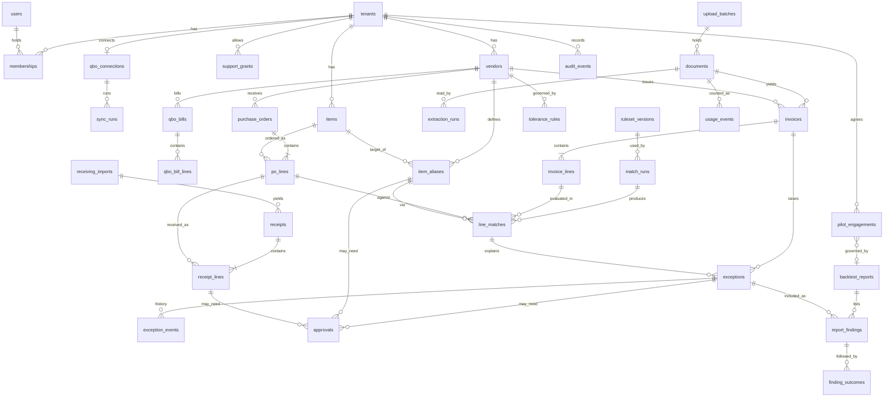

# Data schema — MatchDesk AP three-way match

Number labels follow [Decision.md section 0](Decision.md#0-how-numbers-are-labelled). Column sizes, retention periods and limits are author proposals, so **[assumption]**. Nothing here has been created; migrations are described, not written. Field names for QuickBooks data are MatchDesk's own; what the QuickBooks API actually returns is **unverified, no source consulted** until T-1.1.1.

Database: PostgreSQL 16. Design choices are explained in [TRD.md](TRD.md) (AD-02, AD-10, section 8).

## 1. Entity-relationship diagram

## 2. Conventions

- Every table has `id uuid primary key default gen_random_uuid()` and `created_at timestamptz not null default now()`. They are not repeated below.
- "T" in the scope column means tenant-owned: the table has `tenant_id uuid not null references tenants(id)`, a row-level security policy, a unique constraint on `(tenant_id, id)`, and every foreign key to another tenant-owned table is composite `(tenant_id, <fk>)`. "G" means global.
- Editable rows have `version int not null default 1`, incremented on each update, used for `If-Match`.
- Money `numeric(14,2)`; unit price `numeric(14,6)`; quantity `numeric(14,4)`. Enumerations are `text` with a check constraint, so adding a value is a plain migration.
- All timestamps are UTC `timestamptz`. Document dates are `date` as printed on the document.
- Sensitivity classes: **S3** secret (tokens), **S2** commercially sensitive (prices, documents, reports), **S1** personal (names, emails), **S0** operational.

## 3. Data dictionary

### 3.1 Accounts and identity

**`tenants`** (G, S0) — one paying account.

| Field | Type | Null | Default | Constraint / note |
|---|---|---|---|---|
| name | text | no | | Legal entity name |
| status | text | no | `'pilot'` | `pilot`, `active`, `ended` |
| currency | char(3) | no | `'CAD'` | One currency per tenant |
| waiver_limit | numeric(14,2) | no | `100.00` | ≥ 0. Per-exception limit above which a waiver needs the controller |
| waiver_period_cap | numeric(14,2) | no | `500.00` | ≥ `waiver_limit`. Total a clerk may waive without approval in any rolling 30 days |
| intake_address_local | text | yes | | Unique; random, not derived from the name |
| qbo_mode | text | yes | | B11, migration 0023: `recorded` or `intuit`; null follows the server setting `MATCHDESK_QBO_MODE`. Lets one account connect to Intuit (the sandbox locally) beside the recorded demo |
| ended_at, delete_after | timestamptz | yes | | Set when the account ends |

**`users`** (G, S1): `email citext not null unique`, `display_name text`, `is_operator boolean not null default false`, `totp_secret_enc bytea null` (S3; required when `is_operator`, check `operator_needs_totp`; AES-256-GCM sealed with a key id), `totp_last_step bigint null` (last accepted 30-second step; a code is used once), `deactivated_at timestamptz null`.

**`memberships`** (T, S1): `user_id uuid not null → users`, `role text not null` (`controller`, `clerk`, `viewer`), `status text not null default 'active'` (`active`, `deactivated`), `last_alias_review_at timestamptz null`. Unique `(tenant_id, user_id)`. A trigger refuses to deactivate or demote the last active controller of a tenant.

**`invitations`** (T, S1): `email citext not null`, `role text not null`, `token_hash bytea not null unique`, `invited_by uuid not null`, `expires_at timestamptz not null`, `accepted_at`, `revoked_at` nullable. The token travels only in a URL fragment and a POST body.

**`login_tokens`** (G, S3): `user_id uuid not null`, `token_hash bytea not null unique` (hash of a 256-bit random token), `browser_binding_hash bytea not null` (hash of the cookie set in the requesting browser), `expires_at timestamptz not null` (10 minutes after issue), `used_at timestamptz null`, `requested_ip inet null` (not written since migration 0007, B2-S06), `totp_failures int not null default 0` (B2-S02).

**`auth_rate_events`** (G, S3; added in B2): `kind text not null` (`link_address`, `link_ip`, `exchange_fail_ip`, `totp_fail_user`), `key_hash bytea not null` (HMAC-SHA256 under the server's session key of the kind and the normalised address, IP or user ID; never the value), `created_at`. Index `(kind, key_hash, created_at)`. Counted over the windows of TRD 8.1; rows older than the longest window may be deleted.

**`sessions`** (G, S3): `user_id uuid not null`, `token_hash bytea not null unique`, `active_tenant_id uuid null → tenants`, `support_grant_id uuid null` (set when an operator entered the tenant as `support_reader`), `csrf_token_hash bytea not null`, `last_seen_at timestamptz not null`, `expires_at timestamptz not null`, `ended_at timestamptz null`.

**`support_grants`** (T, S0): `granted_by uuid not null`, `starts_at timestamptz not null default now()`, `ends_at timestamptz not null` (check `ends_at > starts_at` and `ends_at ≤ starts_at + interval '7 days'`), `ended_early_at timestamptz null`.

**`pilot_engagements`** (T, S0): `price numeric(14,2) not null`, `period_start date not null`, `period_end date not null`, `refund_condition text not null`, `refund_threshold numeric(14,2) not null default 500.00`, `signed_by_name text null`, `signed_by_role text null` (`controller`, `owner`), `delivery_mode text not null` (`manual`, `application`), `first_draft_delivered_at timestamptz null`, `governing_report_id uuid null → backtest_reports` (set once, at the end of the review window; a trigger refuses to change it afterwards), `refund_determined_at timestamptz null`, `refund_qualifying_amount numeric(14,2) null`, `refund_due boolean null`, `payment_status text not null default 'unpaid'` (`unpaid`, `paid`, `refunded`), `outcome text null` (`converted`, `refunded`, `ended`), `receiving_attested_class text null` (`A`, `B`, `C`, `none`), `receiving_attested_by uuid null`, `receiving_attested_at timestamptz null`, `no_receiving_declared_at timestamptz null`, `no_receiving_declared_by uuid null`, `version`. Further policies admit the operator setting for select, insert and update (section 4.3), so the operator can create the pilot record as well as edit it.

**`idempotency_keys`** (T, S0): `user_id uuid not null`, `key text not null`, `request_hash bytea not null`, `response_status int`, `result_entity_type text null`, `result_entity_id uuid null`, `expires_at timestamptz not null`. No response body is stored; a replay rebuilds the response from the referenced record, so the table holds no document content. Unique `(tenant_id, user_id, key)`.

### 3.2 QuickBooks copies

**`qbo_connections`** (T, S3): `realm_id text not null` (unique across all tenants: one company, one account), `company_name text`, `refresh_token_enc bytea null` (null only after disconnect: erased at once; B3), `access_token_enc bytea`, `token_key_id text not null`, `access_expires_at`, `refresh_expires_at timestamptz`, `scopes_granted text null`, `status text not null` (`connected`, `needs_reconnect`, `disconnected`), `connected_by uuid not null`, `last_success_at timestamptz null`, `state_version int not null default 0`. Unique `(tenant_id)`.

**`sync_runs`** (T, S0): `mode text not null` (`date_range`, `po_references`; the second reads the purchase orders named on test documents and everything linked to them, whatever the date), `range_start date null`, `range_end date null`, `state text not null` (`queued`, `running`, `succeeded`, `retry_wait`, `failed`), `state_version int not null default 0`, `cursor jsonb` (resume point per record type), `counts jsonb`, `error_code text null`, `lease_expires_at timestamptz null`, `correlation_id uuid not null`, `started_at`, `finished_at`. `scope_fingerprint bytea not null` (hash of the mode with either the date range or the sorted list of purchase-order references). Partial unique index on `(tenant_id, scope_fingerprint)` where state in (`queued`, `running`, `retry_wait`), so two syncs of the same scope cannot run at once in either mode.

**`vendors`** (T, S2): `qbo_id text not null`, `name text not null`, `active boolean not null`, `qbo_updated_at timestamptz`, `synced_at timestamptz not null`. Unique `(tenant_id, qbo_id)`.

**`items`** (T, S2): `qbo_id text not null`, `sku text null`, `name text not null`, `purchase_uom text null`, `active boolean`, `synced_at`. Unique `(tenant_id, qbo_id)`.

**`purchase_orders`** (T, S2): `qbo_id text not null`, `vendor_id uuid not null`, `po_number text not null`, `po_number_norm text not null`, `txn_date date not null`, `qbo_status text` (`Open`, `Closed`), `total numeric(14,2)`, `qbo_sync_token text`, `qbo_updated_at`, `synced_at`, `missing_since timestamptz null` (no longer returned by QuickBooks), `linked_bill_qbo_ids text[] not null default '{}'` (B11: bills the PO's own `LinkedTxn` names), `unread_linked_txns text[] not null default '{}'` (B11-2: `"<TxnType>:<TxnId>"` of other linked transactions, which MatchDesk does not read). Unique `(tenant_id, qbo_id)`.

**`po_lines`** (T, S2): `purchase_order_id uuid not null`, `qbo_line_id text not null`, `line_no int`, `item_id uuid null`, `description text`, `qty_ordered numeric(14,4) not null`, `uom text null`, `unit_price numeric(14,6) not null`, `amount numeric(14,2)`, `qbo_billed_qty numeric(14,4) null` (never used as a receipt, AD-05; used only on the invoiced side for the `history_incomplete` check), `removed_at timestamptz null` (migration 0015: set when a sync reads the purchase order without the line, i.e. deleted in QuickBooks; such a line is not matched, imported into or counted; cleared if it returns). Unique `(tenant_id, purchase_order_id, qbo_line_id)`.

**`qbo_bills`** (T, S2): `qbo_id text not null`, `txn_type text not null` (`bill`, `vendor_credit`), `vendor_id uuid not null`, `doc_number text null`, `doc_number_norm text null`, `txn_date date`, `total numeric(14,2)`, `balance numeric(14,2) null`, `paid_status text not null` (`paid`, `partly_paid`, `unpaid`, `unknown`), `synced_at`. Unique `(tenant_id, txn_type, qbo_id)`.

**`qbo_bill_lines`** (T, S2): `qbo_bill_id uuid not null`, `qbo_line_id text`, `item_id uuid null`, `qty numeric(14,4) null`, `unit_price numeric(14,6) null`, `amount numeric(14,2)`, `linked_po_qbo_id text null`, `linked_po_line_qbo_id text null`, `po_line_id uuid null` (resolved link; lets a bill with no uploaded document count as prior invoiced quantity).

### 3.3 Receiving

**`receiving_mappings`** (T, S0): `name text not null`, `columns jsonb not null` (source header → target field), `created_by uuid`. Unique `(tenant_id, name)`.

**`receiving_imports`** (T, S2): `source_type text not null` (`spreadsheet`, `delivery_document`, `qbo_item_receipt_export`: a QuickBooks Online item-receipt report or CSV export, since the Accounting API has no item-receipt entity; check `qbo_item_receipt_class_a`: such an import is always class `A`, and its rows that fail the independence rule of Decision.md section 3 are `rejected_rows`, never receipt lines; C1, migration 0008), `evidence_class text not null` (`A` warehouse record, `B` receiver-attested delivery document, `C` supplier document only), `kept_by_name text null` (who records receiving), `declared_complete boolean not null default false`, `coverage_start date null`, `coverage_end date null` (class A: the range for which the log is complete; check: both set when `declared_complete`), `document_id uuid not null` (the uploaded file), `file_sha256 bytea not null`, `mapping_id uuid null`, `state text not null` (`draft`, `queued`, `running`, `succeeded`, `failed`, `voided`), `state_version int not null default 0`, `rows_total int`, `rows_valid int`, `rows_rejected int`, `rejected_rows jsonb` (row number, reason; no cell contents beyond the offending value), `committed_by uuid null`, `committed_at`, `voided_by uuid null`, `voided_at`, `void_reason text null`, `expires_at timestamptz null` (drafts). Partial unique `(tenant_id, file_sha256)` where state not in (`voided`, `draft`, `failed`).

**`receipts`** (T, S2): `receiving_import_id uuid not null`, `purchase_order_id uuid not null`, `received_date date not null` (any date; no period check), `receiver_ref text null`, `source_page int null`, `receiver_marks_present boolean null`, `receiver_name text null` (class B: both required before lines count), `confirmed_by uuid null`, `confirmed_at timestamptz null`, `version`.

**`receipt_lines`** (T, S2): `receipt_id uuid not null`, `receiving_import_id uuid not null`, `po_line_id uuid not null`, `qty_received numeric(14,4) not null` (check ≠ 0; negative allowed for a return to supplier), `uom text null`, `qty_in_po_uom numeric(14,4) not null`, `source_row int not null`, `added_after_exception boolean not null default false` (an exception was open on the PO line when this line was committed), `late_approval_id uuid null → approvals`, `counts boolean not null default true`. `counts` is maintained by the import and approval transactions and is false when any holds: the import is voided; evidence class is C; class B without receiver marks recorded; `added_after_exception` without an approved approval. Unique `(tenant_id, receiving_import_id, source_row)`.

### 3.4 Intake and extraction

**`upload_batches`** (T, S0): `source text not null` (`upload`, `email`), `created_by uuid null`, `file_count int not null default 0`, `closed_at timestamptz null`.

**`documents`** (T, S2) — every stored file.

| Field | Type | Null | Default | Constraint / note |
|---|---|---|---|---|
| purpose | text | no | | `invoice`, `receiving`, `export`, `inbound_raw` |
| source | text | no | | `upload`, `email`, `system` |
| batch_id | uuid | yes | | → upload_batches |
| blob_key | text | no | | Unique; begins `t/{tenant_id}/` (check constraint compares with `tenant_id`) |
| sha256 | bytea | no | | |
| original_name | text | yes | | S2; never used in paths or logs |
| mime_type, byte_size, page_count | text, bigint, int | no, no, yes | | |
| state | text | no | `'queued'` | `queued`, `running`, `succeeded`, `needs_review`, `retry_wait`, `failed`, `duplicate_file` |
| state_version | int | no | `0` | Compare-and-set (TRD 6.3) |
| attempts | int | no | `0` | |
| lease_expires_at | timestamptz | yes | | |
| failure_code | text | yes | | |
| duplicate_of_document_id | uuid | yes | | |
| correlation_id | uuid | no | | |
| uploaded_by | uuid | yes | | |
| expires_at | timestamptz | yes | | Set for `export`, `inbound_raw`, draft receiving files |
| deleted_at | timestamptz | yes | | Blob removed; row kept for audit |

Partial unique `(tenant_id, sha256)` where purpose = `invoice` and state <> `duplicate_file` and deleted_at is null. Receiving files are not constrained here, so a voided receiving file can be imported again; their uniqueness is the partial index on `receiving_imports`.

The seven stored states map to the six a user sees (TRD section 6.3): `queued` and `retry_wait` both display as queued.

**`inbound_messages`** (T, S2): `provider_message_id text not null`, `from_address citext not null`, `received_at timestamptz not null`, `status text not null` (`processed`, `held`, `discarded`), `raw_document_id uuid null`, `batch_id uuid null`. Unique `(tenant_id, provider_message_id)`.

**`intake_senders`** (T, S1): `address_or_domain citext not null`, `added_by uuid not null`. Unique `(tenant_id, address_or_domain)`.

**`extraction_runs`** (T, S2): `document_id uuid not null`, `provider text not null`, `model text not null`, `prompt_version text not null`, `input_sha256 bytea not null`, `status text not null` (`succeeded`, `failed`), `raw_output jsonb null`, `verification jsonb not null` (each gate and its result), `latency_ms int`, `cost_estimate numeric(10,4) null`, `correlation_id uuid not null`. Unique `(tenant_id, document_id, input_sha256, provider, model, prompt_version)`.

**`invoices`** (T, S2) — an invoice or credit note.

| Field | Type | Null | Default | Constraint / note |
|---|---|---|---|---|
| document_id | uuid | no | | One file may hold several invoices |
| page_from, page_to | int | no | | Unique `(tenant_id, document_id, page_from)` |
| file_order_key | bytea | no | | Copy of the document's `sha256`, last key of the deterministic order |
| doc_type | text | no | | `invoice`, `credit_note` |
| vendor_id | uuid | yes | | Null until identified |
| vendor_name_read | text | yes | | |
| doc_number, doc_number_norm | text | yes | | Norm: upper-case, letters and digits only, leading zeros of each digit run removed |
| doc_date | date | yes | | |
| po_number_read | text | yes | | |
| purchase_order_id | uuid | yes | | |
| references_invoice_id | uuid | yes | | Credit notes |
| subtotal, tax_total, other_charges, total | numeric(14,2) | yes | | |
| currency | char(3) | yes | | |
| extraction_run_id | uuid | no | | The run currently in use |
| verification_status | text | no | | `passed`, `failed`, `human_confirmed`, `human_confirmed_inconsistent` |
| confirmed_by, confirmed_at | uuid, timestamptz | yes | | |
| qbo_bill_id | uuid | yes | | Matched QuickBooks bill or vendor credit |
| paid_status | text | no | `'unknown'` | Copied from the bill at match time |
| review_draft | jsonb | yes | | Unsaved extraction-review edits, kept on the server, never in the browser |
| version | int | no | `1` | |

**`invoice_lines`** (T, S2): `invoice_id uuid not null`, `line_no int not null`, `supplier_item_code text null`, `description text null`, `qty numeric(14,4) null`, `uom text null`, `unit_price numeric(14,6) null`, `amount numeric(14,2) null`, `line_kind text not null default 'item'` (`item`, `freight`, `fee`, `discount`), `field_sources jsonb not null` (per field: `read` or `edited`, by whom, original value), `page_no int null`, `bbox jsonb null`. Unique `(tenant_id, invoice_id, line_no)`.

### 3.5 Rules and matching

**`item_aliases`** (T, S2): `vendor_id uuid not null`, `supplier_item_code text not null`, `supplier_item_code_norm text not null`, `supplier_description text null`, `item_id uuid not null`, `supplier_uom text null`, `item_uom text null`, `conversion_factor numeric(14,6) not null default 1` (check > 0; item units per supplier unit), `status text not null` (`pending_approval`, `active`, `retired`, `returned`), `created_by uuid not null`, `approved_by uuid null`, `valid_from timestamptz not null default now()`, `valid_to timestamptz null`, `retire_reason text null`, `reviewed_by uuid null → users`, `reviewed_at timestamptz null` (migration 0016: the controller's acknowledgement of a new 1-to-1 alias on S-12), `version`. Partial unique `(tenant_id, vendor_id, supplier_item_code_norm)` where status in (`pending_approval`, `active`). Check: `status = 'active'` with `conversion_factor <> 1`, or with `supplier_uom` and `item_uom` both set and different, requires `approved_by` not null (B1-008).

**`tolerance_rules`** (T, S0): `vendor_id uuid null` (null = account default), `validity tstzrange not null` (generated from `valid_from`, `valid_to`), `qty_tolerance numeric(14,4) not null default 0`, `price_tol_abs numeric(14,6) not null default 0.01`, `price_tol_pct numeric(6,4) not null default 0.5` (check between 0 and 10), `charge_allowance numeric(14,2) not null default 0`, `valid_from timestamptz not null`, `valid_to timestamptz null`, `created_by uuid not null`. Rows are never updated except to set `valid_to`. Two exclusion constraints, because a null never conflicts in one: `exclude (tenant_id with =, vendor_id with =, validity with &&) where (vendor_id is not null)` and `exclude (tenant_id with =, validity with &&) where (vendor_id is null)`. So neither a vendor nor the account default can have two overlapping rules. There is no column for a receipt tolerance, by design (MH-07).

**`ruleset_versions`** (G, S0): `code text not null unique` (for example `v1`), `description text`, `released_at timestamptz`. Rows are added by migration with each rule change.

**`match_runs`** (T, S0): `trigger text not null` (`document_ready`, `receiving_import`, `alias_change`, `tolerance_change`, `credit_note`, `po_change`, `duplicate_decision`, `late_receipt_approval`, `manual`), `trigger_ref uuid null`, `scope jsonb not null` (PO line ids), `input_fingerprint bytea not null`, `ruleset_version_id uuid not null`, `state text not null`, `state_version int not null default 0`, `lines_evaluated int`, `lines_matched int`, `exceptions_raised int`, `correlation_id uuid not null`, `started_at`, `finished_at`. Index on `(tenant_id, input_fingerprint)`; partial unique on it where state in (`queued`, `running`, `retry_wait`). A finished run is not unique on its inputs, because returning to an earlier input state must produce a new current run (B1-001, TRD 6.3).

**`line_matches`** (T, S2) — immutable result of evaluating one invoice line in one run.

| Field | Type | Null | Constraint / note |
|---|---|---|---|
| match_run_id | uuid | no | |
| invoice_line_id | uuid | no | |
| line_kind | text | no | Copy of the invoice line's kind: `item`, `freight`, `fee`, `discount` |
| po_line_id | uuid | yes | |
| alias_id | uuid | yes | |
| tolerance_rule_id | uuid | yes | |
| status | text | no | `matched` (item line passed every check), `charge_ok` (charge line within allowance), `exception`, `not_evaluated` (stopped early, or the document is a duplicate) |
| qty_ordered, qty_received_cum, qty_invoiced_cum_net | numeric(14,4) | yes | Values used, in PO units |
| qty_invoiced_prior_qbo | numeric(14,4) | yes | Part of the cumulative invoiced quantity that came from QuickBooks bill lines with no uploaded document |
| receipt_line_count | int | no | Number of counting receipt lines used |
| checks_run | text[] | no | Which numbered checks of TRD section 8.5 were evaluated; shows that price and ordered-quantity checks ran on a line with no receipt |
| covered | boolean | yes | Receiving coverage for this line (TRD section 8.5) |
| po_unit_price, invoice_unit_price_po_uom | numeric(14,6) | yes | |
| is_current | boolean | no | Default true |
| superseded_by_run_id | uuid | yes | |

Check: `status = 'matched'` requires `line_kind = 'item'`, `receipt_line_count > 0`, `po_line_id` and `alias_id` not null. Check: `status = 'charge_ok'` requires `line_kind <> 'item'`. The first check is a guard against a coding slip that would store a pass with no receipt; it cannot guard against a wrong count, which is what UT-03, UT-23, UT-30 and IT-24 test.

Partial unique `(tenant_id, invoice_line_id)` where `is_current`. 

### 3.6 Exceptions, approvals, reports

**`exceptions`** (T, S2)

| Field | Type | Null | Default | Constraint / note |
|---|---|---|---|---|
| fingerprint | bytea | no | | Hash of (invoice id, invoice line id or none, type). Unique `(tenant_id, fingerprint)` |
| invoice_id | uuid | no | | |
| invoice_line_id | uuid | yes | | Null for document-level types |
| line_match_id | uuid | yes | | Current result that explains it |
| type | text | no | | `extraction_unverified`, `duplicate`, `possible_duplicate`, `no_po`, `alias_unconfirmed`, `po_line_not_found`, `uom_unresolved`, `history_incomplete`, `receipt_absent`, `qty_over_received`, `qty_over_ordered`, `price_variance`, `unmatched_charge`, `credit_unlinked`, `currency_unsupported` |
| sub_reason | text | yes | | For `receipt_absent`: `not_received`, `supplier_slip_only`, `no_evidence`. For `qty_over_received`: `returned_no_credit` where it applies |
| possibly_credited_bill_id | uuid | yes | | A QuickBooks vendor credit tied only by vendor and amount; while set and undecided the exception is reported as open |
| variance_qty | numeric(14,4) | yes | | |
| variance_amount | numeric(14,2) | yes | | The exception's own amount |
| reported_amount | numeric(14,2) | yes | | Amount counted in report totals, the refund criterion and M-3 after the per-line rule of TRD section 8.5: finding-candidate amounts capped at the line amount; an unverified exception reports the line amount less finding amounts on the same line |
| value_class | text | no | | `finding_candidate` (quantity, price, duplicate, charge, and `receipt_absent` with sub-reason `not_received` or controller-confirmed), `open_undecided` (`possible_duplicate`, or `possibly_credited` set), `unverified` (other receipt absent, no PO, history incomplete, alias, unit), `none` |
| qualifying | boolean | no | `false` | True when the exception counts toward the refund criterion (Decision.md section 5.1): finding-capable and not removed by evidence. A waiver does not clear it |
| related_invoice_id | uuid | yes | | The other document of a duplicate pair, or the credit note that resolved it |
| status | text | no | `'open'` | `open`, `pending_approval`, `resolved`, `waived`, `auto_closed` |
| resolution_code | text | yes | | `confirmed_overbilling`, `confirmed_short_shipment`, `confirmed_duplicate`, `confirmed_not_received`, `not_a_duplicate`, `waived`, `source_corrected`, `resolved_by_credit` |
| resolution_note | text | yes | | Required when `resolution_code = 'waived'` (check) |
| resolved_by, resolved_at | uuid, timestamptz | yes | | |
| assigned_to | uuid | yes | | |
| paid_status | text | no | `'unknown'` | At the time of last evaluation |
| version | int | no | `1` | |

Checks for `type = 'receipt_absent'`: the row can never be linked to a `line_matches` row whose status is `matched`; `resolution_code` may be `confirmed_not_received` (controller only, enforced in the permission function and recorded in `exception_events`), `resolved_by_credit`, `source_corrected` or `waived`; `value_class = 'finding_candidate'` requires `sub_reason = 'not_received'` or `resolution_code = 'confirmed_not_received'`. An absent receipt is therefore never a pass, and can be a finding.

A line can have several open exceptions of different types at once, for example `receipt_absent` and `price_variance`; the fingerprint includes the type, so each is its own row.

When a new match run produces the same fingerprint with the same variance, the row is kept and its `line_match_id` moves to the new result, so the clerk's work survives a re-match. If the variance changed, a resolved row returns to `open` with an event. If the run no longer produces it, the row becomes `auto_closed` with an event.

**`exception_events`** (T, S2; insert-only): `exception_id uuid not null`, `event text not null` (`raised`, `assigned`, `resolved`, `sent_for_approval`, `approved`, `returned`, `withdrawn`, `reopened`, `variance_changed`, `auto_closed`), `actor_user_id uuid null`, `actor_job_id text null`, `from_status`, `to_status text`, `detail jsonb`, `match_run_id uuid null`.

**`approvals`** (T, S2): `subject_type text not null` (`waiver`, `alias_conversion`, `late_receipt`), `exception_id uuid null`, `alias_id uuid null`, `receiving_import_id uuid null` (check: exactly one set; a `late_receipt` approval covers the late lines of one import), `reason text null` (`above_item_limit`, `above_period_cap`), `requested_by uuid not null`, `amount numeric(14,2) null`, `status text not null default 'pending'` (`pending`, `approved`, `returned`, `withdrawn`), `decided_by uuid null`, `decided_at`, `decision_note text null`, `self_approved boolean not null default false`, `version`. Partial unique on `(tenant_id, exception_id)` and on `(tenant_id, alias_id)` where status = `pending`.

**`backtest_reports`** (T, S2): `period_start date not null`, `period_end date not null`, `version_no int not null`, `status text not null` (`generating`, `draft`, `approved`, `superseded`), `data_cutoff_at timestamptz not null`, `totals jsonb not null` (frozen figures), `history_read_from date null` (earliest document date used), `receipt_coverage_pct numeric(5,2)`, `coverage_class_a_pct numeric(5,2)`, `coverage_class_b_pct numeric(5,2)`, `class_c_only_lines int`, `not_received_amount numeric(14,2)`, `unverified_amount numeric(14,2)`, `findings_amount numeric(14,2)`, `qualifying_amount numeric(14,2)` (sum over exceptions with `qualifying`; the figure the refund criterion uses), `is_stale boolean not null default false`, `approved_by uuid null`, `approved_at timestamptz null`, `export_document_id uuid null`. Unique `(tenant_id, period_start, period_end, version_no)`. Partial unique `(tenant_id, period_start, period_end)` where status = `approved`. Trigger `backtest_reports_approved_immutable` (migration 0013, whole-row since 0014) refuses any change to an approved version except becoming `superseded`, and any change to a superseded version that was approved. `report_findings` is insert-only, and trigger `report_findings_only_while_generating` (0014) refuses a finding for a report that is not `generating`.

**`report_findings`** (T, S2; insert-only): `report_id uuid not null`, `exception_id uuid not null`, `section text not null` (`finding`, `not_received`, `unverified`, `waived`, `open`), `type text`, `vendor_id uuid`, `amount numeric(14,2)`, `paid_status text`, `snapshot jsonb not null` (document number, PO number, line, quantities, prices as approved). A row in section `finding` or `not_received` of the governing report is a **flagged discrepancy** (PRD M-3a).

**`finding_outcomes`** (T, S2; insert-only; C1; built in B9, differences in section 9): `report_finding_id uuid not null → report_findings`, `outcome text not null` (`controller_confirmed`, `credit_recovered`), `amount numeric(14,2) not null` (check > 0), `recorded_by uuid not null`, `recorded_at timestamptz not null default now()`, `credit_document_id uuid null → documents` (required when `outcome = 'credit_recovered'`), `note text null`. Unique `(tenant_id, report_finding_id, outcome)`. A `controller_confirmed` row needs a controller and an amount not above the finding's `amount`; a `credit_recovered` row needs an existing `controller_confirmed` row for the same finding (trigger). Only rows of the governing report may be followed. The three pilot counts (flagged, controller-confirmed, credit recovered; PRD M-3a to M-3c) are read from `report_findings` and this table and never stored as one figure; `reporting.measure_findings` is the calculation. The permission row for recording both outcomes (controller only) is in section 4.1 since B9.

**`usage_events`** (T, S0): `invoice_id uuid not null`, `document_id uuid not null`, `unit_month date not null` (first day of the month, Pacific time, in which the invoice or credit note was first successfully extracted; not the document's own date), `kind text not null` (`invoice`, `credit_note`). Unique `(tenant_id, invoice_id)`: each invoice or credit note is billed once however often it is re-extracted or re-matched, and a file holding three invoices is three units. A second policy admits the operator setting for select (section 4.3).

**`audit_events`** (T, S2; insert-only): `occurred_at timestamptz not null default now()`, `actor_type text not null` (`user`, `operator`, `job`, `system`), `actor_user_id uuid null`, `action text not null`, `entity_type text not null`, `entity_id uuid null`, `before jsonb null`, `after jsonb null`, `correlation_id uuid null`, `ip inet null`. The application role has `INSERT` and `SELECT` only.

**`deletion_ledger`** (G, S0; insert-only): `tenant_id uuid not null`, `scope text not null` (`tenant`, `document`), `entity_id uuid null`, `requested_by uuid`, `executed_at timestamptz not null`. Copied to the offsite bucket on each insert; used after a restore (section 8).

**`backfill_progress`** (G, S0): `name text not null unique`, `last_key uuid null`, `rows_done bigint not null default 0`, `finished_at timestamptz null`. One row per backfill (section 9).

Job queue tables are created and owned by the queue library and hold only identifiers, `tenant_id` and `correlation_id` in payloads, never document content.

## 4. Roles and permissions

### 4.1 User roles

| Action | Controller | Clerk | Viewer | Operator without grant | Operator with grant (`support_reader`) |
|---|---|---|---|---|---|
| Read documents, matches, exceptions, purchase orders, reports, onboarding state, pilot terms, QuickBooks status | yes | yes | yes | no | yes |
| Export report | yes | yes | yes | no | yes |
| Read and export audit log | yes | no | no | no | yes |
| Upload invoices; import or void receiving; set evidence class and coverage; confirm class B documents | yes | yes | no | no | no |
| Attest the account's receiving evidence; declare "no receiving records" | yes | no | no | no | no |
| Correct extraction; confirm documents | yes | yes | no | no | no |
| Create or retire alias | yes | yes | no | no | no |
| Approve or return: alias conversion, waiver, late receiving evidence | yes | no | no | no | no |
| Resolve exception | yes | yes; a waiver above the item limit or the period cap becomes pending | no | no | no |
| Confirm "not received"; decide a possible duplicate or possible credit | yes | no | no | no | no |
| Withdraw own pending resolution | yes | yes | no | no | no |
| Reopen exception | yes | no | no | no | no |
| Read tolerances | yes | yes | yes | no | yes |
| Edit tolerances, waiver limit and period cap | yes | no | no | no | no |
| Connect or disconnect QuickBooks | yes | no | no | no | no |
| Start a QuickBooks read (sync) | yes | yes | no | no | no |
| Create or refresh draft report | yes | yes | no | no | no |
| Approve report | yes | no | no | no | no |
| Manage users, invitations, support grants | yes | no | no | no | no |
| Email the weekly summary now (S-14; B7) | yes | no | no | no | no |
| Edit email-intake settings | yes | no | no | no | no |
| Release or discard a held email | yes | yes | no | no | no |
| Read own account's usage, per document | yes | no | no | no | no |
| Request document deletion or an archive export (B9: account deletion request and archive) | yes | no | no | no | no |
| Assign or unassign an exception (S-08; B9) | yes | yes | no | no | no |
| Decide a possible duplicate or a possible credit (S-09; MH-08, MH-09; B9) | yes | no | no | no | no |
| Record a finding outcome on the governing report (S-13; PRD M-3b, M-3c; B9) | yes | no | no | no | no |
| Schedule or decline an account deletion request (S-18; B9) | no | no | no | yes | yes |
| List and create tenants; create and edit pilot records; read usage counts per month | no | no | no | yes | yes |
| Enter a tenant as `support_reader` | no | no | no | no | yes |

This table is the single oracle for IT-13. The role columns of [TRD.md section 12](TRD.md#12-api-contracts) and the inventory in [App-flow.md](App-flow.md) are written to agree with it.

Rules that cut across the table: the approver of a waiver must differ from its requester unless the tenant has a single controller (then `self_approved = true` and the report says so); nobody can change their own role; permissions are evaluated in one function in `tenancy` from this table and never in screen code alone.

### 4.2 Database roles

| Role | Used by | Rights |
|---|---|---|
| `matchdesk_owner` | Migrations only | Owns tables |
| `matchdesk_app` | `api` and `worker`, including operator endpoints | Select, insert, update, delete as granted per table; always subject to row-level security, never bypassing it; insert and select only on `audit_events`, `exception_events`, `report_findings`, `deletion_ledger` |
| `matchdesk_backup` | Backup job | Read-only, bypasses row-level security; cannot connect from the application network alias |

### 4.3 Tenant boundary

- Row-level security policy on every T table: `using (tenant_id = nullif(current_setting('app.tenant_id', true), '')::uuid) with check (same)`. With the setting absent or reset to an empty string the comparison is null and no row is visible or insertable; the `nullif` prevents a cast error on pooled connections.
- **Operator policies.** `pilot_engagements` (select, insert, update; the insert and update policies carry the same test as `with check`), `usage_events` (select), `support_grants` (select, and since B7 an insert whose check admits only a request: `status = 'requested'` with no grantor) and, since B9, `deletion_requests` (select, and an update whose check admits only `scheduled` or `declined`) have one extra policy: `using (current_setting('app.operator', true) = 'on')`. `tenancy.operator_session()` is the only code that sets it, only for users with `is_operator`, and never together with a tenant. No other table has such a policy; a CI check lists policies and fails on any unexpected one.
- Global tables hold nothing a tenant could learn about another tenant except `tenants.name`, which only the operator endpoints read. `users.email` is global: a user invited to two accounts is one user; an account cannot list users outside its memberships.
- **Uniqueness scope.** Everything is unique per tenant except: `users.email`, `qbo_connections.realm_id`, `tenants.intake_address_local`, token hashes, `documents.blob_key`. Vendor names, invoice numbers and file hashes may repeat across tenants; two tenants uploading the same PDF get two independent documents and neither can detect the other.
- **Cross-tenant denial.** A request for another tenant's row returns no row, which the API reports as 404. An insert with a foreign key to another tenant's row fails the composite foreign key. Tests IT-01 to IT-03 cover API, worker and files.

## 5. Indexes and the queries they serve

| Index | Query |
|---|---|
| `exceptions (tenant_id, status, type, variance_amount desc)` | S-08 queue: open exceptions by type, most valuable first |
| `exceptions (tenant_id, invoice_id)` | S-09: exceptions for one document |
| `exceptions (tenant_id, assigned_to, status)` | S-08 filter "assigned to me" |
| `line_matches (tenant_id, invoice_line_id) where is_current` (unique) | Current result for a line |
| `line_matches (tenant_id, po_line_id) where is_current` | Cumulative invoiced quantity for a PO line; re-match scope |
| `line_matches (tenant_id, alias_id) where is_current` | Re-match after alias change |
| `receipt_lines (tenant_id, po_line_id) where counts` | Cumulative received quantity; receipt-absent check |
| `invoices (tenant_id, vendor_id, doc_number_norm)` | Duplicate rule on number |
| `invoices (tenant_id, vendor_id, total, doc_date)` | Possible-duplicate rule on total and date window |
| `invoices (tenant_id, purchase_order_id)` | S-10 PO view |
| `qbo_bills (tenant_id, vendor_id, doc_number_norm)` | Link document to QuickBooks bill; duplicate bills |
| `purchase_orders (tenant_id, vendor_id, po_number_norm)` | Resolve PO reference read from a document |
| `item_aliases (tenant_id, vendor_id, supplier_item_code_norm) where status in ('pending_approval','active')` (unique) | Alias lookup during matching |
| `item_aliases using gin (supplier_description gin_trgm_ops)` and `po_lines using gin (description gin_trgm_ops)` | Alias suggestions by similarity |
| `documents (tenant_id, batch_id, state)` | S-06 batch totals |
| `documents (tenant_id, sha256) where purpose = 'invoice'` (partial unique) | Duplicate file detection |
| `qbo_bill_lines (tenant_id, po_line_id)` | Prior invoiced quantity from QuickBooks bills for a PO line |
| `receiving_imports (tenant_id, evidence_class, coverage_start, coverage_end) where declared_complete` | Receiving coverage test |
| `exceptions (tenant_id, resolved_by, resolved_at) where resolution_code = 'waived'` | Rolling 30-day waiver total per clerk |
| `documents (expires_at) where expires_at is not null and deleted_at is null` | Retention sweeper |
| `documents (state, lease_expires_at) where state = 'running'` | Reconciliation of stuck jobs |
| `audit_events (tenant_id, entity_type, entity_id, occurred_at desc)` | "History" of one record |
| `audit_events (tenant_id, actor_user_id, occurred_at desc)` | S-17 filter by person |
| `report_findings (tenant_id, report_id, section, vendor_id)` | S-13 tables |
| `usage_events (tenant_id, unit_month)` | Billable units per month |
| `exceptions (tenant_id) where qualifying` | Qualifying-discrepancy total for the refund criterion |
| `sessions (token_hash)`, `login_tokens (token_hash)` (unique) | Authentication |

Every index is declared both in a migration and in the ORM model; a CI check compares them (section 9).

## 6. Provenance, versions and timestamps

| Question | Where the answer is stored |
|---|---|
| Which file did this value come from? | `invoice_lines.page_no`, `bbox`; `receipt_lines.receiving_import_id`, `source_row`; `documents.sha256` |
| Was it read by a model or typed by a person? | `invoice_lines.field_sources`; `invoices.verification_status` |
| Which model read it? | `extraction_runs.provider`, `model`, `prompt_version` |
| Which rules and tolerances decided it? | `match_runs.ruleset_version_id`; `line_matches.tolerance_rule_id`, `alias_id`, and the quantities and prices copied onto the row |
| How fresh was the QuickBooks data? | `synced_at` on each copy; `backtest_reports.data_cutoff_at` |
| Who decided? | `exception_events`, `approvals`, `audit_events` |
| What did the approved report say? | `backtest_reports.totals`, `report_findings.snapshot` |
| Which flagged discrepancies did the controller confirm, and what was actually recovered? | `finding_outcomes` (C1; not built) |
| Which report decided the refund? | `pilot_engagements.governing_report_id`, `refund_qualifying_amount`, `refund_due` |
| What kind of receiving evidence was it, and who vouched for it? | `receiving_imports.evidence_class`, `kept_by_name`, coverage dates; `receipts.receiver_marks_present`, `receiver_name`; `pilot_engagements.receiving_attested_*`; `receipt_lines.late_approval_id` |

## 7. Transactions, duplicates and audit

**Transaction boundaries.** Each of these is one database transaction, including its audit event and any job it enqueues:

1. Register an uploaded file: `documents` row, job enqueued (no `usage_events` yet). The file is written to the volume first under its final key; if the transaction fails, the orphan file is removed by the sweeper, which deletes blobs with no row after 24 hours.
2. Save an extraction: `extraction_runs`, `invoices`, `invoice_lines`, `usage_events` (first time only), document state change.
3. Commit a receiving import: all `receipts` and `receipt_lines` for the file, import state, re-match job.
4. Complete a match run: `line_matches` inserted, earlier current rows for the same lines set `is_current = false`, exceptions reconciled by fingerprint, `exception_events`, run state. A reader never sees a line with zero or two current results.
5. Resolve an exception: status change with version check, `exception_events`, optional `approvals` row.
6. Change an alias or tolerance: close the old row, insert the new, enqueue re-match.
7. Approve a report: status change, `report_findings` already present from generation, earlier approved version set to `superseded`.

**Duplicate handling.**

| Thing | Rule | Enforced by |
|---|---|---|
| Same invoice file uploaded twice | Second becomes `duplicate_file`, linked to the first, not processed, not billed | Partial unique on `(tenant_id, sha256)` for invoice files |
| Same invoice number from one vendor | `duplicate` exception on the later document; its lines are `not_evaluated` and excluded from cumulative quantities, so the overbilling is reported once | Lookup on `doc_number_norm`; the later of two is by `doc_date`, then `doc_number_norm`, then `file_order_key` (content hash). Upload time is never used |
| Same total within 7 days, different number | `possible_duplicate` on the later document by the same order; lines still evaluated; amount reported as open until decided | Lookup on `(vendor_id, total, doc_date)` |
| Two QuickBooks bills with one number | `duplicate` naming both bills | Lookup on `qbo_bills` |
| Same receiving file | Refused with a message; allowed again after the earlier import is voided | Partial unique on `receiving_imports` file hash |
| Same request retried | Stored response returned | `idempotency_keys` |
| Same job delivered twice | Zero-row update on `state_version`; match run found by fingerprint | Section 6.3 of TRD |
| Same inbound email | One message | Unique on provider message id |

**Audit history.** `audit_events` for every state-changing action; `exception_events` for the life of each exception; superseded `line_matches` and report versions are kept, never overwritten.

## 8. Sensitivity, retention, export and deletion

| Data | Class | Retention (proposed) |
|---|---|---|
| QuickBooks tokens | S3 | Until disconnect; then erased at once |
| Sessions, login tokens | S3 | Deleted 7 days after expiry |
| Invoices, credit notes, receiving files and their extracted rows | S2 | Life of the account; pilot that does not convert: deleted 30 days after the pilot ends |
| Rows copied from QuickBooks (purchase orders, bills, vendor credits, vendors, items) | S2 | Until disconnect; after disconnect no sync or match run uses them, and they are deleted 30 days later or earlier on request (Intuit terms s. 12.2; [compliance/self-check.md section 6.4](compliance/self-check.md#64-software-change-disconnect-stops-processing-p); [P], Decision.md section 11 decision 12; not built) |
| Raw inbound email payloads | S2 | 7 days |
| Generated exports | S2 | 24 hours |
| Draft receiving imports never committed | S2 | 7 days |
| Server-side form drafts (extraction review) | S2 | Until confirmed or 30 days |
| Reports, exceptions, audit events | S2 | Life of the account, then deleted with it. MatchDesk is not the account's system of record; the controller is told to export approved reports and the audit log before the account ends |
| Idempotency keys | S0 | 24 hours |
| Logs | S0 by design | 30 days |

- **Export.** A controller can export the approved reports (PDF, CSV), the audit log (CSV), and on request receives an archive of all original documents with a CSV index. Exports are generated as `documents` with `purpose = 'export'` and expire.
- **Deletion (B10).** A request with no complete archive needs the controller's explicit acknowledgement, stored with the archive state; the operator's row shows it. When due, the worker first claims the request (`deleting`, committed), and only then removes files; cancellation is refused from that moment.
- **Deletion.** Ending an account sets `delete_after`. On that date a job deletes blobs, then tenant rows table by table in dependency order, then the tenant row, writing progress so it can resume, and adds a row to `deletion_ledger`. A single document can be deleted on request if no approved report cites it; if one does, the report is first marked superseded with a note.
- **Backup expiry.** Backups are kept 14 days daily and 8 weeks weekly ([TRD.md section 7](TRD.md#7-deployment-view)). Deleted data therefore persists in encrypted backups for up to 56 days and is then gone. This is stated in the pilot agreement.
- **Restore.** After restoring a backup, the restore procedure replays `deletion_ledger` entries dated after the snapshot before the system accepts traffic, so deleted accounts and documents do not return. QuickBooks tokens in a restored database may be stale; affected tenants show "Reconnect". Rows in `running` state are swept to `queued`.

## 9. Migrations

| Topic | Rule |
|---|---|
| Ordering | One linear history. Each migration names its parent. CI fails if the repository has more than one head, so two branches that each add a migration cannot both merge without one being rebased (R-10) |
| ORM parity | Tables, columns, constraints and indexes are declared in the ORM models. CI builds a database from migrations, asks the migration tool to autogenerate a diff against the models, and fails if the diff is not empty. Row-level security policies, triggers, partial and GIN indexes that the ORM cannot express are listed in a checked-in manifest that a second CI step compares with the database catalogue (R-08) |
| Expand and contract | A release adds; removal of a column or constraint ships one release later, after the code stopped using it |
| Locks | Indexes on existing tables are created concurrently, outside a transaction, one per migration. New constraints are added `NOT VALID` then validated separately. Each migration sets `lock_timeout` to 5 seconds and `statement_timeout` to 15 minutes; a migration that cannot get its lock fails and is retried, it does not queue behind traffic (R-11) |
| Backfills | Never inside a schema migration. A backfill is a job that works in batches of 1,000 rows by primary-key range, commits each batch, stores its last key in a `backfill_progress` row, and can be stopped and restarted at any point. It is idempotent: each batch selects only rows still needing the change (R-09) |
| Partial execution | Transactional migrations roll back whole. For the non-transactional ones (concurrent indexes), the migration first drops an invalid index left by a failed attempt, then creates it again, so re-running is safe (R-09) |
| New tenant-owned table | Must ship with `tenant_id`, the composite unique, the policy, and a test that selects from it without tenant context and expects zero rows. A CI check lists tables without a policy and fails unless they are on the global allow-list (R-05) |
| Seed data | `ruleset_versions` rows by migration. Synthetic fixtures are loaded by a separate proposed command, never by a migration |
| Restore compatibility | A backup restores into the schema version it was taken at; migrations then run forward |

### 9.1 What build milestone B1 implemented (2026-11-11)

Migrations `backend/migrations/versions/0001_base_schema.py` (tables, constraints, indexes, generated from the ORM models) and `0002_tenancy_rls.py` (role, policies, grants, triggers, rule set `v1`). B1 builds a subset of this dictionary; where it differs, the difference is listed here and the dictionary above stays the target.

| Item | B1 state |
|---|---|
| Tables built | `tenants`, `users`, `memberships`, `sessions` (no support-grant column; CSRF column since migration 0006), `vendors`, `items`, `purchase_orders`, `po_lines`, `qbo_bills`, `qbo_bill_lines`, `upload_batches`, `documents`, `invoices`, `invoice_lines`, `extraction_runs`, `receiving_imports`, `receipts`, `receipt_lines`, `item_aliases`, `tolerance_rules`, `ruleset_versions`, `match_runs`, `line_matches`, `exceptions`, `exception_events`, `audit_events`, `idempotency_keys`, plus `job_queue` (global, identifiers only); since B2 also `invitations`, `login_tokens`, `auth_rate_events`. Several tables carry fewer columns than the dictionary |
| Not built | `backfill_progress`; the per-document deletion request (`POST /documents/{id}/deletion-requests`). Built in B9 (2026-11-13, migrations 0018 and 0019): `finding_outcomes`, `deletion_ledger`, `deletion_requests`, `archive_exports`, `no_receiving_declarations`, `po_line_changes` (row below). Built in B7 (2026-11-13, migration 0017): `support_grants`, `pilot_engagements`, `inbound_messages`, `intake_senders`, `usage_events`, `weekly_summary_runs` (row below). Built in B3 (2026-11-12): `qbo_connections`, `sync_runs`, `receiving_mappings`, `approvals`, `backtest_reports`, `report_findings`, plus `qbo_oauth_states` and `receiving_attestations` (rows below) |
| `receipt_lines.counts` | Not stored. The rule engine decides whether a line counts from the import's class, state and void flag, the receipt's receiver marks and signer, and `added_after_exception` with `late_approved` (a boolean standing in for `late_approval_id` until `approvals` exists) |
| Added columns | `po_lines.charge_kind` (`freight`, `fee`; check C1), `qbo_bills.references_invoice_number` (vendor credit tied by invoice number; shape unverified until T-1.1.1), `extraction_runs.in_use` with a partial unique index (one run in use per document), `exceptions.label` (for example "credited in QuickBooks, no document") |
| Check constraints | As section 3.5 and 3.6, with `coalesce` on nullable columns so that a null cannot satisfy a `receipt_absent` check. A trigger refuses a `receipt_absent` exception linked to a `matched` result |
| Grants | `matchdesk_app` has insert and select only on `audit_events` and `exception_events` (also refused by trigger), insert and select on `line_matches` with update only of `is_current` and `superseded_by_run_id`, update only of `valid_to` on `tolerance_rules`, select on `ruleset_versions` and `alembic_version` |
| Roles | `matchdesk_app` (NOSUPERUSER NOBYPASSRLS) exists. Locally the owner is the machine's superuser instead of a `matchdesk_owner` role; tables also have `FORCE ROW LEVEL SECURITY`. `matchdesk_backup` is not created |
| Manifest and CI parity | ORM parity is checked by `alembic check` in an integration test; the catalogue manifest of section 9 is not built (T-2.2.2) |
| Migration 0013 (B3, reports) | `backtest_reports` and `report_findings` as section 3.6, with `created_by`, `supersedes_report_id` (the version a refresh replaced) and `report_findings.qualifying` (frozen with the row). Trigger `backtest_reports_approved_immutable`: once approved, `totals`, the amount columns and the approver cannot change and the only allowed status change is to `superseded`. `report_findings` is insert-only (grant and trigger). `export_document_id` is not built: exports are generated on request |
| Migration 0012 (B3, workflow) | `tenants.waiver_limit` (default 100.00) and `waiver_period_cap` (default 500.00), check `waiver_limits` added NOT VALID then validated; `item_aliases.retire_reason`; extension `pg_trgm` (no index on `items.name` yet) |
| Migration 0011 (B3, intake review) | `documents.original_name`, `page_count`, `uploaded_by`; `invoices.vendor_name_read`, `subtotal`, `tax_total`, `extraction_run_id` (nullable: B1 fixture rows have none), `confirmed_by`, `confirmed_at`, `review_draft`, and `field_sources` (header-field provenance, not in the dictionary before: per field `read` or `edited`, by whom, when, the value first read); `invoice_lines.description`, `page_no`. `other_charges`, `qbo_bill_id` and `paid_status` on invoices are not built (the report derives paid status from the QuickBooks bill) |
| Migration 0010 (B3, receiving and approvals) | `receiving_imports.kept_by_name`, `mapping_id`, `column_map` (mapping in effect), `rows_total`, `rows_valid`, `rows_rejected`, `rejected_rows`, `created_by`, `committed_by`, `voided_by`, `void_reason`, `expires_at`; `receipts.receiver_ref`, `source_page`, `confirmed_by`, `confirmed_at`; `receiving_mappings`; **`receiving_attestations`** (new: insert-only; the controller's attested evidence class and source and the accounts-payable user names of the item-receipt rule; the latest row is in force); `approvals` as section 3.6 plus `requested_resolution` and `requested_note` (what a pending waiver applies on approval), check `one_subject` and `subject_matches_type`, one pending approval per subject (also per import). `receipt_lines.late_approval_id` stays the boolean `late_approved`, set by the `late_receipt` approval decision |
| Migration 0009 (B3, QuickBooks) | `qbo_connections` as section 3.2 except `refresh_token_enc` is nullable so tokens are erased at disconnect (checks `tokens_while_connected`, `tokens_erased_on_disconnect`), plus `disconnected_at` and `delete_after` (QuickBooks-derived rows are deleted after it; the deletion job is not built); **`qbo_oauth_states`** (new: hash of a single-use `state`, the session and user it was issued to, ten-minute expiry); `sync_runs` as section 3.2 plus `po_references` and `requested_by`; `purchase_orders.total`, `qbo_sync_token`; `qbo_bills.balance`; `qbo_bill_lines.linked_po_qbo_id`, `linked_po_line_qbo_id` |
| Migration 0008 (C1 corrections, 2026-11-11) | `receiving_imports.source_type` admits `qbo_item_receipt_export`; check `qbo_item_receipt_class_a` (`source_type <> 'qbo_item_receipt_export' or evidence_class = 'A'`). Both added `NOT VALID` then validated. The row-level independence rule is code (`receiving.item_receipt_rejection`); since B3 it is applied by the receiving import (`receiving.validate`, T-3.2.1). `finding_outcomes` is not built (needs `backtest_reports` and `report_findings`) |
| Migrations 0020 and 0021 (B10, 2026-11-13) | **`archive_exports`**: `expected_count`, `included_count`, `missing_count`, `missing_document_ids jsonb`; status adds `incomplete` (checks `ready_complete`: a ready archive misses nothing; `incomplete_has_file`: an incomplete one keeps its ZIP and misses at least one original). A byte-identical duplicate upload (no second copy stored) is listed as the earlier file, not expected again. **`deletion_requests`**: status adds `deleting` (check `deleting_claimed`: `claimed_at` and `delete_after` set), `claimed_at`; the latest verified archive when the request was made or an archive finished while it was open (`archive_state` `none`/`complete`/`incomplete`/`failed`/`expired`, `archive_included`, `archive_expected`, `archive_checked_at`) and `archive_acknowledged boolean` (the controller deleted without a complete archive, knowingly). The worker claims a due deletion with one conditional `UPDATE` in the tenant session (committed before the first file is removed); a cancellation is a conditional `UPDATE` on `status in ('requested', 'scheduled')`, so it is refused once `deleting`. **`purge_tenant(uuid)`** now requires a claimed (`deleting`) request whose `delete_after` has passed. The partial unique index on open requests `uq_deletion_requests_open` covers `requested`, `scheduled` and `deleting` from migration 0022, so the database also refuses a second request while the worker is deleting. Constraints on existing tables were added `NOT VALID` and validated. **`weekly_summary_deliveries`** (T, new): `run_id → weekly_summary_runs` (composite), `recipient`, `state` (`pending`, `sent`, `failed`), `attempts`, `last_error` (the error class), `sent_at` (check `sent_has_time`), `updated_at`; unique `(tenant_id, run_id, recipient)`. "Sent" is written only after the mailer accepted the message; a retry sends only to pending or failed recipients. **`scheduled_operations`** (G, new, no tenant data): `name` (unique), `last_started_at`, `last_success_at`, `last_failure_at`, `last_error`, `consecutive_failures`, `last_result`; written by the worker for each scheduled operation and read by S-18. No operator policy was added (section 4.3 is unchanged). |
| Migration 0023 (B11, 2026-11-13) | **`tenants.qbo_mode text null`**, check `qbo_mode` (`recorded`, `intuit`) added NOT VALID then validated; null follows `MATCHDESK_QBO_MODE`. `tenants` has one row per account, so the lock lasts milliseconds under the 5-second lock timeout. (Migration 0022 of B10 widened `uq_deletion_requests_open` to the `deleting` state.) |
| Migration 0024 (B11, 2026-11-13) | **`purchase_orders.linked_bill_qbo_ids text[] not null default '{}'`**: the QuickBooks ids of the bills the PO's own `LinkedTxn` names (T-1.1.1 saw the PO-to-bill link only there). Read by the sync to attribute a bill line by its item and by `exceptions.inputs.unattributed_bills`; a constant default rewrites nothing |
| Migration 0025 (B11 lead review, 2026-11-13) | **`purchase_orders.unread_linked_txns text[] not null default '{}'`**: the PO's own `LinkedTxn` entries other than bills (for example `Purchase:115`); any entry makes the PO's history unknown (`exceptions.unknown_history`); a constant default rewrites nothing |
| Migrations 0018 and 0019 (B9, 2026-11-13) | **`no_receiving_declarations`** (T; new, replaces the `no_receiving_declared_*` columns proposed on `pilot_engagements`): `statement text`, `declared_by → users`, `withdrawn_at`, `withdrawn_by → users` (check `withdrawn_pair`), `withdraw_reason`; partial unique `(tenant_id) where withdrawn_at is null`. A fact only: no check guarding `receipt_absent` changes. **`invoice_lines.removed_at`, `removed_by → users`, `removed_reason`** (check `removed_pair`): soft removal in S-07; every match input, gate, count and screen reads live lines only. **`invoices.inconsistent_note`**: required by the code (not by a check, so earlier rows stay valid) when a person confirms `human_confirmed_inconsistent`. **`exceptions.assigned_to → users`** (dictionary column, now built) with index `(tenant_id, assigned_to, status)` built concurrently in 0019; **`exceptions.credit_decision`** (`credited`, `not_credited`), `credit_decision_bill_id → qbo_bills` (composite), `credit_decided_by → users`, `credit_decided_at` (check `credit_decision_complete`): an input of the rule engine, never written by a match run. `exception_events.event` admits `credit_decided`. Constraints on existing tables were added `NOT VALID` and validated. **`po_line_changes`** (T, insert-only): `purchase_order_id`, `po_line_id`, `sync_run_id`, `change` (`changed`, `removed`), `before jsonb`, `after jsonb`, `detected_at`; index `(tenant_id, purchase_order_id, detected_at)`. **`finding_outcomes`** as in the dictionary with one difference: `credit_reference text` stands in for `credit_document_id` when the credit is a QuickBooks credit or refund with no file (check `credit_has_evidence`: one of the two for `credit_recovered`); trigger `finding_outcomes_rules` refuses a section other than `finding`/`not_received`, a report that is not the pilot's governing version, a confirmation above the finding's amount, and a recovery without a confirmation or above it; insert-only trigger. **`deletion_requests`** (T): `scope` (`account`), `reason`, `requested_by`, `status` (`requested`, `scheduled`, `declined`, `cancelled`, `executed`), `decided_by`, `decided_at`, `decision_note`, `delete_after` (check `scheduled_has_date`), `cancelled_by`, `cancelled_at`, `version`; partial unique open request per tenant; operator select and update policies (section 4.3). **`archive_exports`** (T): `requested_by`, `status` (`queued`, `running`, `ready`, `failed`, `expired`), `document_id → documents` (purpose `export`), `file_count`, `byte_size`, `error`, `finished_at`, `expires_at` (24 hours [assumption]). **`deletion_ledger`** (G, insert-only) as in the dictionary plus `rows_deleted`. Function **`purge_tenant(uuid)`** (security definer, owner role, executable by `matchdesk_app`): refuses unless the tenant has a `scheduled` request with `delete_after <= now()`; sets the tenant context and `app.purge`, deletes the tenant's sessions and queued jobs, then every tenant-owned row in dependency order (retrying a table refused by a foreign key until all are empty), then the tenant row, and inserts one `deletion_ledger` row. `refuse_change()` and `memberships_last_controller_guard()` admit a delete only when `app.purge` is on and the current role is not `matchdesk_app` (that is, inside this function). Blobs are deleted by the worker before the function runs. A single document's deletion is not built. Since B9 the migration runner commits its session settings (lock and statement timeouts) before Alembic opens the migration transaction, so a migration can build an index concurrently inside `autocommit_block()` (0019). |
| Migration 0017 (B7, 2026-11-13) | **`pilot_engagements`** as in the dictionary with these differences: unique per tenant; `signed_terms_ref text` (where the signed copy is filed), `governing_set_by uuid → users`, `updated_at`; `receiving_attested_*` and `no_receiving_declared_*` are not built (the attestation lives in `receiving_attestations`; the declaration is not built); trigger `pilot_governing_set_once` refuses any change of `governing_report_id`, `refund_qualifying_amount`, `refund_due`, `refund_determined_at` or `refund_threshold` once the governing version is set. **`usage_events`** as in the dictionary, plus check `unit_month` is a first of month; written by `intake.materialise` with `on conflict do nothing`. **`support_grants`**: `requested_by uuid not null → users` (the operator), `reason text not null`, `hours_requested int` (1 to 168), `status` (`requested`, `active`, `ended`, `declined`), `granted_by`, `starts_at`, `ends_at` null until granted (check `ends_at <= starts_at + 7 days`), `ended_early_at`, `ended_by`. **`sessions.support_grant_id uuid null`** (no foreign key: the grant is a tenant row); trigger `sessions_operator_no_tenant` now admits an operator session with a tenant only together with a grant, and a grant only with its tenant; the grant is re-checked on every request. **`inbound_messages`** as in the dictionary plus `subject`, `attachment_count`, `decided_by`, `decided_at`; the raw message is a `documents` row with purpose `inbound_raw` (the worker deletes it after 7 days; there is no `documents.expires_at`). **`intake_senders`** as in the dictionary (`@domain` allows a whole domain). **`tenants.intake_address_local text unique`**, built in the same migration with a plain unique constraint: `tenants` has one row per customer account, so the lock lasts milliseconds under the 5-second lock timeout; recorded here as an exception to the concurrent-index rule of section 9 (the migration runner opens one transaction and has no autocommit block). **`weekly_summary_runs`** (T, S0; new): `week_start date` (a Monday), `trigger` (`scheduled`, `manual`), `recipients int`, `sent_by uuid null`, `figures jsonb` (the week's totals only); unique `(tenant_id, week_start, trigger)`, so the Monday job and "Send now" each send once per week. Operator policies (section 4.3): `pilot_engagements` select, insert, update; `usage_events` select; `support_grants` select and an insert policy whose check admits only a request (`status = 'requested'`, no grantor), so the operator can ask but never grant |
| Migration 0007 (B2 security review, round 1) | `login_tokens.totp_failures int not null default 0` (link burned after 3 wrong codes); `auth_rate_events.kind` admits `totp_fail_user`; existing counters deleted because `key_hash` is now an HMAC under the server's session key; `login_tokens.requested_ip` cleared and no longer written (dropped in a later contract migration); trigger `sessions_operator_no_tenant` refuses a session of an operator that carries a tenant |
| Migration 0006 (B2, sign-in) | Built `login_tokens` and `invitations` as in the dictionary, `auth_rate_events` (new, above), `users.totp_secret_enc` and `users.totp_last_step` with check `operator_needs_totp`, `sessions.csrf_token_hash` (existing fixture sessions deleted first). `sessions.support_grant_id` is not built (no `support_grants`). Policies beyond `tenant_isolation`, both read-only: `memberships.membership_self` (rows where `user_id` equals the transaction setting `app.user_id`, set only by `tenancy.user_session()` for sign-in, `/me` and the tenant switch) and `invitations.invitation_by_token` (the one row whose `token_hash` equals the setting `app.invitation_token_hash`, set only by `tenancy.invitation_lookup_session()` to accept an invitation; possession of the token is the authority). Trigger `memberships_last_controller_guard` refuses to demote, deactivate or delete the last active controller of a tenant. `matchdesk_app` gained delete on `sessions`, select, insert, update and delete on `login_tokens`, select, insert and delete on `auth_rate_events`, select, insert and update on `invitations` |
| Migration 0005 (review round 3) | Adds `item_aliases.supplier_description` (dictionary column; no similarity index yet). Replaces the function of trigger `item_aliases_reset_approval` so that a change of `vendor_id`, `supplier_item_code`, `supplier_item_code_norm` or `supplier_description` resets approval exactly like a conversion change (MH-10). An update of other columns, such as `valid_to`, keeps the approval |
| Migration 0004 (review round 2) | Trigger `item_aliases_reset_approval`: a change of `conversion_factor`, either unit or `item_id` clears `approved_by`, increments `version` and, for a converting alias, sets `status` to `pending_approval` (MH-10). The lines that used it then read as stale and `exceptions.rematch_alias` re-matches them |
| Migration 0003 (review round 1) | `match_runs`: the unique constraint on `(tenant_id, input_fingerprint)` replaced by an index and a partial unique index on pending runs (B1-001); `item_aliases` approval check widened to unit-changing aliases, added `NOT VALID` then validated (B1-008). Its two indexes are plain builds in one migration: allowed only before the first production deploy, when the table is empty everywhere |
